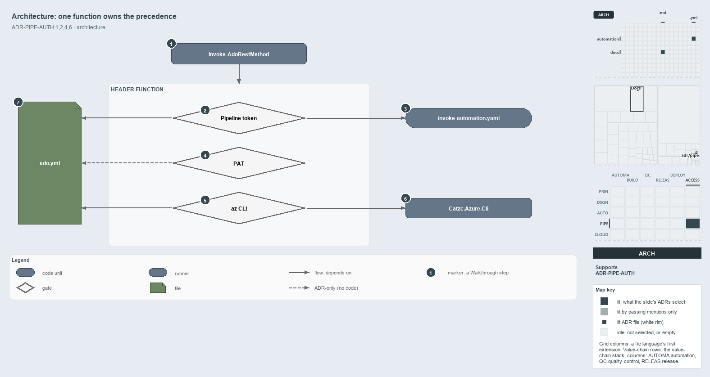

---
catzc:
  derived:
    path: docs/explanation/pipelines/one-header-function-owns-precedence.md
    kind: explanation
    body_sha: a5d8d9ba4f36
    adrs:
      - ADR-PIPE-AUTH#{1,2,4,6}
    links:
      - docs/.assets/explanation/adr-pipe-auth--one-header-function-owns-precedence--architecture.drawio.md
      - docs/.assets/explanation/adr-pipe-auth--one-header-function-owns-precedence--architecture.drawio.png
      - docs/adr/pipelines/dual-authentication.md
      - docs/explanation/index.md#how-to-read-the-diagrams
      - docs/explanation/pipelines/configured-credential-proves-its-org.md
      - docs/explanation/pipelines/index.md
      - docs/explanation/pipelines/three-guarded-early-returns.md
      - docs/explanation/pipelines/what-you-set-decides-the-credential.md
      - docs/explanation/pipelines/which-auth-rungs-have-a-gate.md
---

# One function owns the credential precedence, and ado.yml anchors every proof

```text
One function owns the credential precedence, and ado.yml anchors every proof.

1  Invoke-AdoRestMethod    the one caller of the header function
2  Pipeline token          the first source, proved against the ado.yml organization
3  invoke-automation.yaml  the step template that maps the pipeline token in
4  PAT                     the second source, bound to the org only by the ADR
5  az CLI                  the last source, proved against the ado.yml tenant
6  Catzc.Azure.Cli         the module whose Assert-AzCliConnected checks the session
7  ado.yml                 the config every proof is checked against

Supports ADR-PIPE-AUTH#1, #2, #4 and #6 (architecture lens).
```

Cats calls the Azure DevOps REST API from several modules, but only one function, `Get-AdoAuthorizationHeader`, decides which credential a
call uses. The API functions never touch a credential themselves. Around that function sit the parts it rests on: the step template that
supplies the pipeline token, the az CLI module, and `ado.yml`, which every proof is checked against.



The diagram is described element by element in
[its asset description](../../.assets/explanation/adr-pipe-auth--one-header-function-owns-precedence--architecture.drawio.md).

## Walkthrough

1. **Invoke-AdoRestMethod.** Every ADO API function calls through `Invoke-AdoRestMethod`, which is the only caller of the header function.
   Its callers are `New-AdoPullRequest`, `Register-AdoPipeline` and `Get-AdoPipelineDefinitions` in `Catzc.Azure.DevOps`, and
   `Get-AdoBuildValidations`, `Register-AdoBuildValidation`, `Unregister-AdoBuildValidation` and the private
   `Resolve-AdoBuildValidationContext` in `Catzc.Azure.DevOps.BuildValidation`.
2. **Pipeline token.** The header function's first source is the agent token. It is guarded by `Test-IsRunningInPipeline` from
   `Catzc.Base.Repository`, and it is proved against the `ado.yml` `organization`.
3. **invoke-automation.yaml.** The pipeline token exists only because the step template maps `SYSTEM_ACCESSTOKEN` into a step that sets
   `ExposeAccessToken`.
4. **PAT.** The second source is an operator-set environment variable. It has no runtime proof; the ADR binds it to the org because API
   addresses are built from the `ado.yml` `organization`, which no code checks against the header.
5. **az CLI.** The last source is used when neither of the first two is configured. It is proved against the `ado.yml` `tenant`.
6. **Catzc.Azure.Cli.** The source for the az CLI rests on that module's `Assert-AzCliConnected`, which checks the session against the
   tenant.
7. **ado.yml.** The config is the proof anchor: `organization` for the pipeline token and the PAT, `tenant` for the az CLI.
   `Get-Config -Config ado` loads it as the typed `AdoConfig` record, which requires both keys.

## Why it holds

- The precedence is fixed, top to bottom, and a source that fails raises its own error (ADR-PIPE-AUTH#1).
- Each source proves it targets the configured organization or tenant before it returns a header (ADR-PIPE-AUTH#2).
- Token acquisition lives in one separate function, and API-calling functions never inline it (ADR-PIPE-AUTH#4).
- The step template maps the system token, and functions read only the mapped `$env:SYSTEM_ACCESSTOKEN` (ADR-PIPE-AUTH#6).

## Where the code and the ADR differ

- The ADR says a PAT is bound to the configured org by construction. The API functions default `-Organization` from `ado.yml` but accept any
  value, and nothing checks it against the header's source.
- The help text of `Register-AdoPipeline` names only the pipeline token and az login, and leaves out the PAT.

## See also

- [Dual authentication](../../adr/pipelines/dual-authentication.md) — the decision this article explains.
- The other lenses on the same precedence: [meta](configured-credential-proves-its-org.md),
  [implementation](three-guarded-early-returns.md), [operations](what-you-set-decides-the-credential.md) and
  [governance](which-auth-rungs-have-a-gate.md).
- [The pipelines explanations](index.md) · [How to read the diagrams](../index.md#how-to-read-the-diagrams)
