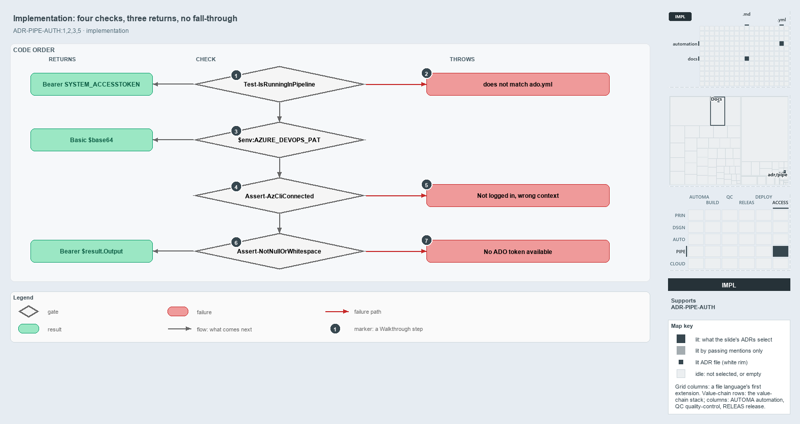

---
catzc:
  derived:
    path: docs/explanation/pipelines/three-guarded-early-returns.md
    kind: explanation
    body_sha: "5990b16fd351"
    adrs:
      - ADR-PIPE-AUTH#{1-3,5}
    links:
      - docs/.assets/explanation/adr-pipe-auth--three-guarded-early-returns--implementation.drawio.md
      - docs/.assets/explanation/adr-pipe-auth--three-guarded-early-returns--implementation.drawio.png
      - docs/adr/pipelines/dual-authentication.md
      - docs/explanation/index.md#how-to-read-the-diagrams
      - docs/explanation/pipelines/configured-credential-proves-its-org.md
      - docs/explanation/pipelines/index.md
      - docs/explanation/pipelines/one-header-function-owns-precedence.md
      - docs/explanation/pipelines/what-you-set-decides-the-credential.md
      - docs/explanation/pipelines/which-auth-rungs-have-a-gate.md
---

# The header function is four checks and three returns, and none falls through on failure

```text
Four checks in code order, three returns, and no check falls through on failure.

1  Test-IsRunningInPipeline      check 1: the pipeline rung; returns Bearer SYSTEM_ACCESSTOKEN
2  does not match ado.yml        the throw when the collection is not the configured org
3  $env:AZURE_DEVOPS_PAT         check 2: the PAT rung; returns Basic $base64
4  Assert-AzCliConnected         check 3: the az CLI session is in the ado.yml tenant
5  Not logged in, wrong context  the two throws of Assert-AzCliConnected
6  Assert-NotNullOrWhitespace    check 4: the token is not empty; returns Bearer $result.Output
7  No ADO token available        the throw when the az CLI yields no token

Supports ADR-PIPE-AUTH#1, #2, #3 and #5 (implementation lens).
```

`Get-AdoAuthorizationHeader` in `Catzc.Azure.DevOps` builds the `Authorization` header for every Azure DevOps REST call in cats. In code it
is a short ladder of four checks and three returns: two guarded early returns, then the az CLI path, which asserts twice before its final
return. Every check either returns a header, passes control on, or throws; a check that throws never hands over to the next rung.



The diagram is described element by element in
[its asset description](../../.assets/explanation/adr-pipe-auth--three-guarded-early-returns--implementation.drawio.md).

## Walkthrough

1. **Test-IsRunningInPipeline.** The first rung runs when `(Test-IsRunningInPipeline) -and $env:SYSTEM_ACCESSTOKEN` holds. The guard is true
   when `TF_BUILD` or `GITHUB_ACTIONS` is set. Inside, the rung compares `$env:SYSTEM_COLLECTIONURI` with
   `(Get-Config -Config ado).organization`, both with the trailing `/` trimmed, and on a match returns `Bearer $env:SYSTEM_ACCESSTOKEN`.
2. **does not match ado.yml.** On a mismatch the rung throws "Pipeline collection '…' does not match ado.yml organization '…' — refusing the
   agent token for a different org." The comparison is skipped when `SYSTEM_COLLECTIONURI` is empty.
3. **$env:AZURE_DEVOPS_PAT.** The second rung runs when the PAT is set, and returns `Basic` with the base64 of `":" + PAT`. It throws
   nothing: a rejected PAT surfaces later as the error of the `Invoke-RestMethod` call in `Invoke-AdoRestMethod`.
4. **Assert-AzCliConnected.** With neither set, the az CLI path runs `Assert-AzCliConnected -TenantId (Get-Config -Config ado).tenant`,
   which proves the session is in the tenant behind the org. It then runs
   `az account get-access-token --resource $ResourceUrl --query accessToken -o tsv` through `Invoke-Executable`; `-ResourceUrl` defaults to
   `499b84ac-1321-427f-aa17-267ca6975798`, the Azure DevOps resource ID.
5. **Not logged in, wrong context.** `Assert-AzCliConnected` throws one of two errors: "Not logged in to az CLI. Run: az login --tenant …"
   when there is no session, or "az CLI is set to the wrong context. Expected tenant=…; got sub=… tenant=…. Run: az login --tenant …" when
   the session is in another tenant.
6. **Assert-NotNullOrWhitespace.** The token output is asserted non-empty, and only then does the function make its third return,
   `Bearer $($result.Output)`.
7. **No ADO token available.** An empty output throws the assert's error text: "No ADO token available. Set $env:AZURE_DEVOPS_PAT, or run
   Connect-AzCli with an Entra ID account."

`organization` and `tenant` are required keys of the typed `AdoConfig` record that `Get-Config -Config ado` returns, so both proofs always
have a value to check against. The only caller of the function is `Invoke-AdoRestMethod`.

## Why it holds

- The rungs run in a fixed order over what is configured, and a rung that fails throws instead of falling through (ADR-PIPE-AUTH#1).
- The pipeline rung proves the collection is the configured org, and the az CLI rung proves the session tenant, before a header is returned
  (ADR-PIPE-AUTH#2).
- Pipeline detection goes through `Test-IsRunningInPipeline`, never a raw read of the agent variables (ADR-PIPE-AUTH#3).
- When the az CLI yields no token, the assert names the actionable causes (ADR-PIPE-AUTH#5).

## Where the code and the ADR differ

The rule says the pipeline rung asserts `SYSTEM_COLLECTIONURI`, but the code skips the comparison when that variable is empty; the ADR's own
sample code shows the same skip.

## See also

- [Dual authentication](../../adr/pipelines/dual-authentication.md) — the decision this article explains.
- The other lenses on the same precedence: [meta](configured-credential-proves-its-org.md),
  [architecture](one-header-function-owns-precedence.md), [operations](what-you-set-decides-the-credential.md) and
  [governance](which-auth-rungs-have-a-gate.md).
- [The pipelines explanations](index.md) · [How to read the diagrams](../index.md#how-to-read-the-diagrams)
