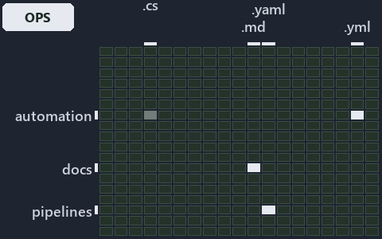

---
catzc:
  immutable:
    with_body_sha: e57ae8bcb294
    repo_status: locked
    path: docs/explanation/repository/.assets/import-materialises-two-gates-name-the-fix/grid.md
    source: docs/explanation/repository/.assets/import-materialises-two-gates-name-the-fix/diagram.drawio.png
    role: asset-description
    language: markdown
    filetype: md
    track: docs
    tracktype: documentation
---

# The import materialises every root file; two gates catch drift and name the fix: the world-map minimap

```text
Where the files that cite ADR-REPO-ROOTCFG sit in the repository: tracks down, file languages across.
4 of 342 cells lit, holding 37 files.
```



This is the world-map minimap in the sidebar of the operations diagram of [The import materialises every root file; two gates catch drift
and name the fix][39], which explains [ADR-REPO-ROOTCFG][1]. It lights every cell of the world map that holds a file citing those codes, so
it shows where the decision lives in the repository. Each lit cell has its reason below, naming the code that selects it.

## What the minimap shows

The grid crosses the 18 tracks (rows) with the 19 file languages (columns) of the world map and lights 4 cells, filled in ink. A cell lit
only by passing mentions (citations in body comments, not in a file's header or text) is touched: a lighter ink. Every other cell is idle, a
grey box: it holds files the slide's ADR codes do not select, or no file at all (288 of the 342 cells hold none). The minimap shows where
the slide sits, not how many files a cell holds; the world-map PDFs show the counts.

- docs × markdown: 34 lit of 2763 files
- pipelines × pipeline-yaml: 1 lit of 14 files
- pwsh × csharp: 1 lit of 293 files, touched
- pwsh × yaml: 1 lit of 115 files

## Key

A lit row prints its track's name; a lit column prints a short code, the first extension of its file language:

- `.cs`: csharp
- `.md`: markdown
- `.yaml`: pipeline-yaml
- `.yml`: yaml

## Why each cell is lit

### docs × markdown (34 lit files)

Placed: the root folder `docs/` names the track docs ([ADR-DSGN-TRACK-TRACKISPLACEDCLUSTER][2]); the extension `.md` names the file language
markdown ([ADR-DSGN-TRACK-FILELANGUAGE][2]). Lit ([ADR-DSGN-TRACK-LITCELL][2]) by:

- [docs/adr/index.md][3]: selected by [ADR-REPO-ROOTCFG][1]: the file cites it at line 327 (text).
- [docs/adr/repository/dora-explains.md][4]: selected by [ADR-REPO-ROOTCFG][1]: the file cites it at line 131 (text).
- [docs/adr/repository/generated-root-configs.md][1]: selected by [ADR-REPO-ROOTCFG][1]: the ADR's own file.
- [docs/references/pwsh/catzc-base-files/Set-FileLink.ps1.md][5]: selected by [ADR-REPO-ROOTCFG][1]: the file cites it at line 24 (text).
- [docs/references/pwsh/catzc-base-git/New-GitIgnore.ps1.md][6]: selected by [ADR-REPO-ROOTCFG][1]: the file cites it at line 24 (text).
- [docs/references/pwsh/catzc-base-git/configs/gitignore.yml.md][7]: selected by [ADR-REPO-ROOTCFG][1]: the file cites it at line 13 (text).
- [docs/references/pwsh/catzc-base-git/types/GitIgnoreConfig.cs.md][8]: selected by [ADR-REPO-ROOTCFG][1]: the file cites it at line 16
  (text).
- [docs/references/pwsh/catzc-base-languages.md][9]: selected by [ADR-REPO-ROOTCFG][1]: the file cites it at line 8 (text).
- [docs/references/pwsh/catzc-base-languages/New-GoWorkspace.ps1.md][10]: selected by [ADR-REPO-ROOTCFG][1]: the file cites it at line 32
  (text).
- [docs/references/pwsh/catzc-base-languages/types/GoWorkspaceFile.cs.md][11]: selected by [ADR-REPO-ROOTCFG][1]: the file cites it at line
  14 (text).
- [docs/references/pwsh/catzc-base-languages/types/PythonWorkspaceFile.cs.md][12]: selected by [ADR-REPO-ROOTCFG][1]: the file cites it at
  line 14 (text).
- [docs/references/pwsh/catzc-base-rootconfig/Build-RootConfig.ps1.md][13]: selected by [ADR-REPO-ROOTCFG][1]: the file cites it at line 26
  (text).
- [docs/references/pwsh/catzc-base-rootconfig/New-GitAttributes.ps1.md][14]: selected by [ADR-REPO-ROOTCFG][1]: the file cites it at line 23
  (text).
- [docs/references/pwsh/catzc-base-rootconfig/Test-RootAnalyzerSettings.ps1.md][15]: selected by [ADR-REPO-ROOTCFG][1]: the file cites it at
  line 15 (text).
- [docs/references/pwsh/catzc-base-rootconfig/Test-RootConfigFiles.ps1.md][16]: selected by [ADR-REPO-ROOTCFG][1]: the file cites it at line
  15 (text).
- [docs/references/pwsh/catzc-base-rootconfig/configs/rootconfig.yml.md][17]: selected by [ADR-REPO-ROOTCFG][1]: the file cites it at line
  30 (text).
- [docs/references/pwsh/catzc-base-rootconfig/private/Get-RootConfigRenderedFile.ps1.md][18]: selected by [ADR-REPO-ROOTCFG][1]: the file
  cites it at line 22 (text).
- [docs/references/pwsh/catzc-base-rootconfig/private/Get-RootConfigTargets.ps1.md][19]: selected by [ADR-REPO-ROOTCFG][1]: the file cites
  it at line 16 (text).
- [docs/references/pwsh/catzc-base-rootconfig/tests/Test-RootConfigIntegrity.Tests.ps1.md][20]: selected by [ADR-REPO-ROOTCFG][1]: the file
  cites it at line 22 (text).
- [docs/references/pwsh/catzc-base-rootconfig/types/RootConfigFiles.cs.md][21]: selected by [ADR-REPO-ROOTCFG][1]: the file cites it at line
  16 (text).
- [docs/references/pwsh/catzc-base-vscode/New-VSCodeExtensions.ps1.md][22]: selected by [ADR-REPO-ROOTCFG][1]: the file cites it at line 22
  (text).
- [docs/references/pwsh/catzc-base-vscode/New-VSCodeLaunch.ps1.md][23]: selected by [ADR-REPO-ROOTCFG][1]: the file cites it at line 20
  (text).
- [docs/references/pwsh/catzc-base-vscode/New-VSCodePipelineSchema.ps1.md][24]: selected by [ADR-REPO-ROOTCFG][1]: the file cites it at line
  25 (text).
- [docs/references/pwsh/catzc-base-vscode/New-VSCodeSettings.ps1.md][25]: selected by [ADR-REPO-ROOTCFG][1]: the file cites it at line 26
  (text).
- [docs/references/pwsh/catzc-base-vscode/New-VSCodeTasks.ps1.md][26]: selected by [ADR-REPO-ROOTCFG][1]: the file cites it at line 20
  (text).
- [docs/references/pwsh/catzc-base-vscode/configs/vscode-extensions.yml.md][27]: selected by [ADR-REPO-ROOTCFG][1]: the file cites it at
  line 16 (text).
- [docs/references/pwsh/catzc-base-vscode/configs/vscode-launch.yml.md][28]: selected by [ADR-REPO-ROOTCFG][1]: the file cites it at line 13
  (text).
- [docs/references/pwsh/catzc-base-vscode/configs/vscode-pipeline-schema.yml.md][29]: selected by [ADR-REPO-ROOTCFG][1]: the file cites it
  at line 15 (text).
- [docs/references/pwsh/catzc-base-vscode/configs/vscode-settings.yml.md][30]: selected by [ADR-REPO-ROOTCFG][1]: the file cites it at line
  13 (text).
- [docs/references/pwsh/catzc-base-vscode/types/VscodeExtensionsConfig.cs.md][31]: selected by [ADR-REPO-ROOTCFG][1]: the file cites it at
  line 13 (text).
- [docs/references/pwsh/catzc-base-vscode/types/VscodeLaunchConfig.cs.md][32]: selected by [ADR-REPO-ROOTCFG][1]: the file cites it at line
  12 (text).
- [docs/references/pwsh/catzc-base-vscode/types/VscodePipelineSchemaConfig.cs.md][33]: selected by [ADR-REPO-ROOTCFG][1]: the file cites it
  at line 13 (text).
- [docs/references/pwsh/catzc-base-vscode/types/VscodeSettingsConfig.cs.md][34]: selected by [ADR-REPO-ROOTCFG][1]: the file cites it at
  line 13 (text).
- [docs/references/pwsh/internal/Catzc.Internal.Importer.psm1.md][35]: selected by [ADR-REPO-ROOTCFG][1]: the file cites it at line 398
  (text).

### pipelines × pipeline-yaml (1 lit file)

Placed: the root folder `pipelines/` names the track pipelines ([ADR-DSGN-TRACK-TRACKISPLACEDCLUSTER][2]); the extension `.yaml` names the
file language pipeline-yaml ([ADR-DSGN-TRACK-FILELANGUAGE][2]). Lit ([ADR-DSGN-TRACK-LITCELL][2]) by:

- [pipelines/ci-automation.yaml][36]: selected by [ADR-REPO-ROOTCFG][1]: a pipeline that cites nothing itself carries its globset's
  citations, which cite it at `pwsh/Catzc.Base.Docs/configs/adrs.yml` line 301 (text) and
  `pwsh/Catzc.Base.VSCode/types/VscodeTasksConfig.cs` line 8 (body comment).

### pwsh × csharp (1 lit file, touched)

Placed: the root folder `pwsh/` names the track pwsh ([ADR-DSGN-TRACK-TRACKISPLACEDCLUSTER][2]); the extension `.cs` names the file language
csharp ([ADR-DSGN-TRACK-FILELANGUAGE][2]). Lit ([ADR-DSGN-TRACK-LITCELL][2]) by:

- [pwsh/Catzc.Base.VSCode/types/VscodeTasksConfig.cs][37]: selected by [ADR-REPO-ROOTCFG][1]: the file cites it at line 8 (body comment) (a
  passing mention only).

### pwsh × yaml (1 lit file)

Placed: the root folder `pwsh/` names the track pwsh ([ADR-DSGN-TRACK-TRACKISPLACEDCLUSTER][2]); the extension `.yml` names the file
language yaml ([ADR-DSGN-TRACK-FILELANGUAGE][2]). Lit ([ADR-DSGN-TRACK-LITCELL][2]) by:

- [pwsh/Catzc.Base.Docs/configs/adrs.yml][38]: selected by [ADR-REPO-ROOTCFG][1]: the file cites it at line 301 (text).

## Keywords

- [world map][40]
- [track][41]
- [file language][42]
- [cell][43]
- [lit cell][44]
- [docs][45]: a track
- [pipelines][45]: a track
- [pwsh][45]: a track
- [csharp][46]: a file language
- [markdown][46]: a file language
- [pipeline-yaml][46]: a file language
- [yaml][46]: a file language

[1]: ../../../../adr/repository/generated-root-configs.md
[2]: ../../../../adr/design/tracks.md
[3]: ../../../../adr/index.md
[4]: ../../../../adr/repository/dora-explains.md
[5]: ../../../../references/pwsh/catzc-base-files/Set-FileLink.ps1.md
[6]: ../../../../references/pwsh/catzc-base-git/New-GitIgnore.ps1.md
[7]: ../../../../references/pwsh/catzc-base-git/configs/gitignore.yml.md
[8]: ../../../../references/pwsh/catzc-base-git/types/GitIgnoreConfig.cs.md
[9]: ../../../../references/pwsh/catzc-base-languages.md
[10]: ../../../../references/pwsh/catzc-base-languages/New-GoWorkspace.ps1.md
[11]: ../../../../references/pwsh/catzc-base-languages/types/GoWorkspaceFile.cs.md
[12]: ../../../../references/pwsh/catzc-base-languages/types/PythonWorkspaceFile.cs.md
[13]: ../../../../references/pwsh/catzc-base-rootconfig/Build-RootConfig.ps1.md
[14]: ../../../../references/pwsh/catzc-base-rootconfig/New-GitAttributes.ps1.md
[15]: ../../../../references/pwsh/catzc-base-rootconfig/Test-RootAnalyzerSettings.ps1.md
[16]: ../../../../references/pwsh/catzc-base-rootconfig/Test-RootConfigFiles.ps1.md
[17]: ../../../../references/pwsh/catzc-base-rootconfig/configs/rootconfig.yml.md
[18]: ../../../../references/pwsh/catzc-base-rootconfig/private/Get-RootConfigRenderedFile.ps1.md
[19]: ../../../../references/pwsh/catzc-base-rootconfig/private/Get-RootConfigTargets.ps1.md
[20]: ../../../../references/pwsh/catzc-base-rootconfig/tests/Test-RootConfigIntegrity.Tests.ps1.md
[21]: ../../../../references/pwsh/catzc-base-rootconfig/types/RootConfigFiles.cs.md
[22]: ../../../../references/pwsh/catzc-base-vscode/New-VSCodeExtensions.ps1.md
[23]: ../../../../references/pwsh/catzc-base-vscode/New-VSCodeLaunch.ps1.md
[24]: ../../../../references/pwsh/catzc-base-vscode/New-VSCodePipelineSchema.ps1.md
[25]: ../../../../references/pwsh/catzc-base-vscode/New-VSCodeSettings.ps1.md
[26]: ../../../../references/pwsh/catzc-base-vscode/New-VSCodeTasks.ps1.md
[27]: ../../../../references/pwsh/catzc-base-vscode/configs/vscode-extensions.yml.md
[28]: ../../../../references/pwsh/catzc-base-vscode/configs/vscode-launch.yml.md
[29]: ../../../../references/pwsh/catzc-base-vscode/configs/vscode-pipeline-schema.yml.md
[30]: ../../../../references/pwsh/catzc-base-vscode/configs/vscode-settings.yml.md
[31]: ../../../../references/pwsh/catzc-base-vscode/types/VscodeExtensionsConfig.cs.md
[32]: ../../../../references/pwsh/catzc-base-vscode/types/VscodeLaunchConfig.cs.md
[33]: ../../../../references/pwsh/catzc-base-vscode/types/VscodePipelineSchemaConfig.cs.md
[34]: ../../../../references/pwsh/catzc-base-vscode/types/VscodeSettingsConfig.cs.md
[35]: ../../../../references/pwsh/internal/Catzc.Internal.Importer.psm1.md
[36]: ../../../../../pipelines/ci-automation.yaml
[37]: ../../../../../pwsh/Catzc.Base.VSCode/types/VscodeTasksConfig.cs
[38]: ../../../../../pwsh/Catzc.Base.Docs/configs/adrs.yml
[39]: ../../import-materialises-two-gates-name-the-fix.md
[40]: ../../../../adr/glossary.md#world-map
[41]: ../../../../adr/glossary.md#track
[42]: ../../../../adr/glossary.md#file-language
[43]: ../../../../adr/glossary.md#cell
[44]: ../../../../adr/glossary.md#lit-cell
[45]: ../../../../../pwsh/Catzc.Base.Variants/configs/variants.yml
[46]: ../../../../../pwsh/Catzc.Base.Languages/configs/languages.yml
