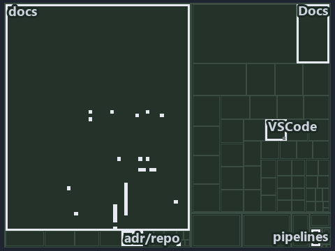

---
catzc:
  immutable:
    with_body_sha: "451aa9439c73"
    repo_status: locked
    path: docs/explanation/repository/.assets/import-materialises-two-gates-name-the-fix/tree.md
    source: docs/explanation/repository/.assets/import-materialises-two-gates-name-the-fix/diagram.drawio.png
    role: asset-description
    language: markdown
    filetype: md
    track: docs
    tracktype: documentation
---

# The import materialises every root file; two gates catch drift and name the fix: the tree minimap

```text
Which files cite ADR-REPO-ROOTCFG: every file of the world map is a tile, grouped by top-level folder.
37 files lit in 6 groups.
```



This is the tree minimap in the sidebar of the operations diagram of [The import materialises every root file; two gates catch drift and
name the fix][38], which explains [ADR-REPO-ROOTCFG][1]. It lights every file that cites those codes, grouped by folder, so it shows which
files carry the decision. Each lit group has its reason below, naming the code that selects it.

## What the minimap shows

The tree draws every file of the world map as a tile, grouped by top-level folder (under `pwsh/` by module, under `docs/adr/` by ADR
domain), and lights 37 files in 6 groups, filled in ink. A lit ADR file has a white rim; a file lit only by passing mentions is a lighter
ink. Every other tile is idle, a grey box: a file the slide's ADR codes do not select.

- docs (docs/ outside docs/adr/): 31 lit files
- adr/repo (docs/adr/repository): 2 lit files
- adr/* (the files directly in docs/adr/): 1 lit file
- pipelines: 1 lit file
- Docs (pwsh/Catzc.Base.Docs): 1 lit file
- VSCode (pwsh/Catzc.Base.VSCode): 1 lit file

## Why each group is lit

### docs (docs/ outside docs/adr/, 31 lit files)

The group holds the files of docs/ outside docs/adr/; each sits in its world-map cell and is lit by:

- [docs/references/pwsh/catzc-base-files/Set-FileLink.ps1.md][2], in the cell docs × markdown: selected by [ADR-REPO-ROOTCFG][1]: the file
  cites it at line 24 (text).
- [docs/references/pwsh/catzc-base-git/New-GitIgnore.ps1.md][3], in the cell docs × markdown: selected by [ADR-REPO-ROOTCFG][1]: the file
  cites it at line 24 (text).
- [docs/references/pwsh/catzc-base-git/configs/gitignore.yml.md][4], in the cell docs × markdown: selected by [ADR-REPO-ROOTCFG][1]: the
  file cites it at line 13 (text).
- [docs/references/pwsh/catzc-base-git/types/GitIgnoreConfig.cs.md][5], in the cell docs × markdown: selected by [ADR-REPO-ROOTCFG][1]: the
  file cites it at line 16 (text).
- [docs/references/pwsh/catzc-base-languages.md][6], in the cell docs × markdown: selected by [ADR-REPO-ROOTCFG][1]: the file cites it at
  line 8 (text).
- [docs/references/pwsh/catzc-base-languages/New-GoWorkspace.ps1.md][7], in the cell docs × markdown: selected by [ADR-REPO-ROOTCFG][1]: the
  file cites it at line 32 (text).
- [docs/references/pwsh/catzc-base-languages/types/GoWorkspaceFile.cs.md][8], in the cell docs × markdown: selected by
  [ADR-REPO-ROOTCFG][1]: the file cites it at line 14 (text).
- [docs/references/pwsh/catzc-base-languages/types/PythonWorkspaceFile.cs.md][9], in the cell docs × markdown: selected by
  [ADR-REPO-ROOTCFG][1]: the file cites it at line 14 (text).
- [docs/references/pwsh/catzc-base-rootconfig/Build-RootConfig.ps1.md][10], in the cell docs × markdown: selected by [ADR-REPO-ROOTCFG][1]:
  the file cites it at line 26 (text).
- [docs/references/pwsh/catzc-base-rootconfig/New-GitAttributes.ps1.md][11], in the cell docs × markdown: selected by [ADR-REPO-ROOTCFG][1]:
  the file cites it at line 23 (text).
- [docs/references/pwsh/catzc-base-rootconfig/Test-RootAnalyzerSettings.ps1.md][12], in the cell docs × markdown: selected by
  [ADR-REPO-ROOTCFG][1]: the file cites it at line 15 (text).
- [docs/references/pwsh/catzc-base-rootconfig/Test-RootConfigFiles.ps1.md][13], in the cell docs × markdown: selected by
  [ADR-REPO-ROOTCFG][1]: the file cites it at line 15 (text).
- [docs/references/pwsh/catzc-base-rootconfig/configs/rootconfig.yml.md][14], in the cell docs × markdown: selected by
  [ADR-REPO-ROOTCFG][1]: the file cites it at line 30 (text).
- [docs/references/pwsh/catzc-base-rootconfig/private/Get-RootConfigRenderedFile.ps1.md][15], in the cell docs × markdown: selected by
  [ADR-REPO-ROOTCFG][1]: the file cites it at line 22 (text).
- [docs/references/pwsh/catzc-base-rootconfig/private/Get-RootConfigTargets.ps1.md][16], in the cell docs × markdown: selected by
  [ADR-REPO-ROOTCFG][1]: the file cites it at line 16 (text).
- [docs/references/pwsh/catzc-base-rootconfig/tests/Test-RootConfigIntegrity.Tests.ps1.md][17], in the cell docs × markdown: selected by
  [ADR-REPO-ROOTCFG][1]: the file cites it at line 22 (text).
- [docs/references/pwsh/catzc-base-rootconfig/types/RootConfigFiles.cs.md][18], in the cell docs × markdown: selected by
  [ADR-REPO-ROOTCFG][1]: the file cites it at line 16 (text).
- [docs/references/pwsh/catzc-base-vscode/New-VSCodeExtensions.ps1.md][19], in the cell docs × markdown: selected by [ADR-REPO-ROOTCFG][1]:
  the file cites it at line 22 (text).
- [docs/references/pwsh/catzc-base-vscode/New-VSCodeLaunch.ps1.md][20], in the cell docs × markdown: selected by [ADR-REPO-ROOTCFG][1]: the
  file cites it at line 20 (text).
- [docs/references/pwsh/catzc-base-vscode/New-VSCodePipelineSchema.ps1.md][21], in the cell docs × markdown: selected by
  [ADR-REPO-ROOTCFG][1]: the file cites it at line 25 (text).
- [docs/references/pwsh/catzc-base-vscode/New-VSCodeSettings.ps1.md][22], in the cell docs × markdown: selected by [ADR-REPO-ROOTCFG][1]:
  the file cites it at line 26 (text).
- [docs/references/pwsh/catzc-base-vscode/New-VSCodeTasks.ps1.md][23], in the cell docs × markdown: selected by [ADR-REPO-ROOTCFG][1]: the
  file cites it at line 20 (text).
- [docs/references/pwsh/catzc-base-vscode/configs/vscode-extensions.yml.md][24], in the cell docs × markdown: selected by
  [ADR-REPO-ROOTCFG][1]: the file cites it at line 16 (text).
- [docs/references/pwsh/catzc-base-vscode/configs/vscode-launch.yml.md][25], in the cell docs × markdown: selected by [ADR-REPO-ROOTCFG][1]:
  the file cites it at line 13 (text).
- [docs/references/pwsh/catzc-base-vscode/configs/vscode-pipeline-schema.yml.md][26], in the cell docs × markdown: selected by
  [ADR-REPO-ROOTCFG][1]: the file cites it at line 15 (text).
- [docs/references/pwsh/catzc-base-vscode/configs/vscode-settings.yml.md][27], in the cell docs × markdown: selected by
  [ADR-REPO-ROOTCFG][1]: the file cites it at line 13 (text).
- [docs/references/pwsh/catzc-base-vscode/types/VscodeExtensionsConfig.cs.md][28], in the cell docs × markdown: selected by
  [ADR-REPO-ROOTCFG][1]: the file cites it at line 13 (text).
- [docs/references/pwsh/catzc-base-vscode/types/VscodeLaunchConfig.cs.md][29], in the cell docs × markdown: selected by
  [ADR-REPO-ROOTCFG][1]: the file cites it at line 12 (text).
- [docs/references/pwsh/catzc-base-vscode/types/VscodePipelineSchemaConfig.cs.md][30], in the cell docs × markdown: selected by
  [ADR-REPO-ROOTCFG][1]: the file cites it at line 13 (text).
- [docs/references/pwsh/catzc-base-vscode/types/VscodeSettingsConfig.cs.md][31], in the cell docs × markdown: selected by
  [ADR-REPO-ROOTCFG][1]: the file cites it at line 13 (text).
- [docs/references/pwsh/internal/Catzc.Internal.Importer.psm1.md][32], in the cell docs × markdown: selected by [ADR-REPO-ROOTCFG][1]: the
  file cites it at line 398 (text).

### adr/repo (docs/adr/repository, 2 lit files)

The group holds the files of docs/adr/repository; each sits in its world-map cell and is lit by:

- [docs/adr/repository/dora-explains.md][33], in the cell docs × markdown: selected by [ADR-REPO-ROOTCFG][1]: the file cites it at line 131
  (text).
- [docs/adr/repository/generated-root-configs.md][1], in the cell docs × markdown: selected by [ADR-REPO-ROOTCFG][1]: the ADR's own file.

### adr/* (the files directly in docs/adr/, 1 lit file)

The group holds the files of the files directly in docs/adr/; each sits in its world-map cell and is lit by:

- [docs/adr/index.md][34], in the cell docs × markdown: selected by [ADR-REPO-ROOTCFG][1]: the file cites it at line 327 (text).

### pipelines (1 lit file)

The group holds the files of pipelines; each sits in its world-map cell and is lit by:

- [pipelines/ci-automation.yaml][35], in the cell pipelines × pipeline-yaml: selected by [ADR-REPO-ROOTCFG][1]: a pipeline that cites
  nothing itself carries its globset's citations, which cite it at `pwsh/Catzc.Base.Docs/configs/adrs.yml` line 301 (text) and
  `pwsh/Catzc.Base.VSCode/types/VscodeTasksConfig.cs` line 8 (body comment).

### Docs (pwsh/Catzc.Base.Docs, 1 lit file)

The group holds the files of pwsh/Catzc.Base.Docs; each sits in its world-map cell and is lit by:

- [pwsh/Catzc.Base.Docs/configs/adrs.yml][36], in the cell pwsh × yaml: selected by [ADR-REPO-ROOTCFG][1]: the file cites it at line 301
  (text).

### VSCode (pwsh/Catzc.Base.VSCode, 1 lit file)

The group holds the files of pwsh/Catzc.Base.VSCode; each sits in its world-map cell and is lit by:

- [pwsh/Catzc.Base.VSCode/types/VscodeTasksConfig.cs][37], in the cell pwsh × csharp: selected by [ADR-REPO-ROOTCFG][1]: the file cites it
  at line 8 (body comment) (a passing mention only).

## Keywords

- [world map][39]
- [track][40]
- [file language][41]
- [cell][42]
- [lit cell][43]
- [docs][44]: a track
- [pipelines][44]: a track
- [pwsh][44]: a track
- [csharp][45]: a file language
- [markdown][45]: a file language
- [pipeline-yaml][45]: a file language
- [yaml][45]: a file language

[1]: ../../../../adr/repository/generated-root-configs.md
[2]: ../../../../references/pwsh/catzc-base-files/Set-FileLink.ps1.md
[3]: ../../../../references/pwsh/catzc-base-git/New-GitIgnore.ps1.md
[4]: ../../../../references/pwsh/catzc-base-git/configs/gitignore.yml.md
[5]: ../../../../references/pwsh/catzc-base-git/types/GitIgnoreConfig.cs.md
[6]: ../../../../references/pwsh/catzc-base-languages.md
[7]: ../../../../references/pwsh/catzc-base-languages/New-GoWorkspace.ps1.md
[8]: ../../../../references/pwsh/catzc-base-languages/types/GoWorkspaceFile.cs.md
[9]: ../../../../references/pwsh/catzc-base-languages/types/PythonWorkspaceFile.cs.md
[10]: ../../../../references/pwsh/catzc-base-rootconfig/Build-RootConfig.ps1.md
[11]: ../../../../references/pwsh/catzc-base-rootconfig/New-GitAttributes.ps1.md
[12]: ../../../../references/pwsh/catzc-base-rootconfig/Test-RootAnalyzerSettings.ps1.md
[13]: ../../../../references/pwsh/catzc-base-rootconfig/Test-RootConfigFiles.ps1.md
[14]: ../../../../references/pwsh/catzc-base-rootconfig/configs/rootconfig.yml.md
[15]: ../../../../references/pwsh/catzc-base-rootconfig/private/Get-RootConfigRenderedFile.ps1.md
[16]: ../../../../references/pwsh/catzc-base-rootconfig/private/Get-RootConfigTargets.ps1.md
[17]: ../../../../references/pwsh/catzc-base-rootconfig/tests/Test-RootConfigIntegrity.Tests.ps1.md
[18]: ../../../../references/pwsh/catzc-base-rootconfig/types/RootConfigFiles.cs.md
[19]: ../../../../references/pwsh/catzc-base-vscode/New-VSCodeExtensions.ps1.md
[20]: ../../../../references/pwsh/catzc-base-vscode/New-VSCodeLaunch.ps1.md
[21]: ../../../../references/pwsh/catzc-base-vscode/New-VSCodePipelineSchema.ps1.md
[22]: ../../../../references/pwsh/catzc-base-vscode/New-VSCodeSettings.ps1.md
[23]: ../../../../references/pwsh/catzc-base-vscode/New-VSCodeTasks.ps1.md
[24]: ../../../../references/pwsh/catzc-base-vscode/configs/vscode-extensions.yml.md
[25]: ../../../../references/pwsh/catzc-base-vscode/configs/vscode-launch.yml.md
[26]: ../../../../references/pwsh/catzc-base-vscode/configs/vscode-pipeline-schema.yml.md
[27]: ../../../../references/pwsh/catzc-base-vscode/configs/vscode-settings.yml.md
[28]: ../../../../references/pwsh/catzc-base-vscode/types/VscodeExtensionsConfig.cs.md
[29]: ../../../../references/pwsh/catzc-base-vscode/types/VscodeLaunchConfig.cs.md
[30]: ../../../../references/pwsh/catzc-base-vscode/types/VscodePipelineSchemaConfig.cs.md
[31]: ../../../../references/pwsh/catzc-base-vscode/types/VscodeSettingsConfig.cs.md
[32]: ../../../../references/pwsh/internal/Catzc.Internal.Importer.psm1.md
[33]: ../../../../adr/repository/dora-explains.md
[34]: ../../../../adr/index.md
[35]: ../../../../../pipelines/ci-automation.yaml
[36]: ../../../../../pwsh/Catzc.Base.Docs/configs/adrs.yml
[37]: ../../../../../pwsh/Catzc.Base.VSCode/types/VscodeTasksConfig.cs
[38]: ../../import-materialises-two-gates-name-the-fix.md
[39]: ../../../../adr/glossary.md#world-map
[40]: ../../../../adr/glossary.md#track
[41]: ../../../../adr/glossary.md#file-language
[42]: ../../../../adr/glossary.md#cell
[43]: ../../../../adr/glossary.md#lit-cell
[44]: ../../../../../pwsh/Catzc.Base.Variants/configs/variants.yml
[45]: ../../../../../pwsh/Catzc.Base.Languages/configs/languages.yml
