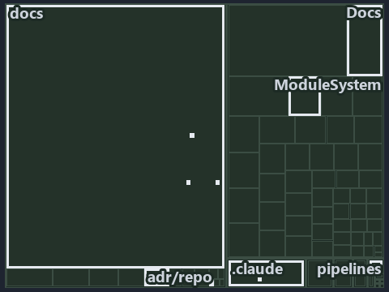

---
catzc:
  immutable:
    with_body_sha: c296f9d29373
    repo_status: locked
    path: docs/explanation/.assets/tree/adr-repo-variant--one-home-one-read-path-one-vocabulary--meta.tree.md
    source: docs/explanation/.assets/adr-repo-variant--one-home-one-read-path-one-vocabulary--meta.drawio.png
    role: asset-description
    language: markdown
    filetype: md
    track: docs
    tracktype: documentation
---

# A repo-wide switch has one home, one read path and one guard vocabulary: the tree minimap

```text
Which files cite ADR-REPO-VARIANT: every file of the world map is a tile, grouped by top-level folder.
10 files lit in 7 groups.
```



This is the tree minimap in the sidebar of the meta diagram of [A repo-wide switch has one home, one read path and one guard
vocabulary][11], which explains [ADR-REPO-VARIANT][1]. It lights every file that cites those codes, grouped by folder, so it shows which
files carry the decision. Each lit group has its reason below, naming the code that selects it.

## What the minimap shows

The tree draws every file of the world map as a tile, grouped by top-level folder (under `automation/` by module, under `docs/adr/` by ADR
domain), and lights 10 files in 7 groups, filled in ink. A lit ADR file has a white rim; a file lit only by passing mentions is a lighter
ink. Every other tile is idle, a grey box: a file the slide's ADR codes do not select.

- docs (docs/ outside docs/adr/): 3 lit files
- adr/repo (docs/adr/repository): 2 lit files
- .claude: 1 lit file
- Docs (pwsh/Catzc.Base.Docs): 1 lit file
- ModuleSystem (pwsh/Catzc.Base.ModuleSystem): 1 lit file
- adr/* (the files directly in docs/adr/): 1 lit file
- pipelines: 1 lit file

## Why each group is lit

### docs (docs/ outside docs/adr/, 3 lit files)

The group holds the files of docs/ outside docs/adr/; each sits in its world-map cell and is lit by:

- [docs/references/pwsh/catzc-base-modulesystem/Sync-GeneratedFile.ps1.md][2], in the cell docs × markdown: selected by
  [ADR-REPO-VARIANT][1]: the file cites it at line 39 (text).
- [docs/references/pwsh/catzc-base-variants/configs/variants.yml.md][3], in the cell docs × markdown: selected by [ADR-REPO-VARIANT][1]: the
  file cites it at line 11 (text).
- [docs/references/pwsh/catzc-base-variants/types/VariantsConfig.cs.md][4], in the cell docs × markdown: selected by [ADR-REPO-VARIANT][1]:
  the file cites it at line 11 (text).

### adr/repo (docs/adr/repository, 2 lit files)

The group holds the files of docs/adr/repository; each sits in its world-map cell and is lit by:

- [docs/adr/repository/dora-explains.md][5], in the cell docs × markdown: selected by [ADR-REPO-VARIANT][1]: the file cites it at line 165
  (text).
- [docs/adr/repository/repo-variants.md][1], in the cell docs × markdown: selected by [ADR-REPO-VARIANT][1]: the ADR's own file.

### .claude (1 lit file)

The group holds the files of .claude; each sits in its world-map cell and is lit by:

- [.claude/plans/plan-module-kinds-tracks.md][6], in the cell .claude × markdown: selected by [ADR-REPO-VARIANT][1]: the file cites it at
  line 877 (text) and line 931 (text).

### Docs (pwsh/Catzc.Base.Docs, 1 lit file)

The group holds the files of pwsh/Catzc.Base.Docs; each sits in its world-map cell and is lit by:

- [pwsh/Catzc.Base.Docs/configs/adrs.yml][7], in the cell automation × yaml: selected by [ADR-REPO-VARIANT][1]: the file cites it at line
  303 (text).

### ModuleSystem (pwsh/Catzc.Base.ModuleSystem, 1 lit file)

The group holds the files of pwsh/Catzc.Base.ModuleSystem; each sits in its world-map cell and is lit by:

- [pwsh/Catzc.Base.ModuleSystem/Sync-GeneratedFile.ps1][8], in the cell automation × powershell: selected by [ADR-REPO-VARIANT][1]: the file
  cites it at line 44 (text).

### adr/* (the files directly in docs/adr/, 1 lit file)

The group holds the files of the files directly in docs/adr/; each sits in its world-map cell and is lit by:

- [docs/adr/index.md][9], in the cell docs × markdown: selected by [ADR-REPO-VARIANT][1]: the file cites it at line 327 (text).

### pipelines (1 lit file)

The group holds the files of pipelines; each sits in its world-map cell and is lit by:

- [pipelines/ci-automation.yaml][10], in the cell pipelines × pipeline-yaml: selected by [ADR-REPO-VARIANT][1]: a pipeline that cites
  nothing itself carries its globset's citations, which cite it at `pwsh/Catzc.Base.Docs/configs/adrs.yml` line 303 (text) and
  `pwsh/Catzc.Base.ModuleSystem/Sync-GeneratedFile.ps1` line 44 (text).

## Keywords

- [world map][12]
- [track][13]
- [file language][14]
- [cell][15]
- [lit cell][16]
- [.claude][17]: a track
- [automation][17]: a track
- [docs][17]: a track
- [pipelines][17]: a track
- [markdown][18]: a file language
- [pipeline-yaml][18]: a file language
- [powershell][18]: a file language
- [yaml][18]: a file language

[1]: ../../../../adr/repository/repo-variants.md
[2]: ../../../../references/pwsh/catzc-base-modulesystem/Sync-GeneratedFile.ps1.md
[3]: ../../../../references/pwsh/catzc-base-variants/configs/variants.yml.md
[4]: ../../../../references/pwsh/catzc-base-variants/types/VariantsConfig.cs.md
[5]: ../../../../adr/repository/dora-explains.md
[6]: ../../../../../.claude/plans/plan-module-kinds-tracks.md
[7]: ../../../../../pwsh/Catzc.Base.Docs/configs/adrs.yml
[8]: ../../../../../pwsh/Catzc.Base.ModuleSystem/Sync-GeneratedFile.ps1
[9]: ../../../../adr/index.md
[10]: ../../../../../pipelines/ci-automation.yaml
[11]: ../../one-home-one-read-path-one-vocabulary.md
[12]: ../../../../adr/glossary.md#world-map
[13]: ../../../../adr/glossary.md#track
[14]: ../../../../adr/glossary.md#file-language
[15]: ../../../../adr/glossary.md#cell
[16]: ../../../../adr/glossary.md#lit-cell
[17]: ../../../../../pwsh/Catzc.Base.Variants/configs/variants.yml
[18]: ../../../../../pwsh/Catzc.Base.Languages/configs/languages.yml
