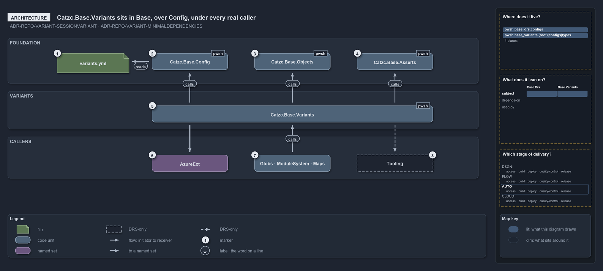

# Catzc.Base.Variants sits in Base, over Config, under every real caller

```text
Catzc.Base.Variants sits in Base, over Config, under every real caller.

1  variants.yml                 the one file: five keys in the module's configs folder
2  Catzc.Base.Config            loads, validates and caches the file for the session
3  Catzc.Base.Objects           the DictionaryRecord base of the module's config type
4  Catzc.Base.Asserts           the Assert-True the Assert- guards throw through
5  Catzc.Base.Variants          the module: one private reader, eighteen exported primitives
6  AzureExt                     the Azure extension group; Catzc.Azure.Templates is its caller
7  Globs · ModuleSystem · Maps  the three upper-Base modules that declare and call it
8  Tooling                      may call through its Base pin; no Tooling module calls today

Supports ADR-REPO-VARIANT-SESSIONVARIANT and ADR-REPO-VARIANT-MINIMALDEPENDENCIES (architecture lens).
```

The primitives that answer a repo-wide question have to be usable as trivial guards wherever such a question matters: deep in the Azure
templating layer, in a tooling step, in a build. That argues for a low, widely dependable module rather than one in the Azure layer.
`Catzc.Base.Variants` is that module. It rests on three foundation modules, and every module layered above the configuration layer may call
it.

```yml drawio
description:
  Catzc.Base.Variants rests on Config, Objects and Asserts in the foundation and is called from Azure extension, upper-Base and Tooling
  modules; the config file feeds Config only.
about:
  rules: [ADR-REPO-VARIANT-SESSIONVARIANT, ADR-REPO-VARIANT-MINIMALDEPENDENCIES]
  lens: architecture
content:
  title: Catzc.Base.Variants sits in Base, over Config, under every real caller
  kind: explanation
  flow: top-to-bottom
  theme: dark
  bands:
    - { id: band-foundation, label: FOUNDATION }
    - { id: band-variants, label: VARIANTS }
    - { id: band-callers, label: CALLERS }
  glyphs:
    - { id: g-variants-yml, kind: file, label: variants.yml, in: band-foundation }
    - { id: g-config, kind: code, label: Catzc.Base.Config, in: band-foundation }
    - { id: g-objects, kind: code, label: Catzc.Base.Objects, in: band-foundation }
    - { id: g-asserts, kind: code, label: Catzc.Base.Asserts, in: band-foundation }
    - { id: g-variants, kind: code, label: Catzc.Base.Variants, in: band-variants }
    - { id: g-azure-ext, kind: set, label: AzureExt, in: band-callers }
    - { id: g-upper-base, kind: code, label: Globs · ModuleSystem · Maps, in: band-callers }
    - { id: g-tooling, kind: drsonly, label: Tooling, in: band-callers }
  edges:
    - { from: g-config, to: g-variants-yml, kind: flow, label: reads }
    - { from: g-variants, to: g-config, kind: flow, label: calls }
    - { from: g-variants, to: g-objects, kind: flow, label: calls }
    - { from: g-variants, to: g-asserts, kind: flow, label: calls }
    - { from: g-variants, to: g-azure-ext, kind: thick, label: "" }
    - { from: g-upper-base, to: g-variants, kind: flow, label: calls }
    - { from: g-variants, to: g-tooling, kind: record, label: "" }
  markers:
    - { at: g-variants-yml, number: 1 }
    - { at: g-config, number: 2 }
    - { at: g-objects, number: 3 }
    - { at: g-asserts, number: 4 }
    - { at: g-variants, number: 5 }
    - { at: g-azure-ext, number: 6 }
    - { at: g-upper-base, number: 7 }
    - { at: g-tooling, number: 8 }
  legend: auto
  minimaps: [code-locations, module-neighbourhood, axis]
layout:
  band-foundation: { x: 20, y: 84, w: 1240, h: 120 }
  band-variants: { x: 20, y: 224, w: 1240, h: 100 }
  band-callers: { x: 20, y: 344, w: 1240, h: 110 }
  g-variants-yml: { x: 150, y: 124, w: 190, h: 52 }
  g-config: { x: 400, y: 124, w: 200, h: 44 }
  g-objects: { x: 670, y: 124, w: 200, h: 44 }
  g-asserts: { x: 940, y: 124, w: 200, h: 44 }
  g-variants: { x: 400, y: 262, w: 740, h: 44 }
  g-azure-ext: { x: 400, y: 392, w: 200, h: 44 }
  g-upper-base: { x: 670, y: 392, w: 200, h: 44 }
  g-tooling: { x: 940, y: 392, w: 200, h: 44 }
```



## Walkthrough

1. **variants.yml.** The file lives in the module's own `configs/` folder and holds the five variants: `ado_naming`, `git_workspace`,
   `have_customers`, `aspects` and `tracks`. It is data, read by the configuration layer below the module, never by the module's callers.
2. **Catzc.Base.Config.** The configuration module loads the file through `Get-Config -Config variants`, hands it to the module's config
   type for validation, and caches the result for the session. Reading a config never bypasses this loader. Config itself depends only on
   Repository, Objects and Asserts, never on Variants, so the edge is acyclic.
3. **Catzc.Base.Objects.** The config type, `VariantsConfig`, is a `DictionaryRecord`, and Objects supplies that base. The type is
   self-contained: it validates the parsed dictionary and reads no other config, so validation adds no further edge.
4. **Catzc.Base.Asserts.** The `Assert-` guards throw through `Assert-True`, which Asserts supplies. These three are the module's only
   dependencies.
5. **Catzc.Base.Variants.** One private reader and eighteen exported primitives. The module is a member of the Base group, declared in
   `dependencies.yml` with exactly the three edges above.
6. **AzureExt.** Every Azure extension module pins Base, so all five may call the primitives. One does: `Catzc.Azure.Templates` asks
   `Get-AdoNaming` for the resource-name order, and `Test-HaveCustomers` and `Test-HaveCustomer` before it accepts a customer deployment.
7. **Globs · ModuleSystem · Maps.** Three upper-Base modules declare Variants among their dependencies and call it: Globs asks `Get-Aspect`
   to classify a module's files, ModuleSystem asks `Test-GitWorkspace -MainViaPr` before it commits a generated file, and Maps asks
   `Get-Track` and `Get-Aspect` to build the world map.
8. **Tooling.** Every Tooling module pins Base as well, so the reach covers it, as the record says. No Tooling module calls a primitive
   today, so the edge exists in the declaration only.

## Why it holds

- A variant is declared in `configs/variants.yml` in `Catzc.Base.Variants` and read through `Get-Config -Config variants`
  (ADR-REPO-VARIANT-SESSIONVARIANT).
- The module depends only on Config, Objects and Asserts, its config type is self-contained, and so the primitives are callable from any
  module above the Config layer, while the foundation modules that cannot call them never need to (ADR-REPO-VARIANT-MINIMALDEPENDENCIES).
- All config reads go through `Get-Config` (ADR-CONF-LOADING-CONFIGONEREADER), and every module edge is declared in `dependencies.yml`
  before it is used (ADR-AUTO-DEPM-CODEBUILTFROM).

## Where the code and the decision record differ

- The record lists Tooling among the real consumers; the declaration allows it, and no Tooling module calls a primitive.
- The record makes `Get-Variant` the single access point; `Get-Aspect` and `Test-AspectDeclaration` in `Catzc.Base.Modules` read the
  `aspects` key straight off the loaded config.

## See also

- [Repo-wide variants](../../drs/repository/repo-variants.md) — the decision this article explains.
- [Controlling module dependencies](../../drs/automation/controlling-module-dependencies.md) — the declaration the edges live in.
- The other lenses on the same diagram: [meta](one-home-one-read-path-one-vocabulary.md),
  [implementation](five-keys-one-reader-twelve-primitives.md), [operations](an-edit-lands-at-the-next-import.md) and
  [governance](values-and-edges-gated-reads-reviewed.md).
- [The repository explanations](index.md) · [How to read the diagrams](../index.md#how-to-read-the-diagrams)
