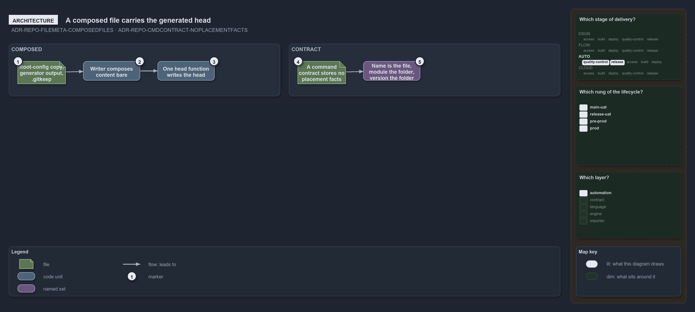

---
catzc:
  warning: "Experimental: this article merges two rules into one and holds nothing beyond what they say"
  edges:
    cites:
      - ADR-REPO-FILEMETA-COMPOSEDFILES
      - ADR-REPO-CMDCONTRACT-NOPLACEMENTFACTS
---

# A composed file carries the generated head and a command contract stores no placement facts

This article is one rule: [ADR-REPO-FILEMETA-COMPOSEDFILES](../../drs/repository/file-meta.md#rule-adr-repo-filemeta-composedfiles) and
[ADR-REPO-CMDCONTRACT-NOPLACEMENTFACTS](../../drs/repository/command-contracts.md#rule-adr-repo-cmdcontract-noplacementfacts) merged into
one. It holds nothing beyond what those two rules say.

A file the automation composes whole, a root-config copy, a generator's output or a `.gitkeep`, carries the generated-file head instead of
an imprinted block; its writer composes the content bare and writes the head through the one head function. A command contract stores
nothing its placement says: the command's name is the file name, the owning module is the folder, and the version is the unit's version
folder.

