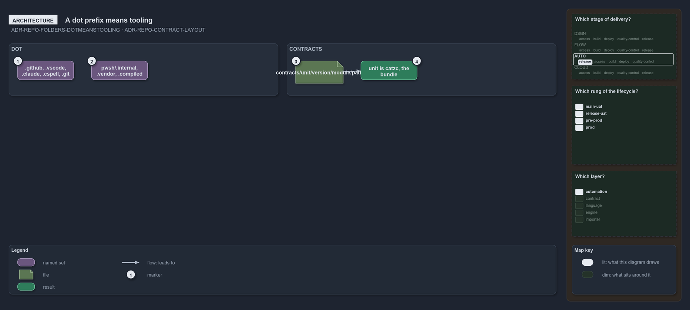

---
catzc:
  warning: "Experimental: this article merges two rules into one and holds nothing beyond what they say"
  edges:
    cites:
      - ADR-REPO-FOLDERS-DOTMEANSTOOLING
      - ADR-REPO-CONTRACT-NODOTFOLDERS
---

# A dot prefix means tooling and contracts hold no dot folders

This article is one rule:
[ADR-REPO-FOLDERS-DOTMEANSTOOLING](../../drs/repository/conventional-folders.md#rule-adr-repo-folders-dotmeanstooling) and
[ADR-REPO-CONTRACT-NODOTFOLDERS](../../drs/repository/api-contracts.md#rule-adr-repo-contract-nodotfolders) merged into one. It holds
nothing beyond what those two rules say.

Dot-prefix means infrastructure or tooling, everywhere: `.github/`, `.vscode/`, `.claude/`, `.cspell/`, `.git/`, `.go/` and, under `pwsh/`,
`.internal`, `.scriptanalyzer`, `.vendor` and `.compiled`. `contracts/` therefore holds no dot-prefixed folder at any depth, every folder
under it being content: a unit, a version, a module or a folder of an asset's path.

