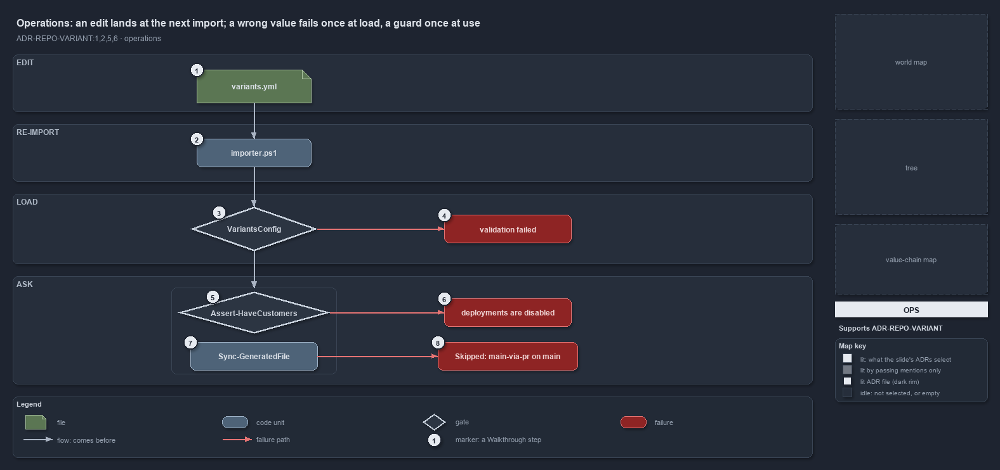

---
catzc:
  immutable:
    with_body_sha: d1258477412c
    path: docs/explanation/repository/an-edit-lands-at-the-next-import.md
    folder: docs/explanation/repository
    name: an-edit-lands-at-the-next-import
    filetype: md
    kind: explanation
    language: markdown
    track: docs
  edges:
    cites:
      - ADR-AUTO-CACHE#6
      - ADR-REPO-VARIANT#{1,2,5,6}
    links:
      - docs/.assets/explanation/adr-repo-variant--an-edit-lands-at-the-next-import--operations.drawio.md
      - docs/.assets/explanation/adr-repo-variant--an-edit-lands-at-the-next-import--operations.drawio.png
      - docs/adr/repository/repo-variants.md
      - docs/explanation/index.md#how-to-read-the-diagrams
      - docs/explanation/repository/a-base-module-between-config-and-its-callers.md
      - docs/explanation/repository/five-keys-one-reader-twelve-primitives.md
      - docs/explanation/repository/index.md
      - docs/explanation/repository/one-home-one-read-path-one-vocabulary.md
      - docs/explanation/repository/values-and-edges-gated-reads-reviewed.md
---

# An edit to a variant lands at the next import, and a wrong value fails once, at load

```text
An edit to a variant lands at the next import; a wrong value fails once at load, a guard once at use.

1  variants.yml                  edit one key, for example have_customers
2  importer.ps1                  re-run it: the session cache is gone, and the next ask reloads the file
3  VariantsConfig                the load check: known keys, allowed values, well-formed aspects and tracks
4  validation failed             one throw, one line per violation; nothing else runs
5  Assert-HaveCustomers          the one-liner guard an operator or a caller runs
6  deployments are disabled      its throw, naming the key to set
7  Sync-GeneratedFile            a committer that asks Test-GitWorkspace -MainViaPr first
8  Skipped: main-via-pr on main  its stop, naming the branch to use instead

Supports ADR-REPO-VARIANT#1, #2, #5 and #6 (operations lens).
```

Changing a repo-wide decision in cats is an edit and a re-import. The edit is one key in `variants.yml`; the re-import is
`. ./importer.ps1`, which starts a fresh session and so drops the cached config. From then on every primitive answers from the new file.
There are two moments an operator sees a variant say no: when the file is loaded with a value it does not accept, and when a guard is asked
and the repository is not in the state the guard requires.



The diagram is described element by element in
[its asset description](../../.assets/explanation/adr-repo-variant--an-edit-lands-at-the-next-import--operations.drawio.md).

## Walkthrough

1. **variants.yml.** Set the key: `have_customers: all`, a list of names, or `false`; `git_workspace: main-via-pr` when the repository goes
   from one author to more; `ado_naming: classic` only as a deliberate one-time decision, because it re-spells every resource name.
2. **importer.ps1.** Re-run the importer. `Get-Config` caches each parsed config in module state that lives for the session, so a running
   session keeps answering from the old file until it is re-imported. The importer does not load the variants itself; the first primitive
   asked afterwards does.
3. **VariantsConfig.** At that first ask, `Get-Config -Config variants` constructs the config type, which checks the file: only the five
   known keys, `ado_naming` in `standard` or `classic`, `git_workspace` in `main-direct` or `main-via-pr`, `have_customers` a boolean, `all`
   or a list of unique lowercase names, and well-formed `aspects` and `tracks`.
4. **validation failed.** A wrong value throws once, `variants configuration validation failed:` followed by one line per violation, such as
   `invalid ado_naming '<value>' (valid: standard, classic)`. The ask that triggered the load fails, and so does every later one, until the
   file is fixed and the session re-imported.
5. **Assert-HaveCustomers.** The guard an operator can run at the prompt, and the one-liner the ADR gives for code: with no `-Name` it
   requires the repository to have customer deployments enabled; with `-Name` it requires each named customer to be enabled.
6. **deployments are disabled.** When the variant is `false`, the guard throws
   `Customer deployments are disabled — set have_customers in variants.yml (all, or a list of customer names).`; with names that are not
   enabled it throws
   `Customer(s) not enabled for this repo: <names> — set have_customers in variants.yml (all, or include them in the list).` The callers in
   `Catzc.Azure.Templates` ask the `Test-` form instead and throw their own message, naming the template that set
   `customer_deployment: true`.
7. **Sync-GeneratedFile.** A committer in `Catzc.Base.ModuleSystem`: before it commits a generated file it asks
   `Test-GitWorkspace -MainViaPr`.
8. **Skipped: main-via-pr on main.** On `main` or `master` in `main-via-pr` mode it writes
   `Skipped: the git_workspace variant is 'main-via-pr' and this is <branch> — commit generated files from a working branch (variants.yml, ADR-REPO-VARIANT#6).`
   and returns without committing. In `main-direct` mode any named branch, main included, commits.

## Why it holds

- A variant is fixed for the importer session because it inherits the `Get-Config` cache, so re-running the importer is how it changes
  (ADR-REPO-VARIANT#1); the importer is the only invalidation of a session cache (ADR-AUTO-CACHE#6).
- A repo-wide decision is a one-liner such as `Assert-HaveCustomers`, and a guard throws with an actionable message (ADR-REPO-VARIANT#2).
- `have_customers` is tri-state, and the plural guards answer the repo-wide question (ADR-REPO-VARIANT#5).
- `git_workspace` guards automation that commits; the single stop condition is a direct commit made while standing on main locally
  (ADR-REPO-VARIANT#6).

## See also

- [Repo-wide variants](../../adr/repository/repo-variants.md) — the decision this article explains.
- The other lenses on the same diagram: [meta](one-home-one-read-path-one-vocabulary.md),
  [architecture](a-base-module-between-config-and-its-callers.md), [implementation](five-keys-one-reader-twelve-primitives.md) and
  [governance](values-and-edges-gated-reads-reviewed.md).
- [The repository explanations](index.md) · [How to read the diagrams](../index.md#how-to-read-the-diagrams)
