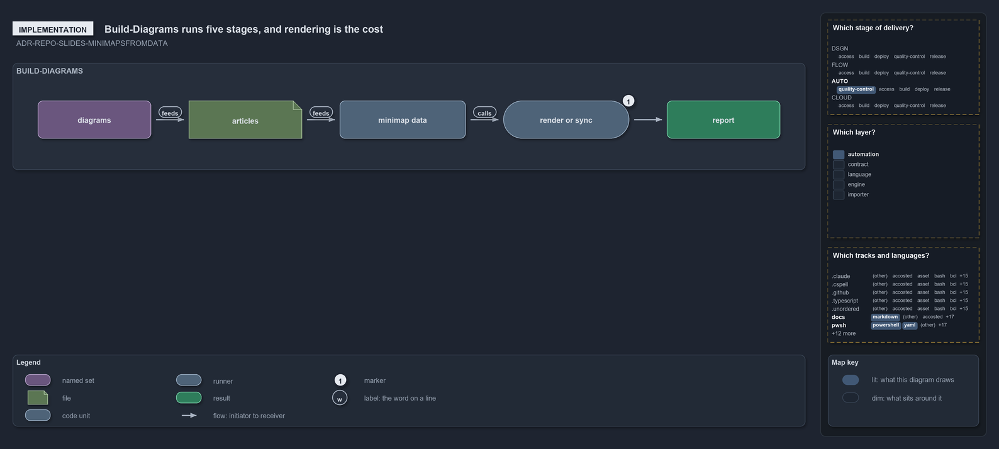

# Build-Diagrams runs five stages, and rendering is the cost

```text
Build-Diagrams runs five stages in one call; rendering each diagram is where a full run spends its time.

   diagrams                      every docs/**/.assets/<name>.drawio pair with a tracked png or a yml, found, never listed
   articles                      every page in the tree that embeds the diagram's png; none makes it an orphan
   minimap data                  the data each declaration's minimaps draw from, written for every declared diagram in one call
1  render or sync                one renderer call per diagram, or a sync after a draw.io edit
   report                        one line per diagram per stage, then the total

Supports ADR-REPO-SLIDES-MINIMAPSFROMDATA (implementation lens).
```

`Build-Diagrams` rebuilds every diagram from its one source, its `<name>.drawio.yml`, in one command. It runs five stages in order, and only
one of them is slow: over the 177 declared diagrams, finding the diagrams and their articles takes about 7 seconds, writing the minimap data
about 20 seconds, and rendering about 1.2 seconds a diagram, close to three and a half minutes in all. So a full run takes minutes, and the
everyday journeys are `-Stale`, which rebuilds only the diagrams a tree change left stale, and `-Path`, which rebuilds the diagrams named.

```yml drawio
description:
  "Build-Diagrams as one pipeline of five stages: it finds the diagrams in the tree, finds every page that embeds each one, writes the
  minimap data of every declared diagram, renders or syncs each diagram, and reports. Rendering is where a full run spends its time."
about:
  adrs:
    - ADR-REPO-SLIDES-MINIMAPSFROMDATA
  lens: implementation
content:
  title: Build-Diagrams runs five stages, and rendering is the cost
  kind: explanation
  flow: left-to-right
  relation: then
  theme: dark
  bands:
    - id: band-pipeline
      label: BUILD-DIAGRAMS
  glyphs:
    - id: g-folders
      kind: set
      label: diagrams
      in: band-pipeline
    - id: g-articles
      kind: file
      label: articles
      in: band-pipeline
    - id: g-minimaps
      kind: code
      label: minimap data
      in: band-pipeline
    - id: g-render
      kind: runner
      label: render or sync
      in: band-pipeline
    - id: g-report
      kind: result
      label: report
      in: band-pipeline
  edges:
    - from: g-folders
      to: g-articles
      kind: flow
      label: ""
    - from: g-articles
      to: g-minimaps
      kind: flow
      label: ""
    - from: g-minimaps
      to: g-render
      kind: flow
      label: ""
    - from: g-render
      to: g-report
      kind: flow
      label: ""
  markers:
    - at: g-render
      number: 1
  legend: auto
  minimaps:
    axis:
      - cell: AUTO/quality-control
        by:
          - ADR-REPO-SLIDES-MINIMAPSFROMDATA
    layer-stack:
      - cell: automation
        by:
          - docs/drs/index.md
          - docs/drs/repository/dora-explains.md
          - docs/drs/repository/slides-as-markdown.md
          - docs/references/pwsh/catzc-base-slides.md
          - docs/references/pwsh/catzc-base-slides/Build-Diagrams.ps1.md
          - docs/references/python/catzc_diagrams.md
          - pwsh/Catzc.Base.Drs/configs/drs.yml
          - pwsh/Catzc.Base.Maps/tests/Get-GridMinimapData.Tests.ps1
          - pwsh/Catzc.Base.Slides/Build-Diagrams.ps1
          - pwsh/Catzc.Base.Slides/tests/Write-DiagramMinimapData.Tests.ps1
          - ADR-REPO-SLIDES-MINIMAPSFROMDATA
    grid:
      - cell: docs/markdown
        by:
          - docs/drs/index.md
          - docs/drs/repository/dora-explains.md
          - docs/drs/repository/slides-as-markdown.md
          - docs/references/pwsh/catzc-base-slides.md
          - docs/references/pwsh/catzc-base-slides/Build-Diagrams.ps1.md
          - docs/references/python/catzc_diagrams.md
          - ADR-REPO-SLIDES-MINIMAPSFROMDATA
      - cell: pwsh/powershell
        by:
          - pwsh/Catzc.Base.Maps/tests/Get-GridMinimapData.Tests.ps1
          - pwsh/Catzc.Base.Slides/Build-Diagrams.ps1
          - pwsh/Catzc.Base.Slides/tests/Write-DiagramMinimapData.Tests.ps1
          - ADR-REPO-SLIDES-MINIMAPSFROMDATA
      - cell: pwsh/yaml
        by:
          - pwsh/Catzc.Base.Drs/configs/drs.yml
          - ADR-REPO-SLIDES-MINIMAPSFROMDATA
layout:
  band-pipeline:
    x: 20
    y: 84
    w: 1260
    h: 170
  g-folders:
    x: 60
    y: 144
    w: 180
    h: 60
  g-articles:
    x: 300
    y: 144
    w: 180
    h: 60
  g-minimaps:
    x: 540
    y: 144
    w: 200
    h: 60
  g-render:
    x: 800
    y: 144
    w: 200
    h: 60
  g-report:
    x: 1060
    y: 144
    w: 180
    h: 60
```



## Walkthrough

- **diagrams.** A diagram is the pair `<article-folder>/.assets/<name>.drawio.png` and `<name>.drawio.yml`, found by a tracked png or a yml,
  so a new diagram gets its first put. The diagrams are found from the git index, never listed by hand.
- **articles.** Every page anywhere in the tree that embeds a diagram's png is its article. A diagram no page embeds is an orphan, reported
  and still rendered, and each page's Supports line is held against the diagram's yml, a mismatch reported as drift.
- **minimap data.** One call writes the minimap data of every declared diagram to `out/minimaps/`, building the world map and reading the
  file facts once for the whole call, so each diagram costs about a tenth of a second.
- **1 render or sync.** The cost. Each diagram is one call of the draw.io kit's renderer through uv, which puts the diagram from its yml
  with its minimaps drawn from that data; under `-FromDrawing` it is a sync instead. At about a second a diagram, this stage is most of a
  full run.
- **report.** Each stage prints one line per diagram with its position, status and time, and the run ends with its total.

## The minimaps

Every lit cell comes from the files and codes tied to ADR-REPO-SLIDES-MINIMAPSFROMDATA, the one ADR the diagram names.

- **Which stage of delivery: AUTO, quality-control.** The ADR's ruleset, ADR-REPO-SLIDES, sits in the repository domain, whose row of the
  value-chain stack is AUTO; the concern it acts in is quality-control.
- **Which layer: automation.** Every file that cites the rule cites a code of ADR-REPO-SLIDES, whose layer is automation.
- **Which tracks and languages: `docs` × markdown.** The ADR itself, `docs/drs/repository/slides-as-markdown.md`, and the pages that cite
  the rule: this article, the DRS index, the domain's `dora-explains.md`, the `Catzc.Base.Slides` and `catzc_diagrams` references, and the
  `Build-Diagrams` help page.
- **`pwsh` × powershell.** `pwsh/Catzc.Base.Slides/Build-Diagrams.ps1` and the grid minimap's test,
  `pwsh/Catzc.Base.Maps/tests/Get-GridMinimapData.Tests.ps1`, cite the rule.
- **`pwsh` × yaml.** `pwsh/Catzc.Base.Drs/configs/drs.yml` registers the ruleset.

## Why it holds

- A diagram is put from its yml, and its minimaps are drawn from data computed from the tree, never drawn by hand
  (ADR-REPO-SLIDES-MINIMAPSFROMDATA).
- One command rebuilds every diagram, so a full run is the one way to bring them all in step (ADR-REPO-SLIDES-ONEBUILDCOMMAND).

## See also

- [Slides as markdown](../../drs/repository/slides-as-markdown.md) — the decision this article explains.
- [The `Build-Diagrams` help](../../references/pwsh/catzc-base-slides/Build-Diagrams.ps1.md) — its parameters and journeys.
- [The repository explanations](index.md) · [How to read the diagrams](../index.md#how-to-read-the-diagrams)
