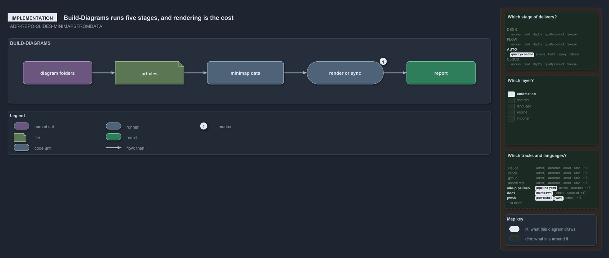

# Build-Diagrams runs five stages, and rendering is the cost

```text
Build-Diagrams runs five stages in one call; rendering each folder is where a full run spends its time.

   diagram folders               every docs/**/.assets/<name>/ folder with a tracked png or a yml, found, never listed
   articles                      every page in the tree that embeds the folder's png; none makes it an orphan
   minimap data                  the data each declaration's minimaps draw from, written for every declared folder in one call
1  render or sync                one renderer call per folder, or a sync after a draw.io edit
   report                        one line per folder per stage, then the total

Supports ADR-REPO-SLIDES-MINIMAPSFROMDATA (implementation lens).
```

`Build-Diagrams` rebuilds every diagram folder from its one source, its `diagram.drawio.yml`, in one command. It runs five stages in order,
and only one of them is slow: over the 174 declared folders, finding the folders and their articles takes about 7 seconds, writing the
minimap data about 20 seconds, and rendering about 0.9 seconds a folder, close to three minutes in all. So a full run takes minutes, and the
everyday journeys are `-Stale`, which rebuilds only the folders a tree change left stale, and `-Path`, which rebuilds the folders named.



## Walkthrough

- **diagram folders.** A diagram folder is `<article-folder>/.assets/<name>/` holding a tracked `diagram.drawio.png` or a
  `diagram.drawio.yml`, so a new folder gets its first put. The folders are found from the git index, never listed by hand.
- **articles.** Every page anywhere in the tree that embeds a folder's png is its article. A folder no page embeds is an orphan, reported
  and still rendered, and each page's Supports line is held against the folder's yml, a mismatch reported as drift.
- **minimap data.** One call writes the minimap data of every declared folder to `out/minimaps/`, building the world map and reading the
  file facts once for the whole call, so each folder costs about a tenth of a second.
- **1 render or sync.** The cost. Each folder is one call of the draw.io kit's renderer through uv, which puts the folder from its yml with
  its minimaps drawn from that data; under `-FromDrawing` it is a sync instead. At almost a second a folder, this stage is most of a full
  run.
- **report.** Each stage prints one line per folder with its position, status and time, and the run ends with its total.

## The minimaps

Every lit cell comes from the files and codes tied to ADR-REPO-SLIDES-MINIMAPSFROMDATA, the one ADR the diagram names.

- **Which stage of delivery: AUTO, quality-control.** The ADR's ruleset, ADR-REPO-SLIDES, sits in the repository domain, whose row of the
  value-chain stack is AUTO; the concern it acts in is quality-control.
- **Which layer: automation.** Every file that cites the rule cites a code of ADR-REPO-SLIDES, whose layer is automation.
- **Which tracks and languages: `ado-pipelines` × pipeline-yaml.** `.ado/pipelines/ci-pwsh.yaml` is the pipeline whose globset covers the
  Slides module that carries the rule.
- **`docs` × markdown.** The ADR itself, `docs/adr/repository/slides-as-markdown.md`, and the pages that cite the rule: this article, the
  ADR index, the domain's `dora-explains.md`, the `Catzc.Base.Slides` and `catzc_diagrams` references, and the `Build-Diagrams` help page.
- **`pwsh` × powershell.** `pwsh/Catzc.Base.Slides/Build-Diagrams.ps1` and the grid minimap's test,
  `pwsh/Catzc.Base.Maps/tests/Get-GridMinimapData.Tests.ps1`, cite the rule.
- **`pwsh` × yaml.** `pwsh/Catzc.Base.Docs/configs/adrs.yml` registers the ruleset.

## Why it holds

- A diagram folder is put from its yml, and its minimaps are drawn from data computed from the tree, never drawn by hand
  (ADR-REPO-SLIDES-MINIMAPSFROMDATA).
- One command rebuilds every diagram, so a full run is the one way to bring them all in step (ADR-REPO-SLIDES-ONEBUILDCOMMAND).

## See also

- [Slides as markdown](../../adr/repository/slides-as-markdown.md) — the decision this article explains.
- [The `Build-Diagrams` help](../../references/pwsh/catzc-base-slides/Build-Diagrams.ps1.md) — its parameters and journeys.
- [The repository explanations](index.md) · [How to read the diagrams](../index.md#how-to-read-the-diagrams)
