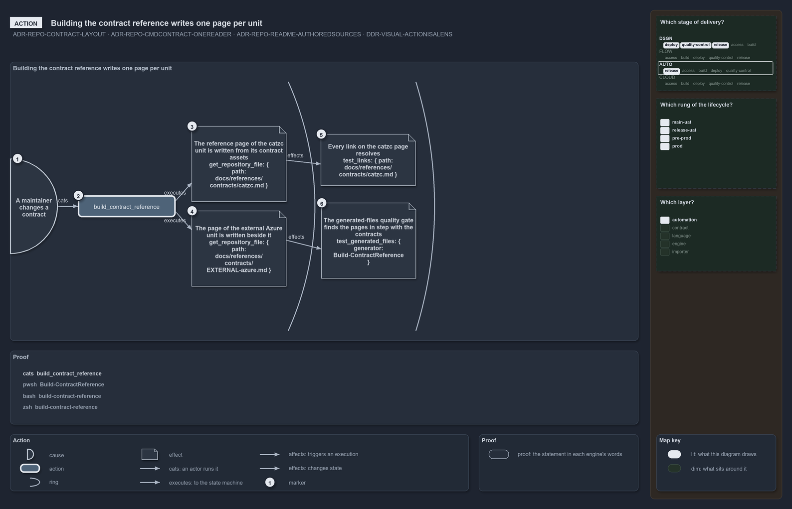

---
catzc:
  warning: "Header is generated by Format-FileMeta via Format-Code; do not change it"
  edges:
    cites:
      - ADR-AUTO-ACCOSTED-ARTICLERENDERING
      - ADR-REPO-CMDCONTRACT-ONEREADER
      - ADR-REPO-CONTRACT-LAYOUT
      - ADR-REPO-README-AUTHOREDSOURCES
      - DDR-VISUAL-ACTIONISALENS
      - DDR-VISUAL-PROOFISTHEACCOSTEDFILE
    drs_total: 6
---

# Building the contract reference writes one page per unit

```text
A maintainer changes a contract; one command rewrites the reference pages, and two gates hold them.

1  A maintainer changes a contract   the cause: a contract asset changed under contracts/
2  build_contract_reference                        the action: one command, in the contract form
3  The catzc unit's page                           zone 1, local: get_repository_file shows docs/references/contracts/catzc.md
4  The external Azure unit's page                  zone 1, local: get_repository_file shows docs/references/contracts/EXTERNAL-azure.md
5  Every link on the catzc page resolves           zone 2, local, after 3: test_links on the page
6  The generated-files quality gate                        zone 2, local, after 4: test_generated_files sees no drift for the builder

Supports ADR-REPO-CONTRACT-LAYOUT, ADR-REPO-CMDCONTRACT-ONEREADER, ADR-REPO-README-AUTHOREDSOURCES and DDR-VISUAL-ACTIONISALENS (action lens).
```

The contracts under `contracts/<unit>/<version>/` are the repository's binding interfaces, and the reference pages under
`docs/references/contracts/` are how a reader meets them. Nobody writes those pages: one command reads the contract assets through the one
reader and writes a page per unit. This diagram is that command, the two pages it writes in parallel, and the two gates that hold them
afterwards: the links on a page must resolve, and the page must match the contracts it was built from.



## What the drawing shows

The [rendered action diagram](.assets/building-the-contract-reference-writes-one-page-per-unit.drawio.png) reads left to right. The cause, a
bold half-disc numbered 1 on the left rim, says **A maintainer changes a contract**; its edge carries `cats` into box 2, the action pill
`build_contract_reference`. Two arcs cut the frame into zones. Zone 1 holds two `local` notes: 3, the catzc unit's reference page, and 4,
the external Azure unit's page, each proven by `get_repository_file` on its path; the edges out of the action carry `executes`. Zone 2 holds
two notes level with them: 5, every link on the catzc page resolves, proven by `test_links` on that page, and 6, the generated-files quality
gate finding the pages in step with the contracts, proven by `test_generated_files` for the builder. The edge from 3 to 5 and the edge from
4 to 6 both carry `effects`, so each gate stands behind the page it checks and the two stories never cross. The legend names the cause, the
action, the ring, the effect note, the four operators and the marker.

## Walkthrough

1. **A maintainer changes a contract.** The cause is a change to a contract asset: a command contract, a type, a sample. The pages that
   describe it are stale the moment it lands.
2. **build_contract_reference.** The action is one command in the contract form, with no arguments. It reads every contract asset through
   the one reader of the contract language and writes the pages
   ([ADR-REPO-CMDCONTRACT-ONEREADER](../../drs/repository/command-contracts.md#rule-adr-repo-cmdcontract-onereader)).
3. **The catzc unit's page.** The first zone holds what the command writes directly. The catzc unit, the bundle a consumer pins, gets its
   page at `docs/references/contracts/catzc.md`
   ([ADR-REPO-CONTRACT-LAYOUT](../../drs/repository/api-contracts.md#rule-adr-repo-contract-layout)).
4. **The external Azure unit's page.** In the same zone, because the same run writes it, the external unit gets its page beside the first.
   The two pages are parallel effects: neither waits for the other.
5. **Every link on the catzc page resolves.** The second zone holds what the pages cause further out. A written page is a page with links,
   and `test_links` on it is the observation that they resolve; it follows the catzc page, so the edge comes from that effect.
6. **The generated-files quality gate.** The generated-files registry names the builder with its inputs and its outputs, and
   `test_generated_files` for that generator finds the pages in step with the contracts: a changed contract without a rebuilt page fails
   here ([ADR-REPO-README-AUTHOREDSOURCES](../../drs/repository/generated-readmes.md#rule-adr-repo-readme-authoredsources)).

## The proof

The drawing never says what the proof does not run. The four runs below are copied from the accosted file the diagram names, and each
observation on the drawing occurs in them verbatim
([DDR-VISUAL-PROOFISTHEACCOSTEDFILE](../../drs/design/visual-design.md#rule-ddr-visual-proofistheaccostedfile)).

```yml accosted
runs:
  - - get_repository_file: { path: docs/references/contracts/catzc.md }
  - - get_repository_file: { path: docs/references/contracts/EXTERNAL-azure.md }
  - - test_links: { path: docs/references/contracts/catzc.md }
  - - test_generated_files: { generator: Build-ContractReference }
```

The same runs in PowerShell, rendered from that file by `Get-AccostedFragment`, never written by hand
([ADR-AUTO-ACCOSTED-ARTICLERENDERING](../../drs/automation/accosted-language.md#rule-adr-auto-accosted-articlerendering)):

```powershell
Get-RepositoryFile -Path 'docs/references/contracts/catzc.md'

Get-RepositoryFile -Path 'docs/references/contracts/EXTERNAL-azure.md'

Test-Links -Path 'docs/references/contracts/catzc.md'

Test-GeneratedFiles -Generator 'Build-ContractReference'
```

## Notes from the inspection

- This is the drawing the grammar fits best: two parallel stories, one hop each, no edge skipping a zone, every word legible. A drawing with
  more than two stories per zone would stack its notes tighter than the lane allows, and the renderer refuses it rather than shrinking the
  text; a taller frame on request is the only relief.
- The `effects` words stand just left of the first arc; one more character and the arc would cut them. The word's position should take the
  arcs into account, not only the source box.
- The numbers run top to bottom inside each zone while the causality runs left to right, so 5 follows 3 and 6 follows 4 although 4 is
  numbered before 5. The numbers tell the declared order, not the chain; a reader who wants the chain follows the words on the edges.

### Stronger with new definitions

- `content.order: chain` beside the default declared order, so the numbers follow each story to its end before the next story starts; here
  the pages and their gates would read 3, 4 for the catzc story and 5, 6 for the Azure one.
- `effects[].unit: catzc` as an optional grouping word printed as a small chip like `where`, so two parallel stories carry the name they
  belong to on every note.

## Why it holds

- Contracts are laid out as `contracts/<unit>/<version>/<module>/<path>`, so a page per unit is the natural shape of their reference
  (ADR-REPO-CONTRACT-LAYOUT).
- One reader reads the contract language, so the pages say what the contracts say and nothing a second parser added
  (ADR-REPO-CMDCONTRACT-ONEREADER).
- A generated page is never authored; its source is the contract asset, and the generated-files quality gate holds the two together
  (ADR-REPO-README-AUTHOREDSOURCES).
- The two pages stand in one zone because one run writes both; each gate stands in the next zone behind the page it checks, which is what
  the `after` edges say (DDR-VISUAL-ACTIONISALENS).

The gates prove that the pages are current and linked today; what a contract promises to a consumer is the contract's own business, proven
by its tests.

## See also

- [API contracts](../../drs/repository/api-contracts.md) and [command contracts](../../drs/repository/command-contracts.md) — the decisions
  this article explains.
- [Visual design](../../drs/design/visual-design.md) — how an action diagram is drawn.
- [The repository explanations](index.md) · [How to read the diagrams](../index.md#how-to-read-the-diagrams)
