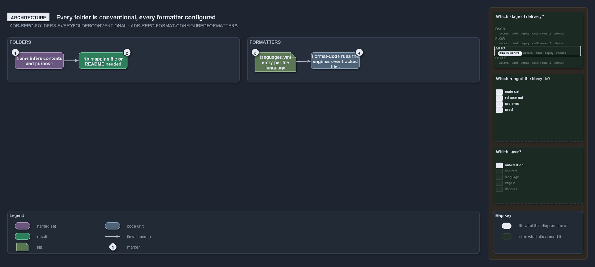

---
catzc:
  warning: "Experimental: this article merges two rules into one and holds nothing beyond what they say"
  edges:
    cites:
      - ADR-REPO-FOLDERS-EVERYFOLDERCONVENTIONAL
      - ADR-REPO-FORMAT-CONFIGUREDFORMATTERS
---

# Every folder is conventional and each formatter is configured not coded

This article is one rule:
[ADR-REPO-FOLDERS-EVERYFOLDERCONVENTIONAL](../../drs/repository/conventional-folders.md#rule-adr-repo-folders-everyfolderconventional) and
[ADR-REPO-FORMAT-CONFIGUREDFORMATTERS](../../drs/repository/uniform-formatting.md#rule-adr-repo-format-configuredformatters) merged into
one. It holds nothing beyond what those two rules say.

Every folder in the repository is conventional: its name infers its contents and purpose, and no folder needs a mapping file or a README to
be understood. Formatters are configured in the same spirit: each file language's entry in `languages.yml` names the formatter engine that
formats its files, or states in `no_formatter:` why it has none, and `Format-Code` runs the engines over every tracked file except vendored
code.

