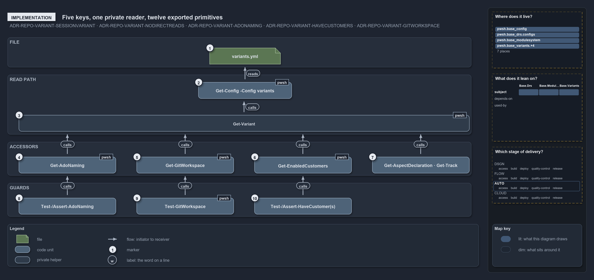

# How variants.yml keys are read

```text
How variants.yml keys are read.

1   variants.yml                  five keys: ado_naming, git_workspace, have_customers, aspects, tracks
2   Get-Config -Config variants   loads the file as a VariantsConfig and caches it for the session
3   Get-Variant                   the private reader: one key, or the caller's default when absent
4   Get-AdoNaming                 ado_naming, default standard
5   Get-GitWorkspace              git_workspace, default main-direct
6   Get-EnabledCustomers          have_customers normalised to @(), all, or a name list
7   Get-AspectDeclaration · Get-Track  aspects and tracks, the two keys with no Assert- guard
8   Test-/Assert-AdoNaming        -Standard or -Classic over Get-AdoNaming
9   Test-GitWorkspace             -MainDirect or -MainViaPr over Get-GitWorkspace
10  Test-/Assert-HaveCustomer(s)  the plural forms over Get-EnabledCustomers; the singular forms cover them

Supports ADR-REPO-VARIANT-SESSIONVARIANT, ADR-REPO-VARIANT-NODIRECTREADS, ADR-REPO-VARIANT-ADONAMING,
ADR-REPO-VARIANT-HAVECUSTOMERS and ADR-REPO-VARIANT-GITWORKSPACE (implementation lens).
```

`Catzc.Base.Variants` is small: one YAML file with five keys, one C# config type that validates it, one private function that reads it, and
twelve public functions that ask it. Each call runs one way, from a `Test-` or `Assert-` guard that answers a question or stops the run to
its `Get-` accessor, then to the private reader and the loader, which reads the file; the value flows back the other way.

```yml drawio
description:
  The Test- and Assert- guards call the Get- accessors, which call one private reader, which calls Get-Config, which reads the five keys of
  variants.yml.
about:
  rules:
    - ADR-REPO-VARIANT-SESSIONVARIANT
    - ADR-REPO-VARIANT-NODIRECTREADS
    - ADR-REPO-VARIANT-ADONAMING
    - ADR-REPO-VARIANT-HAVECUSTOMERS
    - ADR-REPO-VARIANT-GITWORKSPACE
  lens: implementation
content:
  title: How variants.yml keys are read
  kind: explanation
  flow: top-to-bottom
  theme: dark
  bands:
    - { id: band-file, label: FILE }
    - { id: band-read-path, label: READ PATH }
    - { id: band-accessors, label: ACCESSORS }
    - { id: band-guards, label: GUARDS }
  glyphs:
    - { id: g-variants-yml, kind: file, label: variants.yml, in: band-file }
    - { id: g-get-config, kind: code, label: Get-Config -Config variants, in: band-read-path }
    - { id: g-get-variant, kind: private, label: Get-Variant, in: band-read-path }
    - { id: g-ado-naming, kind: code, label: Get-AdoNaming, in: band-accessors }
    - { id: g-git-workspace, kind: code, label: Get-GitWorkspace, in: band-accessors }
    - { id: g-enabled-customers, kind: code, label: Get-EnabledCustomers, in: band-accessors }
    - { id: g-aspect-track, kind: code, label: Get-AspectDeclaration · Get-Track, in: band-accessors }
    - { id: g-test-ado-naming, kind: code, label: Test-/Assert-AdoNaming, in: band-guards }
    - { id: g-test-git-workspace, kind: code, label: Test-GitWorkspace, in: band-guards }
    - { id: g-test-customers, kind: code, label: Test-/Assert-HaveCustomer(s), in: band-guards }
  edges:
    - { from: g-get-config, to: g-variants-yml, kind: flow, label: "" }
    - { from: g-get-variant, to: g-get-config, kind: flow, label: calls }
    - { from: g-ado-naming, to: g-get-variant, kind: flow, label: calls }
    - { from: g-git-workspace, to: g-get-variant, kind: flow, label: calls }
    - { from: g-enabled-customers, to: g-get-variant, kind: flow, label: calls }
    - { from: g-aspect-track, to: g-get-variant, kind: flow, label: calls }
    - { from: g-test-ado-naming, to: g-ado-naming, kind: flow, label: calls }
    - { from: g-test-git-workspace, to: g-git-workspace, kind: flow, label: calls }
    - { from: g-test-customers, to: g-enabled-customers, kind: flow, label: calls }
  markers:
    - { at: g-variants-yml, number: 1 }
    - { at: g-get-config, number: 2 }
    - { at: g-get-variant, number: 3 }
    - { at: g-ado-naming, number: 4 }
    - { at: g-git-workspace, number: 5 }
    - { at: g-enabled-customers, number: 6 }
    - { at: g-aspect-track, number: 7 }
    - { at: g-test-ado-naming, number: 8 }
    - { at: g-test-git-workspace, number: 9 }
    - { at: g-test-customers, number: 10 }
  legend: auto
  minimaps: [code-locations, module-neighbourhood, axis]
layout:
  band-file: { x: 20, y: 84, w: 1240, h: 80 }
  band-read-path: { x: 20, y: 184, w: 1240, h: 160 }
  band-accessors: { x: 20, y: 364, w: 1240, h: 90 }
  band-guards: { x: 20, y: 474, w: 1240, h: 90 }
  g-variants-yml: { x: 560, y: 112, w: 190, h: 44 }
  g-get-config: { x: 530, y: 204, w: 250, h: 44 }
  g-get-variant: { x: 50, y: 292, w: 1205, h: 44 }
  g-ado-naming: { x: 50, y: 404, w: 260, h: 44 }
  g-git-workspace: { x: 365, y: 404, w: 260, h: 44 }
  g-enabled-customers: { x: 680, y: 404, w: 260, h: 44 }
  g-aspect-track: { x: 995, y: 404, w: 260, h: 44 }
  g-test-ado-naming: { x: 50, y: 514, w: 260, h: 44 }
  g-test-git-workspace: { x: 365, y: 514, w: 260, h: 44 }
  g-test-customers: { x: 680, y: 514, w: 260, h: 44 }
```



## Walkthrough

1. **variants.yml.** `configs/variants.yml` declares `ado_naming: standard`, `git_workspace: main-direct`, `have_customers: all`, the
   `aspects` of the automation and infrastructure tracks, and the eleven `tracks` of the repository. Every key is optional, and an unknown
   key is an error.
2. **Get-Config -Config variants.** The loader parses the file into a `VariantsConfig`, the type registered for `variants` in `configs.yml`.
   Constructing the type validates every key and throws one error that lists every violation. The parsed record is cached for the session.
3. **Get-Variant.** `Get-Variant -Name <key> -Default <x>` asks the loaded record for one key and returns the default when the record does
   not contain it. It is listed among the module's files and absent from its exports, so only the module's own primitives call it.
4. **Get-AdoNaming.** Reads `ado_naming` with the default `standard`. The value selects the key of `Get-AzureNameOrderSet` that the name
   assembler uses.
5. **Get-GitWorkspace.** Reads `git_workspace` with the default `main-direct`.
6. **Get-EnabledCustomers.** Reads `have_customers` with the default `$false` and is its single interpreter: a boolean becomes `@()` or
   `all`, the literal `all` stays, and anything else is the list of enabled customer names.
7. **Get-AspectDeclaration · Get-Track.** `Get-AspectDeclaration` reads `aspects` with a built-in default of the two shipped tracks, and
   `Test-AspectDeclaration -Track` answers whether a track has an entry there; `Get-Aspect` in `Catzc.Base.Modules` reads through it.
   `Get-Track -Name` or `-Path` reads `tracks` with an empty default and throws on an unknown name. Neither key has an `Assert-` guard.
8. **Test-/Assert-AdoNaming.** Each takes exactly one of `-Standard` or `-Classic` and calls `Get-AdoNaming`; the predicate returns the
   match, and the guard throws through `Assert-True` with the value to set.
9. **Test-GitWorkspace.** Takes exactly one of `-MainDirect` or `-MainViaPr` and calls `Get-GitWorkspace`. There is no
   `Assert-GitWorkspace`.
10. **Test-/Assert-HaveCustomer(s).** `Test-HaveCustomers`, with an optional `-Name` list, calls `Get-EnabledCustomers`;
    `Assert-HaveCustomers` calls the predicate and throws. The singular `Test-HaveCustomer` and `Assert-HaveCustomer` take one `-Name` and
    call the plural form.

## Why it holds

- The file is the one home, loaded through `Get-Config -Config variants` so that it inherits the session cache
  (ADR-REPO-VARIANT-SESSIONVARIANT).
- Nothing reads the file directly; each variant is a `Get-` accessor and `Test-`/`Assert-` guards over the private `Get-Variant`, so each
  default lives in exactly one place (ADR-REPO-VARIANT-NODIRECTREADS).
- `ado_naming` is a variant, not a code constant: `Get-AdoNaming` reads it with the default `standard` (ADR-REPO-VARIANT-ADONAMING).
- `have_customers` is tri-state, `Get-EnabledCustomers` normalises it, and the plural and singular primitives split by cardinality
  (ADR-REPO-VARIANT-HAVECUSTOMERS, ADR-PWSH-VERBS-PLURALCOLLECTIONNOUNS).
- `git_workspace` is read through `Get-GitWorkspace` and `Test-GitWorkspace -MainDirect|-MainViaPr` (ADR-REPO-VARIANT-GITWORKSPACE).

## Where the code and the decision record differ

- The record promises a `Get-` accessor and `Test-`/`Assert-` guards for each variant; `git_workspace` has no `Assert-`, and `aspects` and
  `tracks` have only their accessors.
- `Assert-AdoNaming` exists and is exported, and the record never names it.

## See also

- [Repo-wide variants](../../drs/repository/repo-variants.md) — the decision this article explains.
- The other lenses on the same diagram: [meta](one-home-one-read-path-one-vocabulary.md),
  [architecture](a-base-module-between-config-and-its-callers.md), [operations](an-edit-lands-at-the-next-import.md) and
  [governance](which-variant-rules-have-a-quality-gate.md).
- [The repository explanations](index.md) · [How to read the diagrams](../index.md#how-to-read-the-diagrams)
