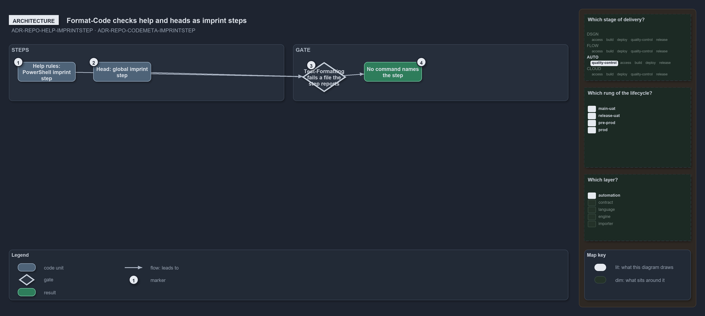

---
catzc:
  warning: "Experimental: this article merges two rules into one and holds nothing beyond what they say"
  edges:
    cites:
      - ADR-REPO-HELP-IMPRINTSTEP
      - ADR-REPO-CODEMETA-IMPRINTSTEP
---

# Format code checks help and writes heads as imprint steps

This article is one rule: [ADR-REPO-HELP-IMPRINTSTEP](../../drs/repository/function-help.md#rule-adr-repo-help-imprintstep) and
[ADR-REPO-CODEMETA-IMPRINTSTEP](../../drs/repository/code-file-meta.md#rule-adr-repo-codemeta-imprintstep) merged into one. It holds nothing
beyond what those two rules say.

`Format-Code` checks the help rules as an imprint step of the PowerShell language, and `Test-Formatting` fails a file the step reports; no
command and no check names the step. It writes the head the same way, as a global imprint step the file-language registry lists once, so it
runs after the formatter of every language.

