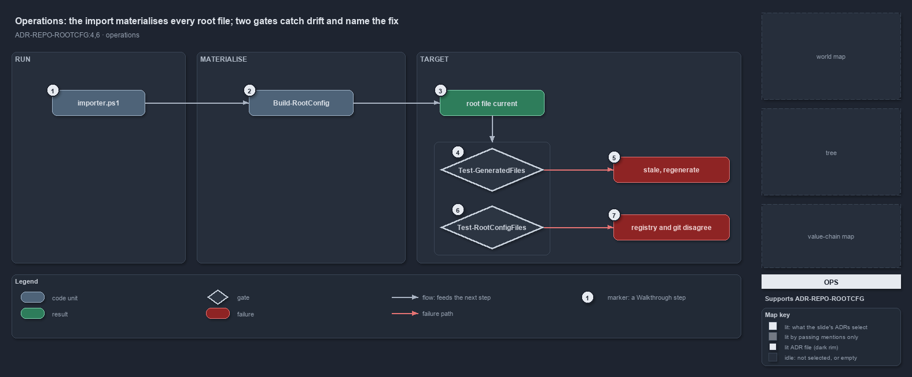

---
catzc:
  derived:
    path: docs/explanation/repository/import-materialises-two-gates-name-the-fix.md
    kind: explanation
    language: markdown
    filetype: md
    track: docs
    body_sha: "7e60f250283d"
    adrs:
      - ADR-REPO-ROOTCFG#{4,6}
    links:
      - docs/.assets/explanation/adr-repo-rootcfg--import-materialises-two-gates-name-the-fix--operations.drawio.md
      - docs/.assets/explanation/adr-repo-rootcfg--import-materialises-two-gates-name-the-fix--operations.drawio.png
      - docs/adr/repository/generated-root-configs.md
      - docs/explanation/index.md#how-to-read-the-diagrams
      - docs/explanation/repository/index.md
      - docs/explanation/repository/one-registry-one-writer-two-primitives.md
      - docs/explanation/repository/one-source-one-writer-one-boolean.md
      - docs/explanation/repository/opted-in-then-link-copy-or-render.md
      - docs/explanation/repository/three-gates-check-registry-drift-membership.md
---

# The import materialises every root file; two gates catch drift and name the fix

```text
The import materialises every managed root file, and two quality gates catch drift and name the fix.

1  importer.ps1               the entry: dot-sourced, its tail runs the writer silently on every load
2  Build-RootConfig           the command to run by hand, with -DryRun -PassThru to report and not write
3  root file current          the normal outcome: every target linked or written, a clean tree a no-op
4  Test-GeneratedFiles        the drift gate: it dry-runs the writer and reports every file it would change
5  stale, regenerate          its issue line, ending with the exact Build-RootConfig call that fixes it
6  Test-RootConfigFiles       the integrity gate: registry, .gitignore and the index must agree, links both ways
7  registry and git disagree  its issue lines: git rm --cached for a tracked copy, re-run the importer for a link

Supports ADR-REPO-ROOTCFG#4 and #6 (operations lens).
```

A developer never writes a managed root file. Running `. ./importer.ps1` materialises every opted-in target before the prompt returns, and
on a clean tree nothing is printed and nothing is written. When a source changes, the next import regenerates its target; when something is
out of step with the registry, one of two quality gates says which file and what to run.



The diagram is described element by element in
[its asset description](../../.assets/explanation/adr-repo-rootcfg--import-materialises-two-gates-name-the-fix--operations.drawio.md).

## Walkthrough

1. **importer.ps1.** The dot-sourced entry point delegates to `Invoke-Importer`, whose tail calls `Build-RootConfig -Silent` on every load.
   The call is guarded, so a bootstrap sandbox without the module skips it, and in build mode the writer reports a skip instead of throwing,
   because a janitor never breaks the load.
2. **Build-RootConfig.** Run by hand, the writer prints one line per managed file under `-Verbose`: `regenerated` or `unchanged` for a
   written file, `linked` or `link current` for a link, each with the source it came from. `Build-RootConfig -DryRun -PassThru` composes the
   same content, writes nothing, and returns one result per file saying whether it would change. `Build-RootConfig '<path>'` materialises
   one entry, or one file of a wildcard entry, and throws when no opted-in entry targets the path.
3. **Root file current.** The normal outcome. Every opted-in target is a link to its source or a real file equal to what the writer
   composes, so a second run changes nothing.
4. **Test-GeneratedFiles.** The drift check runs `Build-RootConfig -DryRun -PassThru -Silent` and turns every result that would change into
   an issue, attributed to the generator that renders the file or to `Build-RootConfig` for a copy.
5. **Stale, regenerate.** The issue reads `<path>: stale — <generator> would change it; regenerate with: Build-RootConfig '<path>'`. The
   gate writes its report under `out/test-generated-files/` and throws once listing every issue.
6. **Test-RootConfigFiles.** The integrity check asserts every opted-in target, a wildcard entry per rendered file, against
   `git check-ignore` and the index: a `committed: false` target must be ignored and untracked, a `committed: true` target tracked and not
   ignored, a `copyAsLink` target an effective link to its source from this OS, and any other target a real file. The L2 integrity test runs
   it and expects zero issues.
7. **Registry and git disagree.** Each issue names its remedy: `git rm --cached <path>` for a copy that is tracked, "re-run the importer"
   for a link that is missing, stale or not a link, or for a copy that is still a link. A third quality gate, `Test-RootAnalyzerSettings`,
   proves the root analyzer settings parse through their link.

## Why it holds

- Generation is idempotent and runs on every import, so the import is the only command a developer needs; a stale target is a defect the
  gates report, never a step to remember (ADR-REPO-ROOTCFG#4).
- The registry, `.gitignore` and git's tracked set must agree, every `copyAsLink` target must be an effective link, and no other managed
  target may be a link; an integrity test asserts it from the registry outward (ADR-REPO-ROOTCFG#6).

## Where the code and the ADR differ

ADR-REPO-ROOTCFG#6 places the drift check, a generator target matching its generator's output, inside the integrity test;
`Test-RootConfigFiles` compares no content, and the drift check is `Test-GeneratedFiles`.

## See also

- [Generated root configs](../../adr/repository/generated-root-configs.md) — the decision this article explains.
- The other lenses on the same mechanism: [meta](one-source-one-writer-one-boolean.md),
  [architecture](one-registry-one-writer-two-primitives.md), [implementation](opted-in-then-link-copy-or-render.md) and
  [governance](three-gates-check-registry-drift-membership.md).
- [The repository explanations](index.md) · [How to read the diagrams](../index.md#how-to-read-the-diagrams)
