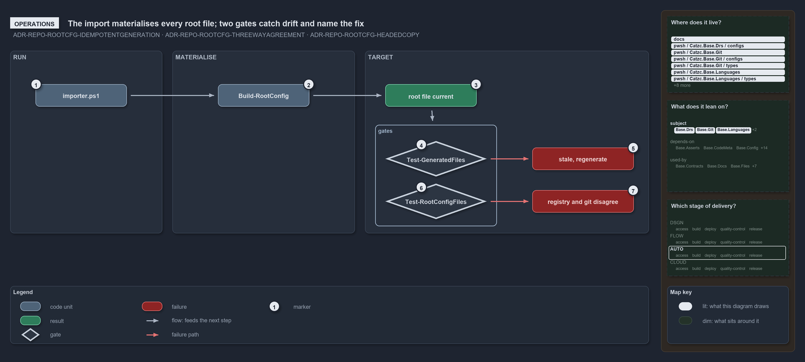

---
catzc:
  warning: "Header is generated by Format-FileMeta via Format-Code; do not change it"
  edges:
    cites:
      - ADR-REPO-ROOTCFG-IDEMPOTENTGENERATION
      - ADR-REPO-ROOTCFG-THREEWAYAGREEMENT
      - ADR-REPO-ROOTCFG-HEADEDCOPY
    drs_total: 3
---

# The import materialises every root file; two gates catch drift and name the fix

```text
The import materialises every managed root file, and two quality gates catch drift and name the fix.

1  importer.ps1               the entry: dot-sourced, its tail runs the writer silently on every load
2  Build-RootConfig           the command to run by hand, with -DryRun -PassThru to report and not write
3  root file current          the normal outcome: every target a headed file equal to what the writer composes, a clean tree a no-op
4  Test-GeneratedFiles        the drift gate: it dry-runs the writer and reports every file it would change
5  stale, regenerate          its issue line, ending with the exact Build-RootConfig call that fixes it
6  Test-RootConfigFiles       the integrity gate: registry, .gitignore, the index and the headed copies must agree, no target a link
7  registry and git disagree  its issue lines: git rm --cached for a tracked copy, re-run the importer for a link or a stale copy

Supports ADR-REPO-ROOTCFG-IDEMPOTENTGENERATION, ADR-REPO-ROOTCFG-THREEWAYAGREEMENT and ADR-REPO-ROOTCFG-HEADEDCOPY (operations lens).
```

A developer never writes a managed root file. Running `. ./importer.ps1` materialises every opted-in target before the prompt returns, and
on a clean tree nothing is printed and nothing is written. When a source changes, the next import regenerates its target; when something is
out of step with the registry, one of two quality gates says which file and what to run.

```yml drawio
description:
  Every import runs the root-file writer, which leaves each managed root file a current headed file; the drift gate and the integrity gate
  each report the file and the exact fix when something is out of step.
about:
  adrs: [ADR-REPO-ROOTCFG-IDEMPOTENTGENERATION, ADR-REPO-ROOTCFG-THREEWAYAGREEMENT, ADR-REPO-ROOTCFG-HEADEDCOPY]
  lens: operations
content:
  title: The import materialises every root file; two gates catch drift and name the fix
  kind: explanation
  flow: left-to-right
  relation: feeds the next step
  theme: dark
  bands:
    - { id: band-run, label: RUN }
    - { id: band-materialise, label: MATERIALISE }
    - { id: band-target, label: TARGET }
  groups:
    - { id: grp-gates, label: gates, in: band-target }
  glyphs:
    - { id: g-importer, kind: code, label: importer.ps1, in: band-run }
    - { id: g-build-root-config, kind: code, label: Build-RootConfig, in: band-materialise }
    - { id: r-current, kind: result, label: root file current, in: band-target }
    - { id: g-generated-files, kind: gate, label: Test-GeneratedFiles, in: grp-gates }
    - { id: g-root-config-files, kind: gate, label: Test-RootConfigFiles, in: grp-gates }
    - { id: f-stale, kind: failure, label: "stale, regenerate", in: band-target }
    - { id: f-disagree, kind: failure, label: registry and git disagree, in: band-target }
  edges:
    - { from: g-importer, to: g-build-root-config, kind: flow, label: "" }
    - { from: g-build-root-config, to: r-current, kind: flow, label: "" }
    - { from: r-current, to: grp-gates, kind: flow, label: "" }
    - { from: g-generated-files, to: f-stale, kind: fail, label: "" }
    - { from: g-root-config-files, to: f-disagree, kind: fail, label: "" }
  markers:
    - { at: g-importer, number: 1 }
    - { at: g-build-root-config, number: 2 }
    - { at: r-current, number: 3 }
    - { at: g-generated-files, number: 4 }
    - { at: f-stale, number: 5 }
    - { at: g-root-config-files, number: 6 }
    - { at: f-disagree, number: 7 }
  legend: auto
  minimaps:
    code-locations:
      - cell: docs/-/.
        by:
          - docs/drs/index.md
          - docs/drs/repository/dora-explains.md
          - docs/drs/repository/generated-root-configs.md
          - docs/references/pwsh/catzc-base-git/New-GitIgnore.ps1.md
          - docs/references/pwsh/catzc-base-git/configs/gitignore.yml.md
          - docs/references/pwsh/catzc-base-git/types/GitIgnoreConfig.cs.md
          - docs/references/pwsh/catzc-base-languages.md
          - docs/references/pwsh/catzc-base-languages/New-GoWorkspace.ps1.md
          - docs/references/pwsh/catzc-base-languages/types/GoWorkspaceFile.cs.md
          - docs/references/pwsh/catzc-base-languages/types/PythonWorkspaceFile.cs.md
          - docs/references/pwsh/catzc-base-root-config.md
          - docs/references/pwsh/catzc-base-root-config/Build-RootConfig.ps1.md
          - docs/references/pwsh/catzc-base-root-config/New-GitAttributes.ps1.md
          - docs/references/pwsh/catzc-base-root-config/Test-RootAnalyzerSettings.ps1.md
          - docs/references/pwsh/catzc-base-root-config/Test-RootConfigFiles.ps1.md
          - docs/references/pwsh/catzc-base-root-config/configs/rootconfig.yml.md
          - docs/references/pwsh/catzc-base-root-config/private/Get-RootConfigCopyContent.ps1.md
          - docs/references/pwsh/catzc-base-root-config/private/Get-RootConfigRenderedFile.ps1.md
          - docs/references/pwsh/catzc-base-root-config/private/Get-RootConfigTargets.ps1.md
          - docs/references/pwsh/catzc-base-root-config/tests/Test-RootConfigIntegrity.Tests.ps1.md
          - docs/references/pwsh/catzc-base-root-config/types/RootConfigFiles.cs.md
          - docs/references/pwsh/catzc-base-vs-code/New-VsCodeExtensions.ps1.md
          - docs/references/pwsh/catzc-base-vs-code/New-VsCodeLaunch.ps1.md
          - docs/references/pwsh/catzc-base-vs-code/New-VsCodePipelineSchema.ps1.md
          - docs/references/pwsh/catzc-base-vs-code/New-VsCodeSettings.ps1.md
          - docs/references/pwsh/catzc-base-vs-code/New-VsCodeTasks.ps1.md
          - docs/references/pwsh/catzc-base-vs-code/configs/vscode-extensions.yml.md
          - docs/references/pwsh/catzc-base-vs-code/configs/vscode-launch.yml.md
          - docs/references/pwsh/catzc-base-vs-code/configs/vscode-pipeline-schema.yml.md
          - docs/references/pwsh/catzc-base-vs-code/configs/vscode-settings.yml.md
          - docs/references/pwsh/catzc-base-vs-code/types/VscodeExtensionsConfig.cs.md
          - docs/references/pwsh/catzc-base-vs-code/types/VscodeLaunchConfig.cs.md
          - docs/references/pwsh/catzc-base-vs-code/types/VscodePipelineSchemaConfig.cs.md
          - docs/references/pwsh/catzc-base-vs-code/types/VscodeSettingsConfig.cs.md
          - docs/references/pwsh/internal/Catzc.Internal.Importer.psm1.md
          - ADR-REPO-ROOTCFG-HEADEDCOPY
          - ADR-REPO-ROOTCFG-IDEMPOTENTGENERATION
          - ADR-REPO-ROOTCFG-THREEWAYAGREEMENT
      - cell: pwsh/Catzc.Base.Drs/configs
        by:
          - pwsh/Catzc.Base.Drs/configs/drs.yml
          - ADR-REPO-ROOTCFG-HEADEDCOPY
          - ADR-REPO-ROOTCFG-IDEMPOTENTGENERATION
          - ADR-REPO-ROOTCFG-THREEWAYAGREEMENT
      - cell: pwsh/Catzc.Base.Git/.
        by:
          - pwsh/Catzc.Base.Git/New-GitIgnore.ps1
          - ADR-REPO-ROOTCFG-HEADEDCOPY
          - ADR-REPO-ROOTCFG-IDEMPOTENTGENERATION
          - ADR-REPO-ROOTCFG-THREEWAYAGREEMENT
      - cell: pwsh/Catzc.Base.Git/configs
        by:
          - pwsh/Catzc.Base.Git/configs/gitignore.yml
          - ADR-REPO-ROOTCFG-HEADEDCOPY
          - ADR-REPO-ROOTCFG-IDEMPOTENTGENERATION
          - ADR-REPO-ROOTCFG-THREEWAYAGREEMENT
      - cell: pwsh/Catzc.Base.Git/types
        by:
          - pwsh/Catzc.Base.Git/types/GitIgnoreConfig.cs
          - ADR-REPO-ROOTCFG-HEADEDCOPY
          - ADR-REPO-ROOTCFG-IDEMPOTENTGENERATION
          - ADR-REPO-ROOTCFG-THREEWAYAGREEMENT
      - cell: pwsh/Catzc.Base.Languages/.
        by:
          - pwsh/Catzc.Base.Languages/New-GoWorkspace.ps1
          - ADR-REPO-ROOTCFG-HEADEDCOPY
          - ADR-REPO-ROOTCFG-IDEMPOTENTGENERATION
          - ADR-REPO-ROOTCFG-THREEWAYAGREEMENT
      - cell: pwsh/Catzc.Base.Languages/types
        by:
          - pwsh/Catzc.Base.Languages/types/GoWorkspaceFile.cs
          - pwsh/Catzc.Base.Languages/types/PythonWorkspaceFile.cs
          - ADR-REPO-ROOTCFG-HEADEDCOPY
          - ADR-REPO-ROOTCFG-IDEMPOTENTGENERATION
          - ADR-REPO-ROOTCFG-THREEWAYAGREEMENT
      - cell: pwsh/Catzc.Base.RootConfig/.
        by:
          - pwsh/Catzc.Base.RootConfig/Build-RootConfig.ps1
          - pwsh/Catzc.Base.RootConfig/New-GitAttributes.ps1
          - pwsh/Catzc.Base.RootConfig/Test-RootAnalyzerSettings.ps1
          - pwsh/Catzc.Base.RootConfig/Test-RootConfigFiles.ps1
          - ADR-REPO-ROOTCFG-HEADEDCOPY
          - ADR-REPO-ROOTCFG-IDEMPOTENTGENERATION
          - ADR-REPO-ROOTCFG-THREEWAYAGREEMENT
      - cell: pwsh/Catzc.Base.RootConfig/configs
        by:
          - pwsh/Catzc.Base.RootConfig/configs/rootconfig.yml
          - ADR-REPO-ROOTCFG-HEADEDCOPY
          - ADR-REPO-ROOTCFG-IDEMPOTENTGENERATION
          - ADR-REPO-ROOTCFG-THREEWAYAGREEMENT
      - cell: pwsh/Catzc.Base.RootConfig/private
        by:
          - pwsh/Catzc.Base.RootConfig/private/Get-RootConfigCopyContent.ps1
          - pwsh/Catzc.Base.RootConfig/private/Get-RootConfigRenderedFile.ps1
          - pwsh/Catzc.Base.RootConfig/private/Get-RootConfigTargets.ps1
          - ADR-REPO-ROOTCFG-HEADEDCOPY
          - ADR-REPO-ROOTCFG-IDEMPOTENTGENERATION
          - ADR-REPO-ROOTCFG-THREEWAYAGREEMENT
      - cell: pwsh/Catzc.Base.RootConfig/tests
        by:
          - pwsh/Catzc.Base.RootConfig/tests/Test-RootConfigIntegrity.Tests.ps1
          - ADR-REPO-ROOTCFG-HEADEDCOPY
          - ADR-REPO-ROOTCFG-IDEMPOTENTGENERATION
          - ADR-REPO-ROOTCFG-THREEWAYAGREEMENT
      - cell: pwsh/Catzc.Base.RootConfig/types
        by:
          - pwsh/Catzc.Base.RootConfig/types/RootConfigFiles.cs
          - ADR-REPO-ROOTCFG-HEADEDCOPY
          - ADR-REPO-ROOTCFG-IDEMPOTENTGENERATION
          - ADR-REPO-ROOTCFG-THREEWAYAGREEMENT
      - cell: pwsh/Catzc.Base.VSCode/.
        by:
          - pwsh/Catzc.Base.VSCode/New-VSCodeExtensions.ps1
          - pwsh/Catzc.Base.VSCode/New-VSCodeLaunch.ps1
          - pwsh/Catzc.Base.VSCode/New-VSCodePipelineSchema.ps1
          - pwsh/Catzc.Base.VSCode/New-VSCodeSettings.ps1
          - pwsh/Catzc.Base.VSCode/New-VSCodeTasks.ps1
          - ADR-REPO-ROOTCFG-HEADEDCOPY
          - ADR-REPO-ROOTCFG-IDEMPOTENTGENERATION
          - ADR-REPO-ROOTCFG-THREEWAYAGREEMENT
      - cell: pwsh/Catzc.Base.VSCode/configs
        by:
          - pwsh/Catzc.Base.VSCode/configs/vscode-extensions.yml
          - pwsh/Catzc.Base.VSCode/configs/vscode-launch.yml
          - pwsh/Catzc.Base.VSCode/configs/vscode-pipeline-schema.yml
          - pwsh/Catzc.Base.VSCode/configs/vscode-settings.yml
          - ADR-REPO-ROOTCFG-HEADEDCOPY
          - ADR-REPO-ROOTCFG-IDEMPOTENTGENERATION
          - ADR-REPO-ROOTCFG-THREEWAYAGREEMENT
      - cell: pwsh/Catzc.Base.VSCode/types
        by:
          - pwsh/Catzc.Base.VSCode/types/VscodeExtensionsConfig.cs
          - pwsh/Catzc.Base.VSCode/types/VscodeLaunchConfig.cs
          - pwsh/Catzc.Base.VSCode/types/VscodePipelineSchemaConfig.cs
          - pwsh/Catzc.Base.VSCode/types/VscodeSettingsConfig.cs
          - pwsh/Catzc.Base.VSCode/types/VscodeTasksConfig.cs
          - ADR-REPO-ROOTCFG-HEADEDCOPY
          - ADR-REPO-ROOTCFG-IDEMPOTENTGENERATION
          - ADR-REPO-ROOTCFG-THREEWAYAGREEMENT
    module-neighbourhood:
      - cell: subject/Catzc.Base.Drs
        by:
          - pwsh/Catzc.Base.Drs/configs/drs.yml
          - ADR-REPO-ROOTCFG-HEADEDCOPY
          - ADR-REPO-ROOTCFG-IDEMPOTENTGENERATION
          - ADR-REPO-ROOTCFG-THREEWAYAGREEMENT
      - cell: subject/Catzc.Base.Git
        by:
          - pwsh/Catzc.Base.Git/New-GitIgnore.ps1
          - pwsh/Catzc.Base.Git/configs/gitignore.yml
          - pwsh/Catzc.Base.Git/types/GitIgnoreConfig.cs
          - ADR-REPO-ROOTCFG-HEADEDCOPY
          - ADR-REPO-ROOTCFG-IDEMPOTENTGENERATION
          - ADR-REPO-ROOTCFG-THREEWAYAGREEMENT
      - cell: subject/Catzc.Base.Languages
        by:
          - pwsh/Catzc.Base.Languages/New-GoWorkspace.ps1
          - pwsh/Catzc.Base.Languages/types/GoWorkspaceFile.cs
          - pwsh/Catzc.Base.Languages/types/PythonWorkspaceFile.cs
          - ADR-REPO-ROOTCFG-HEADEDCOPY
          - ADR-REPO-ROOTCFG-IDEMPOTENTGENERATION
          - ADR-REPO-ROOTCFG-THREEWAYAGREEMENT
      - cell: subject/Catzc.Base.RootConfig
        by:
          - pwsh/Catzc.Base.RootConfig/Build-RootConfig.ps1
          - pwsh/Catzc.Base.RootConfig/New-GitAttributes.ps1
          - pwsh/Catzc.Base.RootConfig/Test-RootAnalyzerSettings.ps1
          - pwsh/Catzc.Base.RootConfig/Test-RootConfigFiles.ps1
          - pwsh/Catzc.Base.RootConfig/configs/rootconfig.yml
          - pwsh/Catzc.Base.RootConfig/private/Get-RootConfigCopyContent.ps1
          - pwsh/Catzc.Base.RootConfig/private/Get-RootConfigRenderedFile.ps1
          - pwsh/Catzc.Base.RootConfig/private/Get-RootConfigTargets.ps1
          - pwsh/Catzc.Base.RootConfig/tests/Test-RootConfigIntegrity.Tests.ps1
          - pwsh/Catzc.Base.RootConfig/types/RootConfigFiles.cs
          - ADR-REPO-ROOTCFG-HEADEDCOPY
          - ADR-REPO-ROOTCFG-IDEMPOTENTGENERATION
          - ADR-REPO-ROOTCFG-THREEWAYAGREEMENT
      - cell: subject/Catzc.Base.VSCode
        by:
          - pwsh/Catzc.Base.VSCode/New-VSCodeExtensions.ps1
          - pwsh/Catzc.Base.VSCode/New-VSCodeLaunch.ps1
          - pwsh/Catzc.Base.VSCode/New-VSCodePipelineSchema.ps1
          - pwsh/Catzc.Base.VSCode/New-VSCodeSettings.ps1
          - pwsh/Catzc.Base.VSCode/New-VSCodeTasks.ps1
          - pwsh/Catzc.Base.VSCode/configs/vscode-extensions.yml
          - pwsh/Catzc.Base.VSCode/configs/vscode-launch.yml
          - pwsh/Catzc.Base.VSCode/configs/vscode-pipeline-schema.yml
          - pwsh/Catzc.Base.VSCode/configs/vscode-settings.yml
          - pwsh/Catzc.Base.VSCode/types/VscodeExtensionsConfig.cs
          - pwsh/Catzc.Base.VSCode/types/VscodeLaunchConfig.cs
          - pwsh/Catzc.Base.VSCode/types/VscodePipelineSchemaConfig.cs
          - pwsh/Catzc.Base.VSCode/types/VscodeSettingsConfig.cs
          - pwsh/Catzc.Base.VSCode/types/VscodeTasksConfig.cs
          - ADR-REPO-ROOTCFG-HEADEDCOPY
          - ADR-REPO-ROOTCFG-IDEMPOTENTGENERATION
          - ADR-REPO-ROOTCFG-THREEWAYAGREEMENT
    axis:
      - cell: AUTO/*
        by: [ADR-REPO-ROOTCFG-HEADEDCOPY, ADR-REPO-ROOTCFG-IDEMPOTENTGENERATION, ADR-REPO-ROOTCFG-THREEWAYAGREEMENT]
layout:
  band-run: { x: 20, y: 84, w: 300, h: 360 }
  band-materialise: { x: 340, y: 84, w: 360, h: 360 }
  band-target: { x: 720, y: 84, w: 560, h: 360 }
  g-importer: { x: 70, y: 150, w: 180, h: 44 }
  g-build-root-config: { x: 430, y: 150, w: 180, h: 44 }
  r-current: { x: 760, y: 150, w: 180, h: 44 }
  grp-gates: { x: 740, y: 230, w: 240, h: 200 }
  g-generated-files: { x: 760, y: 262, w: 200, h: 70 }
  g-root-config-files: { x: 760, y: 346, w: 200, h: 70 }
  f-stale: { x: 1050, y: 275, w: 200, h: 44 }
  f-disagree: { x: 1050, y: 359, w: 200, h: 44 }
```



## Walkthrough

1. **importer.ps1.** The dot-sourced entry point delegates to `Invoke-Importer`, whose tail calls `Build-RootConfig -Silent` on every load.
   The call is guarded, so a bootstrap sandbox without the module skips it, and in build mode the writer reports a skip instead of throwing,
   because a janitor never breaks the load.
2. **Build-RootConfig.** Run by hand, the writer prints one line per managed file under `-Verbose`: `regenerated` or `unchanged` for a file,
   `regenerated` or `unchanged`, each with the source it came from. A target still left as a link from before is deleted before the write
   and counts as regenerated. `Build-RootConfig -DryRun -PassThru` composes the same content, writes nothing, and returns one result per
   file saying whether it would change. `Build-RootConfig '<path>'` materialises one entry, or one file of a wildcard entry, and throws when
   no opted-in entry targets the path.
3. **Root file current.** The normal outcome. Every opted-in target is a real file equal to what the writer composes: the template under its
   generated-file head, or the generator's output under it. A second run changes nothing.
4. **Test-GeneratedFiles.** The drift check runs `Build-RootConfig -DryRun -PassThru -Silent` and turns every result that would change into
   an issue, attributed to the generator that renders the file or to `Build-RootConfig` for a headed copy.
5. **Stale, regenerate.** The issue reads `<path>: stale — <generator> would change it; regenerate with: Build-RootConfig '<path>'`. The
   gate writes its report under `out/test-generated-files/` and throws once listing every issue.
6. **Test-RootConfigFiles.** The integrity check asserts every opted-in target, a wildcard entry per rendered file, against
   `git check-ignore` and the index: a `committed: false` target must be ignored and untracked, a `committed: true` target tracked and not
   ignored, and no target a link. A `source` target must also be its template under the generated-file head, byte for byte once the line
   endings are LF. The L2 integrity test runs it and expects zero issues.
7. **Registry and git disagree.** Each issue names its remedy: `git rm --cached <path>` for a gitignored artifact that is tracked, "re-run
   the importer" for a target that is a link or a copy that is missing, and "edit the template, then re-run the importer" for a copy that
   differs from its template under its head. A third quality gate, `Test-RootAnalyzerSettings`, proves the root analyzer settings file
   exists and parses as a non-empty settings hashtable.

## Why it holds

- Generation is idempotent and runs on every import, so the import is the only command a developer needs; a stale target is a defect the
  gates report, never a step to remember (ADR-REPO-ROOTCFG-IDEMPOTENTGENERATION).
- The registry, `.gitignore` and git's tracked set must agree, every `source` target must equal its template under the head, and no managed
  target may be a link; an integrity test asserts it from the registry outward (ADR-REPO-ROOTCFG-THREEWAYAGREEMENT).
- A `source` target is a headed copy of its template, never a link, so a write never reaches the template (ADR-REPO-ROOTCFG-HEADEDCOPY).

## Where the code and the decision record differ

ADR-REPO-ROOTCFG-THREEWAYAGREEMENT places the drift check, a generator target matching its generator's output, inside the integrity test;
`Test-RootConfigFiles` compares the content of the `source` copies with their templates but not the output of any generator, and the
generator drift check is `Test-GeneratedFiles`.

## See also

- [Generated root configs](../../drs/repository/generated-root-configs.md) — the decision this article explains.
- The other lenses on the same mechanism: [meta](one-source-one-writer-one-boolean.md),
  [architecture](one-registry-one-writer-two-primitives.md), [implementation](opted-in-then-link-copy-or-render.md) and
  [governance](three-gates-check-registry-drift-membership.md).
- [The repository explanations](index.md) · [How to read the diagrams](../index.md#how-to-read-the-diagrams)
