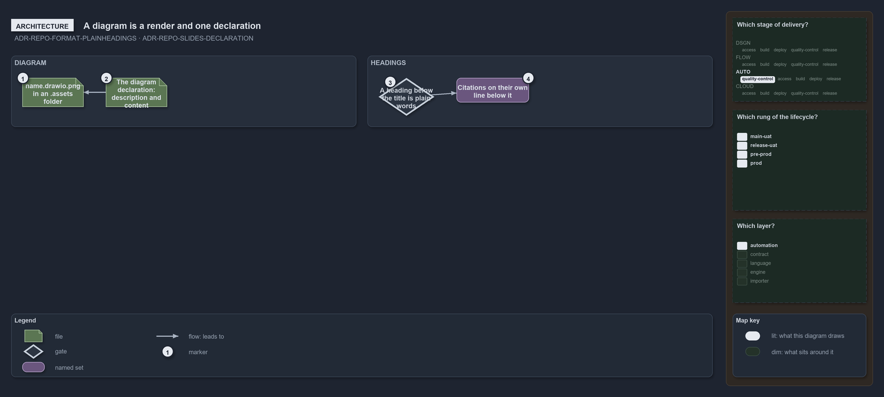

---
catzc:
  warning: "Experimental: this article merges two rules into one and holds nothing beyond what they say"
  edges:
    cites:
      - ADR-REPO-FORMAT-PLAINHEADINGS
      - ADR-REPO-SLIDES-DECLARATION
---

# Markdown headings are plain words and a diagram is a render with one declaration

This article is one rule: [ADR-REPO-FORMAT-PLAINHEADINGS](../../drs/repository/uniform-formatting.md#rule-adr-repo-format-plainheadings) and
[ADR-REPO-SLIDES-DECLARATION](../../drs/repository/slides-as-markdown.md#rule-adr-repo-slides-declaration) merged into one. It holds nothing
beyond what those two rules say.

A Markdown heading below the title is plain words with an anchor unique in its document; a trailing group of code spans, a file name, a path
or a citation, sits on its own line below the heading. A diagram is its render `<name>.drawio.png` in an `.assets/` folder, named by the
diagram, and its one source is the diagram declaration, whose `description:` says in a sentence or two what the diagram shows.

