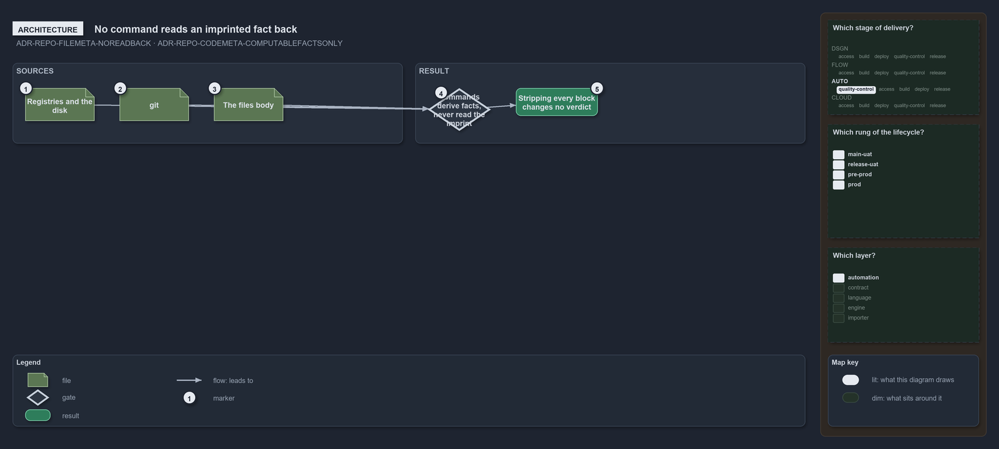

---
catzc:
  warning: "Experimental: this article merges two rules into one and holds nothing beyond what they say"
  edges:
    cites:
      - ADR-REPO-FILEMETA-NOREADBACK
      - ADR-REPO-CODEMETA-COMPUTABLEFACTSONLY
---

# No command reads an imprinted fact back and a code head holds two edges

This article is one rule: [ADR-REPO-FILEMETA-NOREADBACK](../../drs/repository/file-meta.md#rule-adr-repo-filemeta-noreadback) and
[ADR-REPO-CODEMETA-COMPUTABLEFACTSONLY](../../drs/repository/code-file-meta.md#rule-adr-repo-codemeta-computablefactsonly) merged into one.
It holds nothing beyond what those two rules say.

No command reads an imprinted fact back: a gate, a generator or a resolver that needs a place fact or an edge of a file derives it from the
registries, git, the disk and the file's body, so stripping every block changes no verdict. An authored code or config file's head is the
navigation head and holds exactly two edges under `edges`, `cites` and `docs`.

