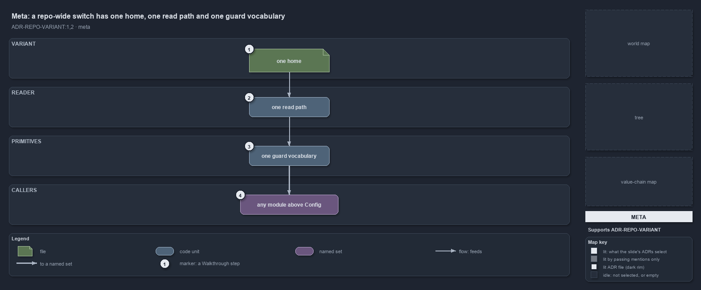

---
catzc:
  immutable:
    with_body_sha: "7272a8567547"
    path: docs/explanation/repository/one-home-one-read-path-one-vocabulary.md
    folder: docs/explanation/repository
    name: one-home-one-read-path-one-vocabulary
    filetype: md
    kind: explanation
    language: markdown
    track: docs
  edges:
    cites:
      - ADR-AUTO-CACHE#6
      - ADR-PWSH-CACHE#1
      - ADR-REPO-VARIANT#{1,2}
    links:
      - docs/.assets/explanation/adr-repo-variant--one-home-one-read-path-one-vocabulary--meta.drawio.md
      - docs/.assets/explanation/adr-repo-variant--one-home-one-read-path-one-vocabulary--meta.drawio.png
      - docs/adr/repository/repo-variants.md
      - docs/explanation/index.md#how-to-read-the-diagrams
      - docs/explanation/repository/a-base-module-between-config-and-its-callers.md
      - docs/explanation/repository/an-edit-lands-at-the-next-import.md
      - docs/explanation/repository/five-keys-one-reader-twelve-primitives.md
      - docs/explanation/repository/index.md
      - docs/explanation/repository/values-and-edges-gated-reads-reviewed.md
---

# A repo-wide switch has one home, one read path and one guard vocabulary

```text
A repo-wide switch has one home, one read path and one guard vocabulary.

1  one home                 the variant file: every repo-wide switch is a key in it
2  one read path            the private reader: the only place the file is read
3  one guard vocabulary     the Get-/Test-/Assert- primitives a caller asks instead of reading a key
4  any module above Config  the callers: every module layered above the configuration layer

Supports ADR-REPO-VARIANT#1 and #2 (meta lens).
```

Some settings belong to the whole repository and hold for a whole run: which Azure naming convention every resource name uses, whether this
repository deploys for customers at all, how changes reach main. Cats calls such a setting a variant. A variant has one home, one read path
and one guard vocabulary, and nothing reads the file it lives in directly.



The diagram is described element by element in
[its asset description](../../.assets/explanation/adr-repo-variant--one-home-one-read-path-one-vocabulary--meta.drawio.md).

## Walkthrough

1. **One home.** A variant is a key in one file, a growing dictionary that gains a key whenever a new repo-wide switch is genuinely needed.
   It is not a per-module config and not an environment variable, so a "this whole repository works this way" decision has exactly one place
   to live.
2. **One read path.** One private reader is the only place the file is read. It goes through the ordinary configuration loader, so the value
   is read once per importer session and cached: every caller sees the same answer, and re-running the importer is the only way to pick up
   an edit.
3. **One guard vocabulary.** Each variant is exposed as typed primitives: a value accessor, predicates that answer a boolean, and guards
   that throw with an actionable message. All of them route through the one reader, so each variant's default lives in exactly one place.
4. **Any module above Config.** The primitives are callable from every module layered above the configuration layer, which is every real
   consumer. A caller never mentions the file or a raw key; it asks a named question.

## Why it holds

- A repo-wide variant is a session-fixed setting declared in `configs/variants.yml` in `Catzc.Base.Variants` and read through
  `Get-Config -Config variants`, so it inherits the session cache (ADR-REPO-VARIANT#1).
- Nothing reads `variants.yml` directly; each variant is exposed as `Get-`, `Test-` and `Assert-` primitives over the private `Get-Variant`
  reader, the single access point (ADR-REPO-VARIANT#2).
- "Fixed for the session" is the ordinary configuration cache boundary: the only invalidation is re-running the importer (ADR-AUTO-CACHE#6),
  and the cache lives in module script state that the importer boundary resets (ADR-PWSH-CACHE#1).

## Where the code and the ADR differ

One reader is the rule, and one caller breaks it: `Get-WorldMap` in `Catzc.Base.Maps` reads the `aspects` key straight off the loaded
variants config instead of asking `Get-Aspect`, so the file has a second read path today.

## See also

- [Repo-wide variants](../../adr/repository/repo-variants.md) — the decision this article explains.
- The other lenses on the same diagram: [architecture](a-base-module-between-config-and-its-callers.md),
  [implementation](five-keys-one-reader-twelve-primitives.md), [operations](an-edit-lands-at-the-next-import.md) and
  [governance](values-and-edges-gated-reads-reviewed.md).
- [The repository explanations](index.md) · [How to read the diagrams](../index.md#how-to-read-the-diagrams)
