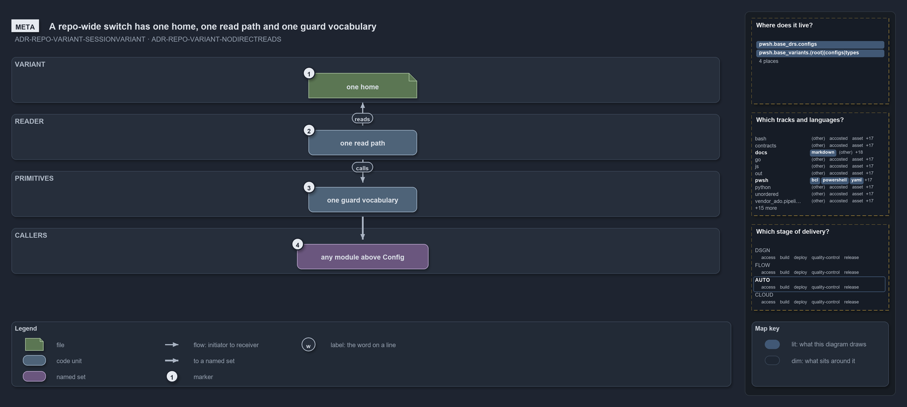

# A repo-wide switch has one home, one read path and one guard vocabulary

```text
A repo-wide switch has one home, one read path and one guard vocabulary.

1  one home                 the variant file: every repo-wide switch is a key in it
2  one read path            the private reader: the only place the file is read
3  one guard vocabulary     the Get-/Test-/Assert- primitives a caller asks instead of reading a key
4  any module above Config  the callers: every module layered above the configuration layer

Supports ADR-REPO-VARIANT-SESSIONVARIANT and ADR-REPO-VARIANT-NODIRECTREADS (meta lens).
```

Some settings belong to the whole repository and hold for a whole run: which Azure naming convention every resource name uses, whether this
repository deploys for customers at all, how changes reach main. Cats calls such a setting a variant. A variant has one home, one read path
and one guard vocabulary, and nothing reads the file it lives in directly.

```yml drawio
description:
  A repo-wide switch lives in one file, is read through one private reader, is asked through one guard vocabulary, and is called from any
  module above Config.
about:
  adrs: [ADR-REPO-VARIANT-SESSIONVARIANT, ADR-REPO-VARIANT-NODIRECTREADS]
  lens: meta
content:
  title: A repo-wide switch has one home, one read path and one guard vocabulary
  kind: explanation
  flow: top-to-bottom
  relation: feeds
  theme: dark
  bands:
    - { id: band-variant, label: VARIANT }
    - { id: band-reader, label: READER }
    - { id: band-primitives, label: PRIMITIVES }
    - { id: band-callers, label: CALLERS }
  glyphs:
    - { id: g-home, kind: file, label: one home, in: band-variant }
    - { id: g-read-path, kind: code, label: one read path, in: band-reader }
    - { id: g-vocabulary, kind: code, label: one guard vocabulary, in: band-primitives }
    - { id: g-callers, kind: set, label: any module above Config, in: band-callers }
  edges:
    - { from: g-home, to: g-read-path, kind: flow, label: "" }
    - { from: g-read-path, to: g-vocabulary, kind: flow, label: "" }
    - { from: g-vocabulary, to: g-callers, kind: thick, label: "" }
  markers:
    - { at: g-home, number: 1 }
    - { at: g-read-path, number: 2 }
    - { at: g-vocabulary, number: 3 }
    - { at: g-callers, number: 4 }
  legend: auto
  minimaps: [code-locations, grid, axis]
layout:
  band-variant: { x: 20, y: 84, w: 1240, h: 80 }
  band-reader: { x: 20, y: 184, w: 1240, h: 80 }
  band-primitives: { x: 20, y: 284, w: 1240, h: 80 }
  band-callers: { x: 20, y: 384, w: 1240, h: 80 }
  g-home: { x: 540, y: 112, w: 190, h: 44 }
  g-read-path: { x: 540, y: 212, w: 190, h: 44 }
  g-vocabulary: { x: 540, y: 312, w: 190, h: 44 }
  g-callers: { x: 520, y: 412, w: 230, h: 44 }
```



## Walkthrough

1. **One home.** A variant is a key in one file, a growing dictionary that gains a key whenever a new repo-wide switch is genuinely needed.
   It is not a per-module config and not an environment variable, so a "this whole repository works this way" decision has exactly one place
   to live.
2. **One read path.** One private reader is the only place the file is read. It goes through the ordinary configuration loader, so the value
   is read once per importer session and cached: every caller sees the same answer, and re-running the importer is the only way to pick up
   an edit.
3. **One guard vocabulary.** Each variant is exposed as typed primitives: a value accessor, predicates that answer a boolean, and guards
   that throw with an actionable message. All of them route through the one reader, so each variant's default lives in exactly one place.
4. **Any module above Config.** The primitives are callable from every module layered above the configuration layer, which is every real
   consumer. A caller never mentions the file or a raw key; it asks a named question.

## Why it holds

- A repo-wide variant is a session-fixed setting declared in `configs/variants.yml` in `Catzc.Base.Variants` and read through
  `Get-Config -Config variants`, so it inherits the session cache (ADR-REPO-VARIANT-SESSIONVARIANT).
- Nothing reads `variants.yml` directly; each variant is exposed as `Get-`, `Test-` and `Assert-` primitives over the private `Get-Variant`
  reader, the single access point (ADR-REPO-VARIANT-NODIRECTREADS).
- "Fixed for the session" is the ordinary configuration cache boundary: the only invalidation is re-running the importer
  (ADR-AUTO-CACHE-IMPORTERINVALIDATES), and the cache lives in module script state that the importer boundary resets
  (ADR-PWSH-CACHE-SCRIPTSCOPESTATE).

## Where the code and the decision record differ

One reader is the rule, and one module breaks it: `Get-Aspect` and `Test-AspectDeclaration` in `Catzc.Base.Modules` read the `aspects` key
straight off the loaded variants config instead of through `Get-Variant`, so the file has a second read path today.

## See also

- [Repo-wide variants](../../drs/repository/repo-variants.md) — the decision this article explains.
- The other lenses on the same diagram: [architecture](a-base-module-between-config-and-its-callers.md),
  [implementation](five-keys-one-reader-twelve-primitives.md), [operations](an-edit-lands-at-the-next-import.md) and
  [governance](values-and-edges-gated-reads-reviewed.md).
- [The repository explanations](index.md) · [How to read the diagrams](../index.md#how-to-read-the-diagrams)
