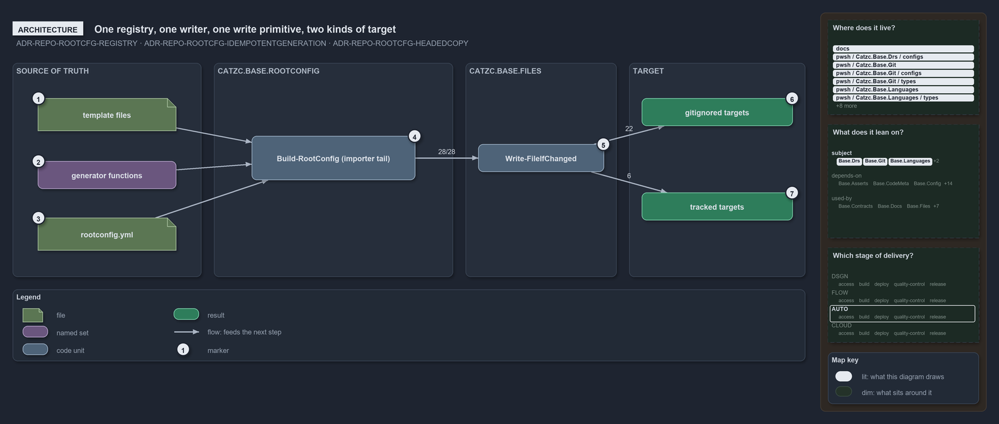

# One registry, one writer, one write primitive, two kinds of target

```text
Root config materialisation is one registry, one writer, one write primitive and two kinds of target.

1  template files          the files under pwsh/ that a source entry copies out under a generated-file head
2  generator functions     the eleven functions a generator entry names, bound in one dispatch
3  rootconfig.yml          the registry: 28 entries, each with one source of truth and two booleans
4  Build-RootConfig        the single writer, in Catzc.Base.RootConfig, run by the importer tail
5  Write-FileIfChanged     the one write primitive, in Catzc.Base.Files: all 28 entries are written through it
6  gitignored targets      22 targets git ignores
7  tracked targets         6 targets git keeps, because git or the bootstrap reads them before the importer runs

Supports ADR-REPO-ROOTCFG-REGISTRY, ADR-REPO-ROOTCFG-IDEMPOTENTGENERATION and ADR-REPO-ROOTCFG-HEADEDCOPY (architecture lens).
```

Root config materialisation in cats has four parts and one direction. Sources of truth sit under `pwsh/`; the registry in
`Catzc.Base.RootConfig` says how each one lands; the writer in the same module reproduces every target through the one write primitive that
`Catzc.Base.Files` owns; and the targets fall into two kinds that differ by one boolean. The dependency edges point one way, from the
RootConfig module to the Files module and to the modules that hold the generators, and nothing reads the registry back.



## Walkthrough

1. **Template files.** A `source` entry names a file kept under `pwsh/`, most of them in `Catzc.Base.RootConfig/assets/root/`. The root path
   is a copy of it under a generated-file head that names it as the source; the template itself stays the pure authored file.
2. **Generator functions.** A `generator` entry names a function that renders the file: `New-Importer`, `New-GitIgnore`,
   `New-GitAttributes`, `New-CatsCommandLookup`, the five `New-VsCode*` writers, `New-GoWorkspace` and `New-PythonProject`.
   `Invoke-RootConfigGenerator` is the one place a name is bound to its call, so an unknown name fails loudly.
3. **rootconfig.yml.** The registry lists 28 entries. Each names its target, exactly one source of truth, and the booleans `optIn` and
   `committed`. Nothing else in cats restates the target-to-source pairing.
4. **Build-RootConfig.** The single writer reads the registry, keeps the opted-in entries, and reproduces each target. The importer tail
   runs it on every load, silently; a clean tree is a no-op.
5. **Write-FileIfChanged.** Every entry hands its composed content, the generated-file head over the template or the generator's output, to
   the one shared write primitive: canonical output, a line-ending-insensitive compare, and a delete-then-write only on a real change.
   Before the write, `Build-RootConfig` deletes a target still left as a link from before, so no root file is a link.
6. **Gitignored targets.** 22 targets are gitignored, each matched by a `.gitignore` rule that `New-GitIgnore` injects from the registry.
7. **Tracked targets.** The remaining 6 stay in git because git or the bootstrap reads them before the importer runs: `importer.ps1`,
   `.gitignore`, `.gitattributes` and `pwsh/.internal/assets/importer-commands.sh` from generators, and `importer.sh` and
   `pwsh/.internal/assets/Catzc.Types.csproj` as headed copies.

## Why it holds

- The registry is one file and `Build-RootConfig` is its single writer; the target-to-source pairing lives nowhere else
  (ADR-REPO-ROOTCFG-REGISTRY).
- All writes go through `Write-FileIfChanged`, whose delete-then-write never writes through a link into a source of truth
  (ADR-REPO-ROOTCFG-IDEMPOTENTGENERATION).
- A `source` entry is a headed copy of its template, never a link to it, since a head written into a link would land in the template
  (ADR-REPO-ROOTCFG-HEADEDCOPY).

## See also

- [Generated root configs](../../drs/repository/generated-root-configs.md) — the decision this article explains.
- The other lenses on the same mechanism: [meta](one-source-one-writer-one-boolean.md),
  [implementation](opted-in-then-link-copy-or-render.md), [operations](import-materialises-two-gates-name-the-fix.md) and
  [governance](three-gates-check-registry-drift-membership.md).
- [The repository explanations](index.md) · [How to read the diagrams](../index.md#how-to-read-the-diagrams)
