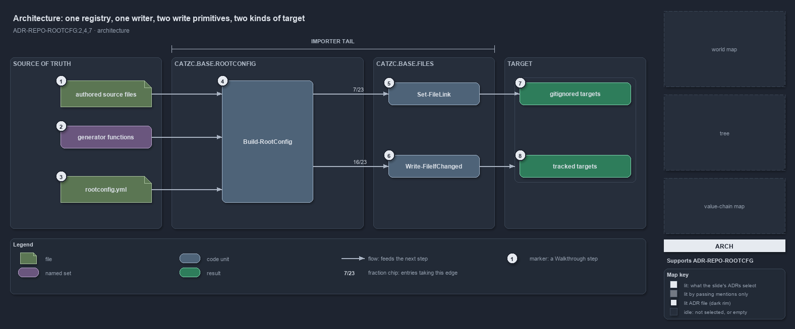

---
catzc:
  immutable:
    with_body_sha: "8ebc8a912f72"
    repo_status: clean
    path: docs/explanation/repository/one-registry-one-writer-two-primitives.md
    folder: docs/explanation/repository
    name: one-registry-one-writer-two-primitives
    filetype: md
    kind: explanation
    language: markdown
    track: docs
    tracktype: documentation
  edges:
    cites:
      - ADR-REPO-ROOTCFG#{2,4,7}
    links:
      - docs/.assets/explanation/adr-repo-rootcfg--one-registry-one-writer-two-primitives--architecture.drawio.md
      - docs/.assets/explanation/adr-repo-rootcfg--one-registry-one-writer-two-primitives--architecture.drawio.png
      - docs/adr/repository/generated-root-configs.md
      - docs/explanation/index.md#how-to-read-the-diagrams
      - docs/explanation/repository/import-materialises-two-gates-name-the-fix.md
      - docs/explanation/repository/index.md
      - docs/explanation/repository/one-source-one-writer-one-boolean.md
      - docs/explanation/repository/opted-in-then-link-copy-or-render.md
      - docs/explanation/repository/three-gates-check-registry-drift-membership.md
---

# One registry, one writer, two write primitives, two kinds of target

```text
Root config materialisation is one registry, one writer, two write primitives and two kinds of target.

1  authored source files   the config files under automation/ that a source entry copies or links out
2  generator functions     the eight functions a generator entry names, bound in one dispatch
3  rootconfig.yml          the registry: 23 entries, each with one source of truth and three booleans
4  Build-RootConfig        the single writer, in Catzc.Base.RootConfig, run by the importer tail
5  Set-FileLink            the link primitive in Catzc.Base.Files: 7 entries are linked
6  Write-FileIfChanged     the content primitive in Catzc.Base.Files: 16 entries are written
7  gitignored targets      19 targets git ignores: every link, plus 12 written copies
8  tracked targets         4 written targets git keeps: importer.ps1, importer.sh, .gitattributes, .gitignore

Supports ADR-REPO-ROOTCFG#2, #4 and #7 (architecture lens).
```

Root config materialisation in cats has four parts and one direction. Sources of truth sit under `automation/`; the registry in
`Catzc.Base.RootConfig` says how each one lands; the writer in the same module reproduces every target through two primitives that
`Catzc.Base.Files` owns; and the targets fall into two kinds that differ by one boolean. The dependency edges point one way, from the
RootConfig module to the Files module and to the modules that hold the generators, and nothing reads the registry back.



The diagram is described element by element in
[its asset description](../../.assets/explanation/adr-repo-rootcfg--one-registry-one-writer-two-primitives--architecture.drawio.md).

## Walkthrough

1. **Authored source files.** A `source` entry names a config file kept under `automation/`, most of them in
   `Catzc.Base.RootConfig/assets/root/`. The root path is reproduced from it, as a copy with a generated-file header or as a link.
2. **Generator functions.** A `generator` entry names a function that renders the whole file, header included: `New-Importer`,
   `New-GitIgnore`, the four `New-VSCode*` writers, `New-GoWorkspace` and `New-PythonProject`. `Invoke-RootConfigGenerator` is the one place
   a name is bound to its call, so an unknown name fails loudly.
3. **rootconfig.yml.** The registry lists 23 entries. Each names its target, exactly one source of truth, and the booleans `optIn`,
   `committed` and `copyAsLink`. Nothing else in cats restates the target-to-source pairing.
4. **Build-RootConfig.** The single writer reads the registry, keeps the opted-in entries, and reproduces each target. The importer tail
   runs it on every load, silently; a clean tree is a no-op.
5. **Set-FileLink.** A `copyAsLink` entry composes no content at all: the writer asks `Catzc.Base.Files` to make the root path a filesystem
   link to the source, so the two are one file. 7 of the 23 entries take this edge.
6. **Write-FileIfChanged.** Every other entry hands its composed content, a header plus the source or a generator's output, to the one
   shared write primitive: canonical output, a line-ending-insensitive compare, and a delete-then-write only on a real change. 16 of the 23
   entries take this edge.
7. **Gitignored targets.** Every linked target is gitignored by construction, since a link may never be committed, and so are 12 of the
   written ones: 19 targets in all, each matched by a `.gitignore` rule that `New-GitIgnore` injects from the registry.
8. **Tracked targets.** The remaining 4 written targets stay in git because git or the bootstrap reads them before the importer runs:
   `importer.ps1` and `.gitignore` from generators, `importer.sh` and `.gitattributes` as header-bearing copies.

## Why it holds

- The registry is one file and `Build-RootConfig` is its single writer; the target-to-source pairing lives nowhere else
  (ADR-REPO-ROOTCFG#2).
- All content writes go through `Write-FileIfChanged`, whose delete-then-write can never write through a linked target into a source of
  truth; link targets are materialised by `Set-FileLink` instead (ADR-REPO-ROOTCFG#4).
- A `copyAsLink` entry requires a `source`, requires `committed: false` and forbids a `comment`; `Set-FileLink` is the single mechanism
  owner and throws rather than degrade to a copy (ADR-REPO-ROOTCFG#7).

## See also

- [Generated root configs](../../adr/repository/generated-root-configs.md) — the decision this article explains.
- The other lenses on the same mechanism: [meta](one-source-one-writer-one-boolean.md),
  [implementation](opted-in-then-link-copy-or-render.md), [operations](import-materialises-two-gates-name-the-fix.md) and
  [governance](three-gates-check-registry-drift-membership.md).
- [The repository explanations](index.md) · [How to read the diagrams](../index.md#how-to-read-the-diagrams)
