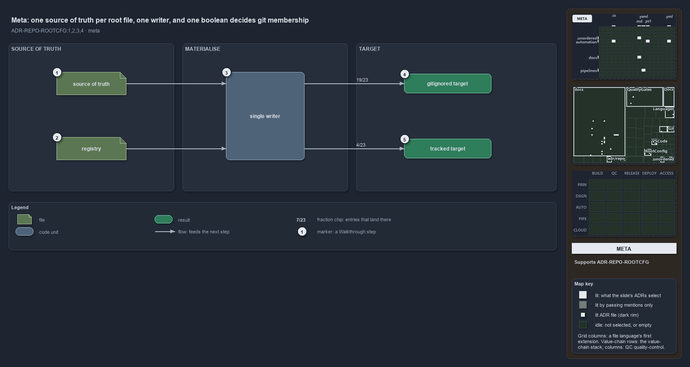

---
catzc:
  immutable:
    with_body_sha: "1932fd9f0525"
    path: docs/explanation/repository/one-source-one-writer-one-boolean.md
    folder: docs/explanation/repository
    name: one-source-one-writer-one-boolean
    filetype: md
    kind: explanation
    language: markdown
    track: docs
  edges:
    cites:
      - ADR-REPO-ROOTCFG#{1-4}
    links:
      - docs/.assets/explanation/adr-repo-rootcfg--one-source-one-writer-one-boolean--meta.drawio.md
      - docs/.assets/explanation/adr-repo-rootcfg--one-source-one-writer-one-boolean--meta.drawio.png
      - docs/adr/repository/generated-root-configs.md
      - docs/explanation/index.md#how-to-read-the-diagrams
      - docs/explanation/repository/import-materialises-two-gates-name-the-fix.md
      - docs/explanation/repository/index.md
      - docs/explanation/repository/one-registry-one-writer-two-primitives.md
      - docs/explanation/repository/opted-in-then-link-copy-or-render.md
      - docs/explanation/repository/three-gates-check-registry-drift-membership.md
---

# Every managed root file has one source of truth, one writer, and one boolean that decides git membership

```text
Every managed root file has one source of truth, one writer, and one boolean that decides git membership.

1  source of truth     the one authored file or generator function an entry names
2  registry            the one list of managed root files and how each one lands
3  single writer       the one function that reproduces every opted-in target on every import
4  gitignored target   a derived copy or link that git ignores: 19 of the 23 entries
5  tracked target      a file git or the bootstrap reads before the importer runs: 4 of 23

Supports ADR-REPO-ROOTCFG#1, #2, #3 and #4 (meta lens).
```

The repository root carries configuration files for git, editors and quality-gate tools. Cats does not keep them by hand: each one that is
opted in is reproduced from one source of truth inside `automation/`, by one writer, on every import. Whether the reproduced file is
gitignored or stays tracked is one boolean per entry, not a second system.



The diagram is described element by element in
[its asset description](../../.assets/explanation/adr-repo-rootcfg--one-source-one-writer-one-boolean--meta.drawio.md).

## Walkthrough

1. **Source of truth.** Every entry names exactly one: an authored file that is copied or linked out, or a generator function whose rendered
   output is the whole file. Corrections go to the source. A reproduced copy is a rendering and is never hand-edited; a link target is the
   source itself.
2. **Registry.** One list declares which root files are managed and how each one lands. Opt-out is the default: a root file with no entry,
   or an entry that is not opted in, stays hand-authored and committed. Today every one of the 23 entries is opted in.
3. **Single writer.** One function reads the registry, keeps the opted-in entries, and reproduces each target from its source. The importer
   tail calls it on every load, and it is idempotent: a clean tree is a fast no-op.
4. **Gitignored target.** By default a managed target is a derived artifact that git ignores, materialised on import like the generated
   module manifests. 19 of the 23 entries land this way.
5. **Tracked target.** Some root files are read before the importer can have produced them: the import entry point itself, and the files git
   reads at checkout. Those 4 stay tracked, with the automation still owning their content, so a source change surfaces as a reviewable
   diff.

## Why it holds

- An opted-in root file is fully managed: materialised from exactly one in-repo source of truth, a `source` file or a `generator` function,
  and never corrected in place (ADR-REPO-ROOTCFG#1).
- The registry is one file, validated by one type and materialised by one writer; opt-out is the default and `optIn: true` is the explicit
  takeover switch (ADR-REPO-ROOTCFG#2).
- Per entry, `committed` decides git membership and nothing else: false is a gitignored artifact, true is a tracked file the bootstrap needs
  before the importer runs (ADR-REPO-ROOTCFG#3).
- Generation is idempotent and runs on every import, so a target can never go stale between loads (ADR-REPO-ROOTCFG#4).

## See also

- [Generated root configs](../../adr/repository/generated-root-configs.md) — the decision this article explains.
- The other lenses on the same mechanism: [architecture](one-registry-one-writer-two-primitives.md),
  [implementation](opted-in-then-link-copy-or-render.md), [operations](import-materialises-two-gates-name-the-fix.md) and
  [governance](three-gates-check-registry-drift-membership.md).
- [The repository explanations](index.md) · [How to read the diagrams](../index.md#how-to-read-the-diagrams)
