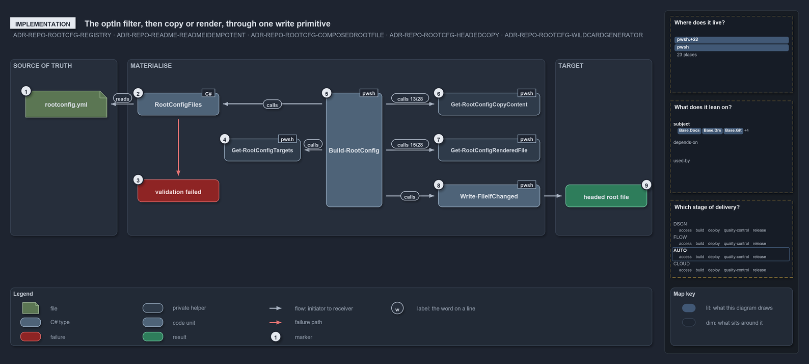

# The optIn filter, then copy or render, through one write primitive

```text
Build-RootConfig filters the registry to the opted-in entries, then copies or renders each one, and one primitive writes every file.

1  rootconfig.yml               the registry, loaded as the rootconfig config
2  RootConfigFiles              the config type that validates every entry at load
3  validation failed            the one throw that lists every malformed entry
4  Get-RootConfigTargets        keeps the entries with optIn true, in registry order
5  Build-RootConfig             branches per entry: source, else generator
6  Get-RootConfigCopyContent    the copy branch: 13 of 28 entries, the template under a generated-file head
7  Get-RootConfigRenderedFile   the generator branch: 15 of 28 entries, one record per file
8  Write-FileIfChanged          the one write for every file, after Build-RootConfig deletes a link left at the target
9  headed root file             what every branch leaves at the root path

Supports ADR-REPO-ROOTCFG-REGISTRY, ADR-REPO-README-READMEIDEMPOTENT, ADR-REPO-ROOTCFG-COMPOSEDROOTFILE,
ADR-REPO-ROOTCFG-HEADEDCOPY and ADR-REPO-ROOTCFG-WILDCARDGENERATOR (implementation lens).
```

`Build-RootConfig` is a short function with one filter and two branches. It loads the registry through the config reader, which types and
validates it; keeps the opted-in entries; and for each one either copies its template under a generated-file head or asks a generator for
its output and writes the same head over it. One primitive in `Catzc.Base.Files` does every write, and no root file is ever a link.

```yml drawio
description:
  Build-RootConfig loads the registry through its validating config type, keeps the opted-in entries, and sends each one down the copy
  branch or the generator branch; one primitive writes every file, leaving a headed root file and never a link.
about:
  rules:
    - ADR-REPO-ROOTCFG-REGISTRY
    - ADR-REPO-README-READMEIDEMPOTENT
    - ADR-REPO-ROOTCFG-COMPOSEDROOTFILE
    - ADR-REPO-ROOTCFG-HEADEDCOPY
    - ADR-REPO-ROOTCFG-WILDCARDGENERATOR
  lens: implementation
content:
  title: The optIn filter, then copy or render, through one write primitive
  kind: explanation
  flow: left-to-right
  theme: dark
  bands:
    - { id: band-source, label: SOURCE OF TRUTH }
    - { id: band-materialise, label: MATERIALISE }
    - { id: band-target, label: TARGET }
  glyphs:
    - { id: g-rootconfig-yml, kind: file, label: rootconfig.yml, in: band-source }
    - { id: g-config-type, kind: type, label: RootConfigFiles, in: band-materialise }
    - { id: f-validation, kind: failure, label: validation failed, in: band-materialise }
    - { id: g-targets, kind: private, label: Get-RootConfigTargets, in: band-materialise }
    - { id: g-build, kind: code, label: Build-RootConfig, in: band-materialise }
    - { id: g-copy-content, kind: private, label: Get-RootConfigCopyContent, in: band-materialise }
    - { id: g-rendered-file, kind: private, label: Get-RootConfigRenderedFile, in: band-materialise }
    - { id: g-write-if-changed, kind: code, label: Write-FileIfChanged, in: band-materialise }
    - { id: r-headed, kind: result, label: headed root file, in: band-target }
  edges:
    - { from: g-config-type, to: g-rootconfig-yml, kind: flow }
    - { from: g-config-type, to: f-validation, kind: fail }
    - { from: g-build, to: g-config-type, kind: flow, label: calls }
    - { from: g-build, to: g-targets, kind: flow, label: calls }
    - { from: g-build, to: g-copy-content, kind: flow, label: calls, count: 13/28 }
    - { from: g-build, to: g-rendered-file, kind: flow, label: calls, count: 15/28 }
    - { from: g-build, to: g-write-if-changed, kind: flow, label: calls }
    - { from: g-write-if-changed, to: r-headed, kind: flow }
  markers:
    - { at: g-rootconfig-yml, number: 1 }
    - { at: g-config-type, number: 2 }
    - { at: f-validation, number: 3 }
    - { at: g-targets, number: 4 }
    - { at: g-build, number: 5 }
    - { at: g-copy-content, number: 6 }
    - { at: g-rendered-file, number: 7 }
    - { at: g-write-if-changed, number: 8 }
    - { at: r-headed, number: 9 }
  legend: auto
  minimaps: [code-locations, module-neighbourhood, axis]
layout:
  band-source: { x: 20, y: 100, w: 210, h: 346 }
  band-materialise: { x: 250, y: 100, w: 820, h: 346 }
  band-target: { x: 1090, y: 100, w: 190, h: 346 }
  g-rootconfig-yml: { x: 50, y: 162, w: 160, h: 52 }
  g-config-type: { x: 270, y: 166, w: 160, h: 44 }
  f-validation: { x: 270, y: 336, w: 160, h: 44 }
  g-targets: { x: 440, y: 256, w: 150, h: 44 }
  g-build: { x: 640, y: 166, w: 110, h: 224 }
  g-copy-content: { x: 860, y: 166, w: 200, h: 44 }
  g-rendered-file: { x: 860, y: 256, w: 200, h: 44 }
  g-write-if-changed: { x: 860, y: 346, w: 200, h: 44 }
  r-headed: { x: 1110, y: 346, w: 160, h: 44 }
```



## Walkthrough

1. **rootconfig.yml.** `Get-Config -Config rootconfig` loads the registry from `pwsh/Base.RootConfig/configs/`. Every path in it is
   repository-root-relative and forward-slashed.
2. **RootConfigFiles.** The `rootconfig` config is typed `Catzc.Base.RootConfig.RootConfigFiles`, so loading it constructs every entry as a
   `RootConfigFile`: exactly one of `source` or `generator`; a wildcard target only with a `generator`; `sources` only with a `generator`;
   targets are unique.
3. **Validation failed.** A malformed registry throws once, `rootconfig config validation failed:` followed by every error, before any file
   is touched.
4. **Get-RootConfigTargets.** The validated entries are filtered to those with `optIn` true, in registry order. An opted-out entry is
   validated for shape but neither written nor treated as owned.
5. **Build-RootConfig.** Per entry the writer takes the branch that applies: `source`, else `generator`. A `-Target` argument narrows the
   run to one entry, or to one file of a wildcard entry.
6. **Get-RootConfigCopyContent.** The copy branch reads the template, normalises it to LF and writes the generated-file head over it, naming
   the template as its source. 13 entries take it.
7. **Get-RootConfigRenderedFile.** The generator branch calls the entry's generator through `Invoke-RootConfigGenerator` and normalises the
   result to `{ Target; Content }` records: one string for a literal target, one record per file for a wildcard such as `*/tests/*/go.mod`,
   which may render none. A record outside the pattern, or a literal target with anything but one file, throws naming the entry and the
   generator. Each record gets the same head, naming the generator and its sources. 15 entries take this branch.
8. **Write-FileIfChanged.** Every file goes to `Write-FileIfChanged`: canonical LF and UTF-8 without BOM, a compare that ignores carriage
   returns, and a delete-then-write only on a real change. Before the write, `Build-RootConfig` deletes a target that is still a link, left
   from before the headed copy, and counts it as changed.
9. **Headed root file.** The root path holds a real file under the generated-file head that names its template or generator. The writer
   reports `regenerated` or `unchanged`.

## Why it holds

- The registry is validated by the `RootConfigFiles` type and materialised by `Build-RootConfig`, the single writer; only `optIn: true`
  entries are touched (ADR-REPO-ROOTCFG-REGISTRY).
- Every write goes through `Write-FileIfChanged`: canonical output, an EOL-insensitive compare, write only on a real change,
  delete-then-write (ADR-REPO-README-READMEIDEMPOTENT).
- Every root file, a template copy or a generator's output, carries the generated-file head in its file class's carrier
  (ADR-REPO-ROOTCFG-COMPOSEDROOTFILE).
- A `source` entry is a headed copy of its template, never a link to it, since a head written into a link would land in the template
  (ADR-REPO-ROOTCFG-HEADEDCOPY).
- A generator entry may name a wildcard target and render one record per file, each written and reported on its own
  (ADR-REPO-ROOTCFG-WILDCARDGENERATOR).

## See also

- [Generated root configs](../../drs/repository/generated-root-configs.md) — the decision this article explains.
- The other lenses on the same mechanism: [meta](one-source-one-writer-one-boolean.md),
  [architecture](one-registry-one-writer-two-primitives.md), [operations](import-materialises-two-gates-name-the-fix.md) and
  [governance](three-gates-check-registry-drift-membership.md).
