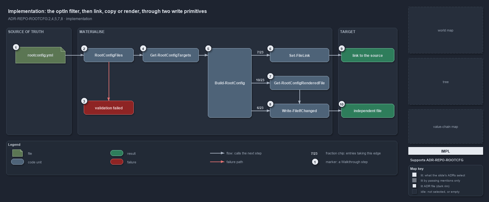

---
catzc:
  immutable:
    with_body_sha: "2d4abe8ad11f"
    repo_status: clean
    path: docs/explanation/repository/opted-in-then-link-copy-or-render.md
    folder: docs/explanation/repository
    name: opted-in-then-link-copy-or-render
    filetype: md
    kind: explanation
    language: markdown
    track: docs
    tracktype: documentation
  edges:
    cites:
      - ADR-REPO-ROOTCFG#{2,4,5,7,8}
    links:
      - docs/.assets/explanation/adr-repo-rootcfg--opted-in-then-link-copy-or-render--implementation.drawio.md
      - docs/.assets/explanation/adr-repo-rootcfg--opted-in-then-link-copy-or-render--implementation.drawio.png
      - docs/adr/repository/generated-root-configs.md
      - docs/explanation/index.md#how-to-read-the-diagrams
      - docs/explanation/repository/import-materialises-two-gates-name-the-fix.md
      - docs/explanation/repository/index.md
      - docs/explanation/repository/one-registry-one-writer-two-primitives.md
      - docs/explanation/repository/one-source-one-writer-one-boolean.md
      - docs/explanation/repository/three-gates-check-registry-drift-membership.md
---

# The optIn filter, then link, copy or render, through two write primitives

```text
Build-RootConfig filters the registry to the opted-in entries, then links, copies or renders each one through two write primitives.

1   rootconfig.yml               the registry, loaded as the rootconfig config
2   RootConfigFiles              the config type that validates every entry at load
3   validation failed            the one throw that lists every malformed entry
4   Get-RootConfigTargets        keeps the entries with optIn true, in registry order
5   Build-RootConfig             branches per entry: copyAsLink, then source, else generator
6   Set-FileLink                 the link branch: 7 of 23 entries
7   Get-RootConfigRenderedFile   the generator branch: 10 of 23 entries, one record per file
8   Write-FileIfChanged          the content write for the copy branch (6 of 23) and every rendered file
9   link to the source           what the link branch leaves at the root path
10  independent file             what the content write leaves at the root path

Supports ADR-REPO-ROOTCFG#2, #4, #5, #7 and #8 (implementation lens).
```

`Build-RootConfig` is a short function with one filter and three branches. It loads the registry through the config reader, which types and
validates it; keeps the opted-in entries; and for each one either asks for a link, composes the source under a generated-file head, or asks
a generator for its output and writes the same head over it. Two primitives in `Catzc.Base.Files` do every write.



The diagram is described element by element in
[its asset description](../../.assets/explanation/adr-repo-rootcfg--opted-in-then-link-copy-or-render--implementation.drawio.md).

## Walkthrough

1. **rootconfig.yml.** `Get-Config -Config rootconfig` loads the registry from `automation/Catzc.Base.RootConfig/configs/`. Every path in it
   is repository-root-relative and forward-slashed.
2. **RootConfigFiles.** The `rootconfig` config is typed `Catzc.Base.RootConfig.RootConfigFiles`, so loading it constructs every entry as a
   `RootConfigFile`: exactly one of `source` or `generator`; a wildcard target only with a `generator`; `sources` only with a `generator`;
   `copyAsLink` needs a `source`, needs `committed: false` and forbids a `carrier`; targets are unique.
3. **Validation failed.** A malformed registry throws once, `rootconfig config validation failed:` followed by every error, before any file
   is touched.
4. **Get-RootConfigTargets.** The validated entries are filtered to those with `optIn` true, in registry order. An opted-out entry is
   validated for shape but neither written nor treated as owned.
5. **Build-RootConfig.** Per entry the writer takes the first branch that applies: `copyAsLink`, then `source`, else `generator`. A
   `-Target` argument narrows the run to one entry, or to one file of a wildcard entry.
6. **Set-FileLink.** The link branch composes nothing: `Set-FileLink -Path <target> -Target <source>` verifies or recreates a relative
   symbolic link, or a hard link on Windows without the symlink privilege, and throws when neither works. 7 entries take it.
7. **Get-RootConfigRenderedFile.** The generator branch calls the entry's generator through `Invoke-RootConfigGenerator` and normalises the
   result to `{ Target; Content }` records: one string for a literal target, one record per file for a wildcard such as `*/tests/*/go.mod`,
   which may render none. A record outside the pattern, or a literal target with anything but one file, throws naming the entry and the
   generator. 10 entries take this branch.
8. **Write-FileIfChanged.** The copy branch reads the source, normalises it to LF and writes the generated-file head over it, naming the
   source; 6 entries take it. A rendered record gets the same head, naming the generator and its sources. That content goes to
   `Write-FileIfChanged`: canonical LF and UTF-8 without BOM, a compare that ignores carriage returns, and a delete-then-write only on a
   real change. A target that is currently a link is deleted first and counted as changed.
9. **Link to the source.** The root path and the authored file are one file. The writer reports `linked` or `link current`.
10. **Independent file.** The root path is a fresh, real file that no link reaches. The writer reports `regenerated` or `unchanged`.

## Why it holds

- The registry is validated by the `RootConfigFiles` type and materialised by `Build-RootConfig`, the single writer; only `optIn: true`
  entries are touched (ADR-REPO-ROOTCFG#2).
- Every content write goes through `Write-FileIfChanged`: canonical output, an EOL-insensitive compare, write only on a real change,
  delete-then-write; link targets go through `Set-FileLink` instead (ADR-REPO-ROOTCFG#4).
- A composed file, a source copy that is not a link or a generator's output, carries the generated-file head in its file class's carrier; a
  `copyAsLink` entry carries no head (ADR-REPO-ROOTCFG#5).
- A `copyAsLink` entry is a filesystem link, with its three constraints validated by `RootConfigFile`, and `Set-FileLink` throws rather than
  copy (ADR-REPO-ROOTCFG#7).
- A generator entry may name a wildcard target and render one record per file, each written and reported on its own (ADR-REPO-ROOTCFG#8).

## See also

- [Generated root configs](../../adr/repository/generated-root-configs.md) — the decision this article explains.
- The other lenses on the same mechanism: [meta](one-source-one-writer-one-boolean.md),
  [architecture](one-registry-one-writer-two-primitives.md), [operations](import-materialises-two-gates-name-the-fix.md) and
  [governance](three-gates-check-registry-drift-membership.md).
- [The repository explanations](index.md) · [How to read the diagrams](../index.md#how-to-read-the-diagrams)
