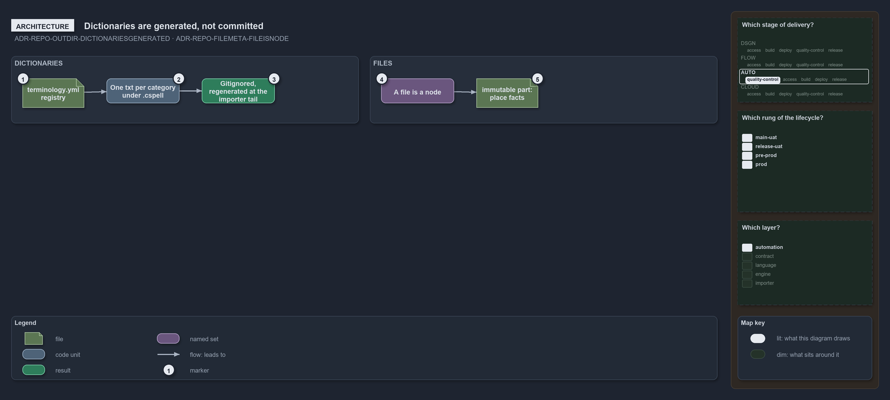

---
catzc:
  warning: "Experimental: this article merges two rules into one and holds nothing beyond what they say"
  edges:
    cites:
      - ADR-REPO-OUTDIR-DICTIONARIESGENERATED
      - ADR-REPO-FILEMETA-FILEISNODE
---

# Spell checker dictionaries are generated not committed and a file is a node

This article is one rule:
[ADR-REPO-OUTDIR-DICTIONARIESGENERATED](../../drs/repository/dedicated-output-directory.md#rule-adr-repo-outdir-dictionariesgenerated) and
[ADR-REPO-FILEMETA-FILEISNODE](../../drs/repository/file-meta.md#rule-adr-repo-filemeta-fileisnode) merged into one. It holds nothing beyond
what those two rules say.

The spell-checker dictionaries generated from the terminology registry are not committed: like the `.psd1` manifests they are generated, one
`<category>.txt` per vocabulary category under the root `.cspell/`, gitignored and regenerated at the importer tail from
`configs/terminology.yml`. A file is a node, and its meta block says two things about it, `immutable` holding the place facts a reader of
the head needs.

