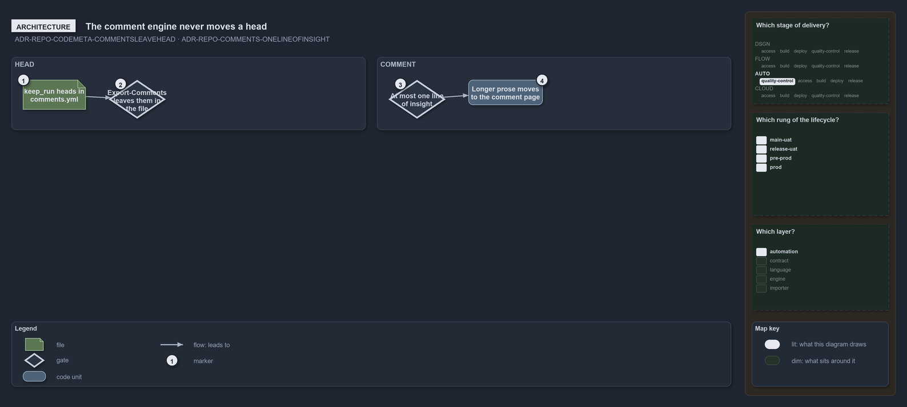

---
catzc:
  warning: "Experimental: this article merges two rules into one and holds nothing beyond what they say"
  edges:
    cites:
      - ADR-REPO-CODEMETA-COMMENTSLEAVEHEAD
      - ADR-REPO-COMMENTS-ONELINEOFINSIGHT
---

# The comment engine never moves head and comment is at most one line of insight

This article is one rule:
[ADR-REPO-CODEMETA-COMMENTSLEAVEHEAD](../../drs/repository/code-file-meta.md#rule-adr-repo-codemeta-commentsleavehead) and
[ADR-REPO-COMMENTS-ONELINEOFINSIGHT](../../drs/repository/comments-in-docs.md#rule-adr-repo-comments-onelineofinsight) merged into one. It
holds nothing beyond what those two rules say.

The comment engine never moves, flags or rewrites a head: a comment whose front matter opens with a head listed under `keep_run:` in
`comments.yml` is not a prose comment, so `Export-Comments` leaves it in the file. A comment in a code or configuration file is at most one
line of insight: what the code does not say itself, and a comment that needs more than one line of prose moves, verbatim, to the file's
comment page.

