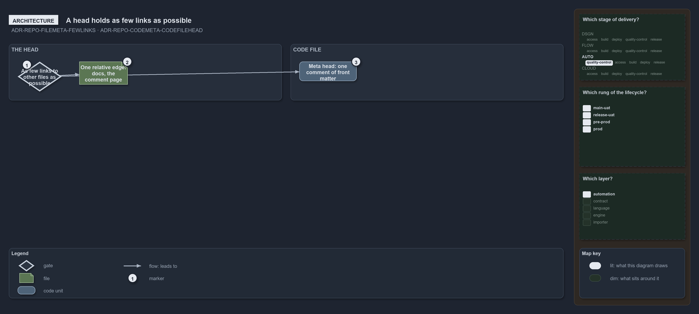

---
catzc:
  warning: "Experimental: this article merges two rules into one and holds nothing beyond what they say"
  edges:
    cites:
      - ADR-REPO-FILEMETA-FEWLINKS
      - ADR-REPO-CODEMETA-CODEFILEHEAD
---

# The head holds as few links as possible and code head one front matter comment

This article is one rule: [ADR-REPO-FILEMETA-FEWLINKS](../../drs/repository/file-meta.md#rule-adr-repo-filemeta-fewlinks) and
[ADR-REPO-CODEMETA-CODEFILEHEAD](../../drs/repository/code-file-meta.md#rule-adr-repo-codemeta-codefilehead) merged into one. It holds
nothing beyond what those two rules say.

The head is a map of facts about its own file, so it holds as few links to other files as possible, only those that cost to derive and truly
define a relationship; a file has one relative edge, `docs`, its comment page under `docs/references`. For a code file the head is a meta
head: one comment at the top of the file whose text is a front matter document, the same `catzc:` block a Markdown file carries.

