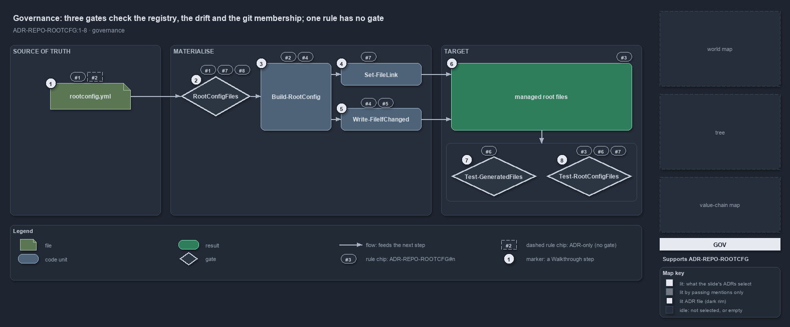

---
catzc:
  derived:
    path: docs/explanation/repository/three-gates-check-registry-drift-membership.md
    folder: docs/explanation/repository
    name: three-gates-check-registry-drift-membership
    filetype: md
    kind: explanation
    language: markdown
    track: docs
    body_sha: "413a6f2fae83"
    adrs:
      - ADR-AUTO-TEST#35
      - ADR-REPO-ROOTCFG
    links:
      - docs/.assets/explanation/adr-repo-rootcfg--three-gates-check-registry-drift-membership--governance.drawio.md
      - docs/.assets/explanation/adr-repo-rootcfg--three-gates-check-registry-drift-membership--governance.drawio.png
      - docs/adr/automation/test-automation.md
      - docs/adr/repository/generated-root-configs.md
      - docs/explanation/index.md#how-to-read-the-diagrams
      - docs/explanation/repository/import-materialises-two-gates-name-the-fix.md
      - docs/explanation/repository/index.md
      - docs/explanation/repository/one-registry-one-writer-two-primitives.md
      - docs/explanation/repository/one-source-one-writer-one-boolean.md
      - docs/explanation/repository/opted-in-then-link-copy-or-render.md
---

# Three gates check the registry, the drift and the git membership; one rule has no gate

```text
Three gates check the registry, the drift and the git membership; one clause of the ADR has no gate.

1  rootconfig.yml         the registry: rules #1 and #2 govern its entries; "not restated elsewhere" has no gate
2  RootConfigFiles        the load-time gate: exactly one source (#1), the link constraints (#7), wildcard only with a generator (#8)
3  Build-RootConfig       the single writer that keeps only opted-in entries (#2) and runs on every import (#4)
4  Set-FileLink           the link mechanism owner (#7)
5  Write-FileIfChanged    the content primitive: delete-then-write (#4), the generated-file head (#5)
6  managed root files     the targets; committed decides their git membership (#3)
7  Test-GeneratedFiles    the drift gate (#6): every target equals what the writer composes now
8  Test-RootConfigFiles   the integrity gate: git membership (#3), registry = .gitignore = index and links both ways (#6, #7)

Supports ADR-REPO-ROOTCFG#1, #2, #3, #4, #5, #6, #7 and #8 (governance lens).
```

The eight rules of the generated-root-configs decision are enforced at three points. A malformed registry stops the config load; a target
that differs from what the writer would compose fails the drift check; and a target whose git membership, ignore rule or link mechanism
disagrees with the registry fails the integrity check. One clause stands on the ADR alone: that the target-to-source pairing is restated
nowhere else.



The diagram is described element by element in
[its asset description](../../.assets/explanation/adr-repo-rootcfg--three-gates-check-registry-drift-membership--governance.drawio.md).

## Walkthrough

1. **rootconfig.yml.** Each entry names one source of truth (#1), and the registry is the one place that pairs a target with its source,
   with opt-out as the default (#2). The pairing's uniqueness has no gate: `New-GitIgnore` and `New-VSCodeSettings` are fed the targets from
   the registry rather than a second list, but nothing asserts that no second list exists.
2. **RootConfigFiles.** Loading the `rootconfig` config constructs the type, which rejects an entry with both or neither of `source` and
   `generator` (#1), a `copyAsLink` entry without a `source`, with `committed: true` or with a `carrier` (#7), and a wildcard target without
   a `generator` (#8). It throws once, listing every error, before any write.
3. **Build-RootConfig.** The single writer touches only the entries `Get-RootConfigTargets` keeps, those with `optIn` true (#2), and the
   importer tail runs it on every load (#4).
4. **Set-FileLink.** The one mechanism owner for a `copyAsLink` target: a symbolic link, a hard link on Windows without the privilege, and a
   throw when neither works, never a content copy (#7).
5. **Write-FileIfChanged.** Every content write is canonical, compared without regard to line endings, and delete-then-write, so it can
   never tunnel into a source through a link (#4). Both composed branches feed it the generated-file head, and a generator renders the rest
   (#5). The head is checked only through the composed content, by the drift check.
6. **Managed root files.** The `committed` boolean decides whether a target is a gitignored artifact or a tracked file, and nothing else
   (#3).
7. **Test-GeneratedFiles.** The drift check dry-runs the writer and reports every file whose content would change, one issue per file of a
   wildcard entry (#6, #8). It is a quality gate in the sense of ADR-AUTO-TEST#35: one report, one throw listing every issue.
8. **Test-RootConfigFiles.** The integrity check asserts, per opted-in target, that `committed` agrees with `.gitignore` and the index (#3,
   #6), that every `copyAsLink` target is an effective link from the running OS, and that no other target is a link (#6, #7). The L2
   integrity test runs it and expects zero issues.

## Why it holds

- Exactly one in-repo source of truth per opted-in root file; corrections go to the source (ADR-REPO-ROOTCFG#1).
- One registry, validated by `RootConfigFiles` and written by `Build-RootConfig`; opt-out is the default (ADR-REPO-ROOTCFG#2).
- `committed` decides git membership and nothing else (ADR-REPO-ROOTCFG#3).
- Idempotent generation on every import, through `Write-FileIfChanged` or `Set-FileLink` (ADR-REPO-ROOTCFG#4).
- A composed file carries the generated-file head, and a link carries none (ADR-REPO-ROOTCFG#5).
- The registry, `.gitignore` and the tracked set agree, and the link mechanism is asserted both ways (ADR-REPO-ROOTCFG#6).
- A `copyAsLink` entry is a filesystem link under three validated constraints, and `Set-FileLink` never copies (ADR-REPO-ROOTCFG#7).
- A generator entry may name a wildcard target, each rendered file written, reported and checked on its own (ADR-REPO-ROOTCFG#8).
- Every repository check is a quality gate that collects every issue, writes one report and throws once (ADR-AUTO-TEST#35).

## Where the code and the ADR differ

ADR-REPO-ROOTCFG#6 lists the drift check among the integrity test's assertions; the integrity check `Test-RootConfigFiles` compares no
content, and the drift check lives in `Test-GeneratedFiles`. `Test-GeneratedFiles` does not list `New-PythonProject` among the generators it
can be asked for, although the registry names it; a stale `pyproject.toml` is still caught by the default run.

## See also

- [Generated root configs](../../adr/repository/generated-root-configs.md) — the decision this article explains.
- [Test automation](../../adr/automation/test-automation.md) — the quality-gate rule the two gates follow.
- The other lenses on the same mechanism: [meta](one-source-one-writer-one-boolean.md),
  [architecture](one-registry-one-writer-two-primitives.md), [implementation](opted-in-then-link-copy-or-render.md) and
  [operations](import-materialises-two-gates-name-the-fix.md).
- [The repository explanations](index.md) · [How to read the diagrams](../index.md#how-to-read-the-diagrams)
