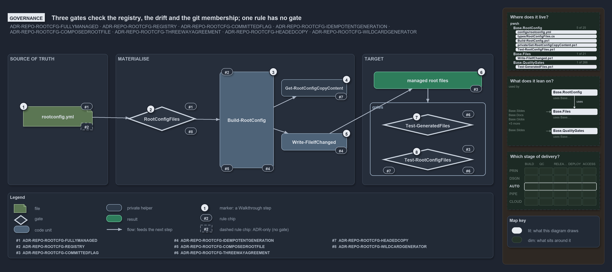

# Three gates check the registry, the drift and the git membership; one rule has no gate

```text
Three gates check the registry, the drift and the git membership; one clause of the ADR has no gate.

1  rootconfig.yml               the registry: rules #1 and #2 govern its entries; "not restated elsewhere" has no gate
2  RootConfigFiles              the load-time gate: exactly one source (#1), a wildcard target only with a generator (#8)
3  Build-RootConfig             the single writer that keeps only opted-in entries (#2), runs on every import (#4) and writes the head (#5)
4  Get-RootConfigCopyContent    the headed copy: the template under the generated-file head, never a link (#7)
5  Write-FileIfChanged          the content primitive: canonical, EOL-insensitive, delete-then-write (#4)
6  managed root files           the targets; committed decides their git membership (#3)
7  Test-GeneratedFiles          the drift gate (#6): every target equals what the writer composes now
8  Test-RootConfigFiles         the integrity gate: git membership (#3), registry = .gitignore = index, copies equal templates, no link (#6, #7)

Supports ADR-REPO-ROOTCFG-FULLYMANAGED, ADR-REPO-ROOTCFG-REGISTRY, ADR-REPO-ROOTCFG-COMMITTEDFLAG, ADR-REPO-ROOTCFG-IDEMPOTENTGENERATION, ADR-REPO-ROOTCFG-COMPOSEDROOTFILE, ADR-REPO-ROOTCFG-THREEWAYAGREEMENT, ADR-REPO-ROOTCFG-HEADEDCOPY and ADR-REPO-ROOTCFG-WILDCARDGENERATOR (governance lens).
```

The eight rules of the generated-root-configs decision are enforced at three points. A malformed registry stops the config load; a target
that differs from what the writer would compose fails the drift check; and a target whose git membership, ignore rule, copy or link status
disagrees with the registry fails the integrity check. One clause stands on the ADR alone: that the target-to-source pairing is restated
nowhere else.



## Walkthrough

1. **rootconfig.yml.** Each entry names one source of truth (#1), and the registry is the one place that pairs a target with its source,
   with opt-out as the default (#2). The pairing's uniqueness has no gate: `New-GitIgnore` and `New-VSCodeSettings` are fed the targets from
   the registry rather than a second list, but nothing asserts that no second list exists.
2. **RootConfigFiles.** Loading the `rootconfig` config constructs the type, which rejects an entry with both or neither of `source` and
   `generator` (#1), a wildcard target without a `generator` (#8), `sources` without a `generator`, and a duplicate target. It throws once,
   listing every error, before any write.
3. **Build-RootConfig.** The single writer touches only the entries `Get-RootConfigTargets` keeps, those with `optIn` true (#2), and the
   importer tail runs it on every load (#4). It writes the generated-file head over a generator's output (#5).
4. **Get-RootConfigCopyContent.** The copy branch for a `source` entry: the template read as LF under the generated-file head that names it,
   a headed copy and never a link, so the template stays the pure authored file (#7, #5).
5. **Write-FileIfChanged.** Every content write is canonical, compared without regard to line endings, and delete-then-write, so it can
   never tunnel into a source through a link (#4). `Build-RootConfig` also deletes a target that is still a link before it writes.
6. **Managed root files.** The `committed` boolean decides whether a target is a gitignored artifact or a tracked file, and nothing else
   (#3).
7. **Test-GeneratedFiles.** The drift check dry-runs the writer and reports every file whose content would change, one issue per file of a
   wildcard entry (#6, #8). It is a quality gate in the sense of ADR-AUTO-TEST-QUALITYGATE: one report, one throw listing every issue.
8. **Test-RootConfigFiles.** The integrity check asserts, per opted-in target, that `committed` agrees with `.gitignore` and the index (#3,
   #6), that no target is a link, and that every `source` target equals its template under the generated-file head (#6, #7). The L2
   integrity test runs it and expects zero issues. A third gate, `Test-RootAnalyzerSettings`, checks that the root analyzer settings file
   exists and parses.

## Why it holds

- Exactly one in-repo source of truth per opted-in root file; corrections go to the source (ADR-REPO-ROOTCFG-FULLYMANAGED).
- One registry, validated by `RootConfigFiles` and written by `Build-RootConfig`; opt-out is the default (ADR-REPO-ROOTCFG-REGISTRY).
- `committed` decides git membership and nothing else (ADR-REPO-ROOTCFG-COMMITTEDFLAG).
- Idempotent generation on every import, through `Write-FileIfChanged` (ADR-REPO-ROOTCFG-IDEMPOTENTGENERATION).
- Every managed file, a template copy or a generator's output, carries the generated-file head (ADR-REPO-ROOTCFG-COMPOSEDROOTFILE).
- The registry, `.gitignore` and the tracked set agree, the copies equal their templates, and no target is a link
  (ADR-REPO-ROOTCFG-THREEWAYAGREEMENT).
- A `source` entry is a headed copy of its template, never a link, so a head written into the root file never lands in the template
  (ADR-REPO-ROOTCFG-HEADEDCOPY).
- A generator entry may name a wildcard target, each rendered file written, reported and checked on its own
  (ADR-REPO-ROOTCFG-WILDCARDGENERATOR).
- Every repository check is a quality gate that collects every issue, writes one report and throws once (ADR-AUTO-TEST-QUALITYGATE).

## Where the code and the ADR differ

ADR-REPO-ROOTCFG-THREEWAYAGREEMENT lists the drift check among the integrity test's assertions; the integrity check `Test-RootConfigFiles`
compares the `source` copies with their templates but no generator's output, and the generator drift check lives in `Test-GeneratedFiles`.

## See also

- [Generated root configs](../../adr/repository/generated-root-configs.md) — the decision this article explains.
- [Test automation](../../adr/automation/test-automation.md) — the quality-gate rule the two gates follow.
- The other lenses on the same mechanism: [meta](one-source-one-writer-one-boolean.md),
  [architecture](one-registry-one-writer-two-primitives.md), [implementation](opted-in-then-link-copy-or-render.md) and
  [operations](import-materialises-two-gates-name-the-fix.md).
- [The repository explanations](index.md) · [How to read the diagrams](../index.md#how-to-read-the-diagrams)
