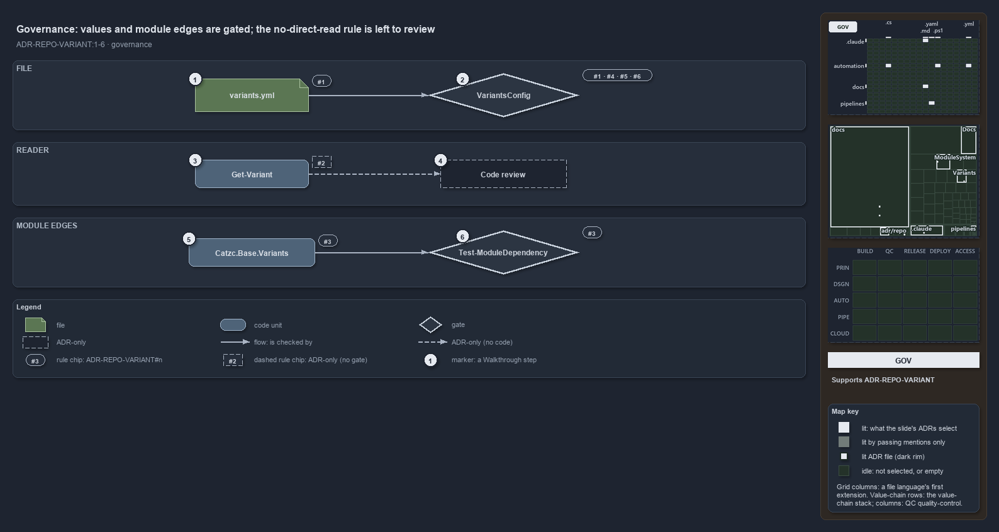

# Values and module edges have a gate; the no-direct-read rule is left to review

```text
Values and module edges have a gate; the rule that nothing reads the file directly is left to review.

1  variants.yml           rule 1: one home, a dictionary of known keys
2  VariantsConfig         the load gate for rules 1, 4, 5 and 6: keys and values, one throw for all
3  Get-Variant            rule 2: the single access point; no gate checks that it stays the only one
4  Code review            the ADR's third mechanism: new switches land as variants with primitives
5  Catzc.Base.Variants    rule 3: depends on Config, Objects and Asserts only
6  Test-ModuleDependency  the quality gate for rule 3, run by an L1 integrity test

Supports ADR-REPO-VARIANT#1, #2, #3, #4, #5 and #6 (governance lens).
```

The six rules of the variants decision are held by two gates and one habit. The config type checks the file and its values whenever it
loads; the module-dependency check proves that the module keeps its three declared edges; and the rule that nothing reads the file directly,
the one the decision is named for, has no gate at all and is left to code review. That gap is what the diagram points at.



The diagram is described element by element in [its asset description](values-and-edges-gated-reads-reviewed.drawio.md).

## Walkthrough

1. **variants.yml.** Rule 1 makes the file the one home of every repo-wide switch: a growing dictionary whose keys are known. Any other
   home, a per-module config or an environment variable, is out.
2. **VariantsConfig.** The C# config type registered for `variants` is the quality gate at load time for rules 1, 4, 5 and 6. It rejects an
   unknown key, an `ado_naming` outside `standard` and `classic`, a `git_workspace` outside `main-direct` and `main-via-pr`, a
   `have_customers` that is not a boolean, `all` or a list of unique names, and an `aspects` or `tracks` map of the wrong shape. Every
   violation goes into one throw. An integrity test loads the shipped file through it.
3. **Get-Variant.** Rule 2 makes the private reader the single access point, and no gate checks it: nothing asserts that the function stays
   private, and nothing scans the modules for a direct read of the loaded config. Today one caller, `Get-WorldMap` in `Catzc.Base.Maps`,
   reads the `aspects` key straight off `Get-Config -Config variants`, and nothing catches it.
4. **Code review.** The ADR's enforcement section names a third mechanism beside the two gates: review keeps new repo-wide switches in this
   module, as variants with their own primitives, rather than as ad-hoc config reads or environment variables. It stands alone: no code runs
   or checks it.
5. **Catzc.Base.Variants.** Rule 3 pins the module's dependencies to Config, Objects and Asserts, declared in the Base group of
   `dependencies.yml`. The declaration itself is checked at load: `DependenciesConfig` rejects a cycle.
6. **Test-ModuleDependency.** The quality gate reads every real function call and C# type reference and fails on any edge outside the
   declaration. Its L1 integrity test, tagged `source-only`, runs it on the real code, so every default test run includes it. A variant that
   reached up into another layer would fail here.

## Why it holds

- A variant has one home, `configs/variants.yml`, a growing dictionary of known keys (ADR-REPO-VARIANT#1).
- Nothing reads the file directly; the private `Get-Variant` is the single access point the primitives share (ADR-REPO-VARIANT#2).
- The module depends only on Config, Objects and Asserts, and its config type is self-contained (ADR-REPO-VARIANT#3).
- `ado_naming` is `standard` or `classic` (ADR-REPO-VARIANT#4); `have_customers` is `false`, `all` or a list of names (ADR-REPO-VARIANT#5);
  `git_workspace` is `main-direct` or `main-via-pr` (ADR-REPO-VARIANT#6).
- The declaration's shape is checked at load and the real edges by the gate (ADR-AUTO-DEPM#4), and a quality gate is one `Test-<subject>`
  that collects every issue and throws once, run by an integrity test at its tier (ADR-AUTO-TEST#35).

## Where the code and the ADR differ

- The ADR makes `Get-Variant` the single access point; `Get-WorldMap` reads the loaded config directly, and no gate catches it.
- The ADR promises `Test-`/`Assert-` guards for each variant; `git_workspace` has no `Assert-`, `aspects` and `tracks` have only `Get-`, and
  no gate checks the set of primitives either.

## See also

- [Repo-wide variants](../../adr/repository/repo-variants.md) — the decision this article explains.
- [Controlling module dependencies](../../adr/automation/controlling-module-dependencies.md) and
  [test automation](../../adr/automation/test-automation.md) — the gate rules, ADR-AUTO-DEPM#4 and ADR-AUTO-TEST#35.
- The other lenses on the same diagram: [meta](one-home-one-read-path-one-vocabulary.md),
  [architecture](a-base-module-between-config-and-its-callers.md), [implementation](five-keys-one-reader-twelve-primitives.md) and
  [operations](an-edit-lands-at-the-next-import.md).
- [The repository explanations](index.md) · [How to read the diagrams](../index.md#how-to-read-the-diagrams)
