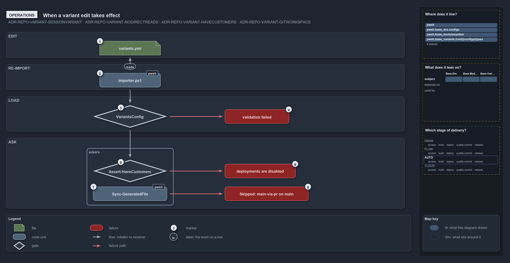

# When a variant edit takes effect

```text
When a variant edit takes effect.

1  variants.yml                  edit one key, for example have_customers
2  importer.ps1                  re-run it: the session cache is gone, and the next ask reloads the file
3  VariantsConfig                the load check: known keys, allowed values, well-formed aspects and tracks
4  validation failed             one throw, one line per violation; nothing else runs
5  Assert-HaveCustomers          the one-liner guard an operator or a caller runs
6  deployments are disabled      its throw, naming the key to set
7  Sync-GeneratedFile            a committer that asks Test-GitWorkspace -MainViaPr first
8  Skipped: main-via-pr on main  its stop, naming the branch to use instead

Supports ADR-REPO-VARIANT-SESSIONVARIANT, ADR-REPO-VARIANT-NODIRECTREADS, ADR-REPO-VARIANT-HAVECUSTOMERS
and ADR-REPO-VARIANT-GITWORKSPACE (operations lens).
```

Changing a repo-wide decision in cats is an edit and a re-import. The edit is one key in `variants.yml`; the re-import is
`. ./importer.ps1`, which starts a fresh session and so drops the cached config. From then on every primitive answers from the new file.
There are two moments an operator sees a variant say no: when the file is loaded with a value it does not accept, and when a guard is asked
and the repository is not in the state the guard requires.

```yml drawio
description:
  A variant edit is one key in variants.yml and a re-import; a wrong value fails once at load in the config type, and a guard asked later or
  a committer asking for the workspace stops with a message naming the fix.
about:
  rules: [ADR-REPO-VARIANT-SESSIONVARIANT, ADR-REPO-VARIANT-NODIRECTREADS, ADR-REPO-VARIANT-HAVECUSTOMERS, ADR-REPO-VARIANT-GITWORKSPACE]
  lens: operations
content:
  title: When a variant edit takes effect
  kind: explanation
  flow: top-to-bottom
  theme: dark
  bands:
    - { id: band-edit, label: EDIT }
    - { id: band-reimport, label: RE-IMPORT }
    - { id: band-load, label: LOAD }
    - { id: band-ask, label: ASK }
  groups:
    - { id: grp-askers, label: askers, in: band-ask }
  glyphs:
    - { id: g-variants-yml, kind: file, label: variants.yml, in: band-edit }
    - { id: g-importer, kind: code, label: importer.ps1, in: band-reimport }
    - { id: g-variants-config, kind: gate, label: VariantsConfig, in: band-load }
    - { id: f-validation, kind: failure, label: validation failed, in: band-load }
    - { id: g-assert-have-customers, kind: gate, label: Assert-HaveCustomers, in: grp-askers }
    - { id: g-sync, kind: code, label: Sync-GeneratedFile, in: grp-askers }
    - { id: f-disabled, kind: failure, label: deployments are disabled, in: band-ask }
    - { id: f-skipped, kind: failure, label: "Skipped: main-via-pr on main", in: band-ask }
  edges:
    - { from: g-importer, to: g-variants-yml, kind: flow, label: reads }
    - { from: g-importer, to: g-variants-config, kind: flow, label: "" }
    - { from: g-variants-config, to: g-assert-have-customers, kind: flow, label: "" }
    - { from: g-variants-config, to: f-validation, kind: fail, label: "" }
    - { from: g-assert-have-customers, to: f-disabled, kind: fail, label: "" }
    - { from: g-sync, to: f-skipped, kind: fail, label: "" }
  markers:
    - { at: g-variants-yml, number: 1 }
    - { at: g-importer, number: 2 }
    - { at: g-variants-config, number: 3 }
    - { at: f-validation, number: 4 }
    - { at: g-assert-have-customers, number: 5 }
    - { at: f-disabled, number: 6 }
    - { at: g-sync, number: 7 }
    - { at: f-skipped, number: 8 }
  legend: auto
  minimaps: [code-locations, module-neighbourhood, axis]
layout:
  band-edit: { x: 20, y: 84, w: 1240, h: 80 }
  band-reimport: { x: 20, y: 184, w: 1240, h: 80 }
  band-load: { x: 20, y: 284, w: 1240, h: 110 }
  band-ask: { x: 20, y: 414, w: 1240, h: 220 }
  g-variants-yml: { x: 310, y: 112, w: 190, h: 44 }
  g-importer: { x: 310, y: 212, w: 190, h: 44 }
  g-variants-config: { x: 290, y: 312, w: 230, h: 70 }
  f-validation: { x: 700, y: 325, w: 200, h: 44 }
  grp-askers: { x: 270, y: 446, w: 270, h: 178 }
  g-assert-have-customers: { x: 290, y: 482, w: 230, h: 70 }
  g-sync: { x: 290, y: 566, w: 230, h: 44 }
  f-disabled: { x: 700, y: 495, w: 220, h: 44 }
  f-skipped: { x: 700, y: 566, w: 260, h: 44 }
```



## Walkthrough

1. **variants.yml.** Set the key: `have_customers: all`, a list of names, or `false`; `git_workspace: main-via-pr` when the repository goes
   from one author to more; `naming` is changed only as a deliberate one-time decision, because it re-spells every resource name.
2. **importer.ps1.** Re-run the importer. `Get-Config` caches each parsed config in module state that lives for the session, so a running
   session keeps answering from the old file until it is re-imported. The importer does not load the variants itself; the first primitive
   asked afterwards does.
3. **VariantsConfig.** At that first ask, `Get-Config -Config variants` constructs the config type, which checks the file: only the five
   known keys, `naming` a preset or a segment list, `git_workspace` in `main-direct` or `main-via-pr`, `have_customers` a boolean, `all` or
   a list of unique lowercase names, and well-formed `aspects` and `tracks`.
4. **validation failed.** A wrong value throws once, `variants configuration validation failed:` followed by one line per violation, such as
   `invalid naming '<value>' (a preset: standard, classic; or a list naming each segment once: …)`. The ask that triggered the load fails,
   and so does every later one, until the file is fixed and the session re-imported.
5. **Assert-HaveCustomers.** The guard an operator can run at the prompt, and the one-liner the record gives for code: with no `-Name` it
   requires the repository to have customer deployments enabled; with `-Name` it requires each named customer to be enabled.
6. **deployments are disabled.** When the variant is `false`, the guard throws
   `Customer deployments are disabled — set have_customers in variants.yml (all, or a list of customer names).`; with names that are not
   enabled it throws
   `Customer(s) not enabled for this repo: <names> — set have_customers in variants.yml (all, or include them in the list).` The callers in
   `Catzc.Azure.Templates` ask the `Test-` form instead and throw their own message, naming the template that set
   `customer_deployment: true`.
7. **Sync-GeneratedFile.** A committer in `Catzc.Base.ModuleSystem`: before it commits a generated file it asks
   `Test-GitWorkspace -MainViaPr`.
8. **Skipped: main-via-pr on main.** On `main` or `master` in `main-via-pr` mode it writes
   `Skipped: the git_workspace variant is 'main-via-pr' and this is <branch>` followed by
   `— commit generated files from a working branch (variants.yml, ADR-REPO-VARIANT-GITWORKSPACE).` and returns without committing. In
   `main-direct` mode any named branch, main included, commits.

## Why it holds

- A variant is fixed for the importer session because it inherits the `Get-Config` cache, so re-running the importer is how it changes
  (ADR-REPO-VARIANT-SESSIONVARIANT); the importer is the only invalidation of a session cache (ADR-AUTO-CACHE-IMPORTERINVALIDATES).
- A repo-wide decision is a one-liner such as `Assert-HaveCustomers`, and a guard throws with an actionable message
  (ADR-REPO-VARIANT-NODIRECTREADS).
- `have_customers` is tri-state, and the plural guards answer the repo-wide question (ADR-REPO-VARIANT-HAVECUSTOMERS).
- `git_workspace` guards automation that commits; the single stop condition is a direct commit made while standing on main locally
  (ADR-REPO-VARIANT-GITWORKSPACE).

## See also

- [Repo-wide variants](../../drs/repository/repo-variants.md) — the decision this article explains.
- The other lenses on the same diagram: [meta](where-a-repo-wide-switch-lives.md), [architecture](where-the-variants-module-sits.md),
  [implementation](how-variants-yml-keys-are-read.md) and [governance](which-variant-rules-have-a-quality-gate.md).
- [The repository explanations](index.md) · [How to read the diagrams](../index.md#how-to-read-the-diagrams)
