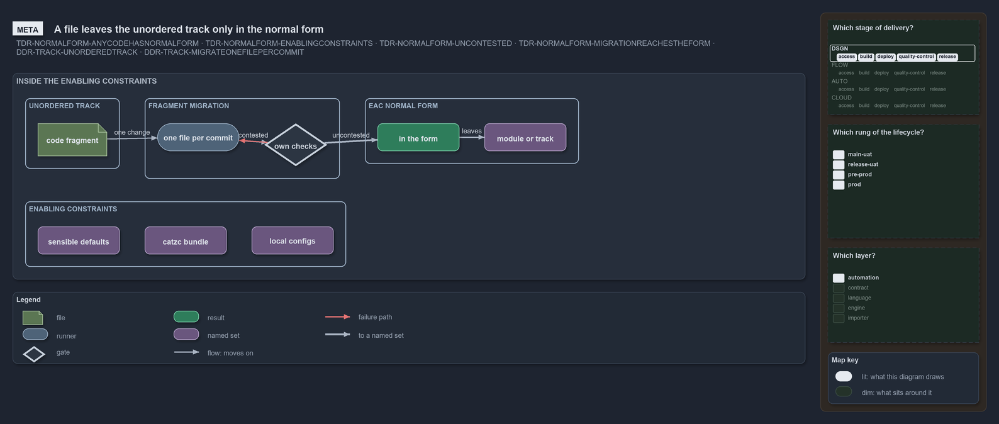

# A file leaves the unordered track only in the normal form

```text
A file leaves the unordered track only in the normal form.

1  code fragment        a file in the unordered track, in whatever shape its origin left it
2  one file per commit  fragment migration: one reviewed change at a time
3  own checks           the repository's formatters, tests and asserts, run over the change
4  contested            a check changes the file or fails, so migration goes on
5  in the form          no check changes it and none fails: the eac normal form
6  module or track      the file leaves the unordered track for its home
7  enabling constraints sensible defaults, catzc bundle, local configs: all a check may use

Supports TDR-NORMALFORM-ANYCODEHASNORMALFORM, TDR-NORMALFORM-ENABLINGCONSTRAINTS, TDR-NORMALFORM-UNCONTESTED,
TDR-NORMALFORM-MIGRATIONREACHESTHEFORM, ADR-DSGN-TRACK-UNORDEREDTRACK and ADR-DSGN-TRACK-MIGRATEONEFILEPERCOMMIT (meta lens).
```

Code reaches cats from many places: written in the trunk, imported with its history, copied from a vendor sample, exported from a UI. The
thesis gives all of it one target shape, the **eac normal form**: code the repository can verify within its enabling constraints, and that
its own formatters, tests and asserts leave unchanged and do not fail. An import lands in the unordered track, and fragment migration moves
each file into the form before it leaves the track for its home.



## Walkthrough

1. **Code fragment.** A file in the unordered track holds code the repository keeps but does not decide by. Its shape is whatever its origin
   left it, and nothing reads it as truth while it stays there.
2. **One file per commit.** Fragment migration changes the fragment through the one change process, one file per reviewed commit, so each
   step is small enough to review and to revert.
3. **Own checks.** Every change runs the repository's own formatters, tests and asserts over the file. They decide whether the form is
   reached, never a person's judgement.
4. **Contested.** A formatter that still rewrites the file, or a test or assert that fails on it, sends the file back to migration. A file
   whose tests pass but that a formatter still rewrites is not yet in the form.
5. **In the form.** When no check changes the file and none fails, running them again changes nothing: the file is at the fixed point of the
   checks, uncontested.
6. **Module or track.** Only then does the file leave the unordered track for the module or track that owns it.
7. **Enabling constraints.** The whole flow sits inside the sensible defaults, the catzc bundle and the local configs. A check that needs
   anything outside them, a tool installed by hand or a value one person knows, cannot be repeated, so passing it proves nothing.

## Why it holds

- Everything inside a responsibility domain is code managed through one change process, so any code, an unordered fragment included, has an
  eac normal form (TDR-NORMALFORM-ANYCODEHASNORMALFORM).
- Code is in the form when it can be verified within the sensible defaults, the catzc bundle and the local configs, and nothing else
  (TDR-NORMALFORM-ENABLINGCONSTRAINTS).
- The form is the fixed point of the repository's own checks: none changes the code and none fails, decided by running them
  (TDR-NORMALFORM-UNCONTESTED).
- Fragment migration brings an unordered fragment into the form through the one change process, and until then it decides nothing about the
  delivered system (TDR-NORMALFORM-MIGRATIONREACHESTHEFORM).
- An import lands in the unordered track, and nothing reads or defaults to the track (ADR-DSGN-TRACK-UNORDEREDTRACK); sorting moves one file
  per commit (ADR-DSGN-TRACK-MIGRATEONEFILEPERCOMMIT).

## See also

- [Eac normal form](../../adr/thesis/eac-normal-form.md) — the thesis this article explains.
- [Tracks](../../adr/design/tracks.md#rule-adr-dsgn-track-unorderedtrack) — the unordered track and how files leave it.
- [The thesis explanations](index.md) · [How to read the diagrams](../index.md#how-to-read-the-diagrams)
