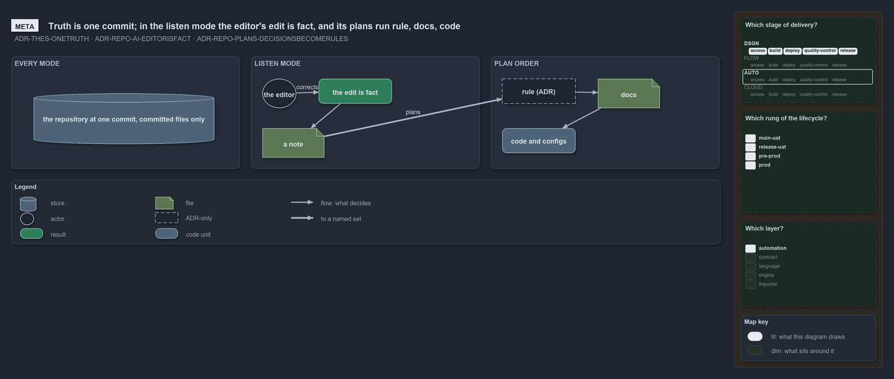

# Thesis explanations

```text
What cats is for, as a deck.

Product thesis   one source of truth, six principles, twelve domains, in 21 slides
Eac normal form  a file leaves the unordered track only in the normal form
```

These pages explain the [thesis decision-record domain](../../drs/index.md#thesis). The product thesis is a deck kept as slide files under
[product-thesis](product-thesis/deck.md), rendered through the slides kit ([ADR-REPO-SLIDES](../../drs/repository/slides-as-markdown.md));
the [explanation index](../index.md) says how to read the explanations.

- [A file leaves the unordered track only in the normal form](eac-normal-form.md) — the eac normal form and fragment migration
  ([TDR-NORMALFORM](../../drs/thesis/eac-normal-form.md)).


