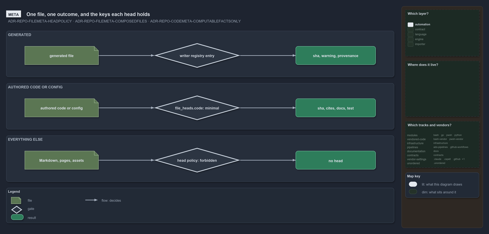

# Add a fact to a file's head

A file's **head** is the one block of facts the tooling owns about it. What decides whether a file has one, and what it holds, is
[ADR-REPO-FILEMETA](../../drs/repository/file-meta.md); how a code file carries it is
[ADR-REPO-CODEMETA](../../drs/repository/code-file-meta.md). This guide takes a wanted fact to an imprinted head, and restates none of their
rules.

## Decide which head the fact belongs to

There are three outcomes, and a fact belongs to exactly one:

- **A generated file's head**: the file's writer composes it, with the warning and the provenance keys. A fact here is written by the
  writer, never imprinted; change the writer and the one head function it calls, not the imprint engine.
- **An authored code or config file's navigation head**: present when the `file_heads.code` variant in
  `pwsh/Catzc.Base.Variants/configs/variants.yml` says so (`minimal` by default, `none` for no head). It holds `with_body_sha` and the
  edges, so a new fact here is a new edge, and a place fact (path, role, language, track, module) is derived on demand instead, never
  written.
- **No head**: authored Markdown, comment pages, assets and agent definitions. A fact about these files is a derived query, never a key.

If the fact can be derived on demand from the registries, git or the disk, derive it and stop: a head holds only what a reader needs to see
in the file.



The sidebar lights one cell. Which layer: automation, because ADR-REPO-FILEMETA and ADR-REPO-CODEMETA name no layer in `drs.yml` and so
take the declared default. The code-locations and track-placement maps light nothing.

## Add the kind

1. Add an entry under `kinds:` in `pwsh/Catzc.Base.QualityGates/configs/file-meta.yml`: its keys in order, the `section` (`immutable` or
   `edges`), and `select` by class and language, never by glob. A one-line comment above it says what the kind writes.
2. Write the processor `Get-<Kind>FileMetaFact.ps1` in the module that owns the fact. It is found by its name, so no engine changes; it
   returns exactly the keys the kind declares.
3. Write its test beside it, with neutral fixture names, and run it:

   ```powershell
   Invoke-TestFile pwsh/<Module>/tests/Get-<Kind>FileMetaFact.Tests.ps1 -PassThru
   ```

## Imprint and check

1. Imprint one module first, read the heads it wrote, then widen:

   ```powershell
   Format-FileMeta -Path pwsh/<Module>
   ```

   A second run changes no file.

2. Run the gates that hold a head: `Test-FileMetaProcessors` (every kind has its function, every function its kind) and
   `Test-FileMeta -Path pwsh/<Module>` (every head is what the imprint would write).
