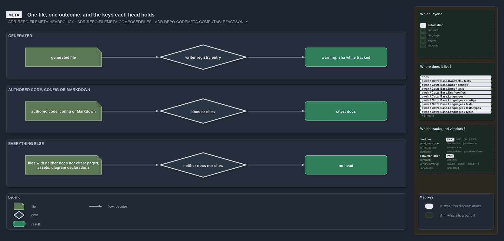

---
catzc:
  warning: "Header is generated by Format-FileMeta via Format-Code; do not change it"
  edges:
    cites:
      - ADR-REPO-CODEMETA
      - ADR-REPO-FILEMETA
    drs_total: 5
---

# Add a fact to a file's head

A file's **head** is the one block of facts the tooling owns about it. What decides whether a file has one, and what it holds, is
[ADR-REPO-FILEMETA](../../drs/repository/file-meta.md); how a code file carries it is
[ADR-REPO-CODEMETA](../../drs/repository/code-file-meta.md). This guide takes a wanted fact to an imprinted head, and restates none of their
rules.

## Decide which head the fact belongs to

There are three outcomes, and a fact belongs to exactly one:

- **A generated file's head**: the file's writer composes it: the warning, and `with_body_sha` while git tracks the file, nothing else. A
  fact here is written by the writer, never imprinted; change the writer and the one head function it calls, not the imprint engine.
- **An authored file's head**: present only when the file has a comment page (`docs`) or rule codes to cite (`cites`), and it holds those
  two edges and nothing else: no `with_body_sha`, no `test` or `code` edge. A new fact here is a new edge, and a place fact (path, role,
  language, track, module) is derived on demand instead, never written.
- **No head**: every other authored file, diagram declarations included, and binaries. Agent, skill and slide files keep their own tool's
  front matter and are out of scope. A fact about these files is a derived query, never a key.

If the fact can be derived on demand from the registries, git or the disk, derive it and stop: a head holds only what a reader needs to see
in the file.

```yml drawio
description:
  "What decides a file's head and what fills it: a generated file carries the warning head its writer composes, with with_body_sha while git
  tracks it; an authored file carries a head only for a docs link to its comment page or the rule codes it cites; every other file carries
  none."
about:
  adrs: [ADR-REPO-FILEMETA-HEADPOLICY, ADR-REPO-FILEMETA-COMPOSEDFILES, ADR-REPO-CODEMETA-COMPUTABLEFACTSONLY]
  lens: meta
content:
  title: One file, one outcome, and the keys each head holds
  kind: explanation
  flow: left-to-right
  relation: decides
  theme: dark
  bands:
    - { id: band-generated, label: GENERATED }
    - { id: band-authored, label: "AUTHORED CODE, CONFIG OR MARKDOWN" }
    - { id: band-other, label: EVERYTHING ELSE }
  glyphs:
    - { id: g-gen-file, kind: file, label: generated file, in: band-generated }
    - { id: g-gen-gate, kind: gate, label: writer registry entry, in: band-generated }
    - { id: g-gen-head, kind: result, label: "warning; sha while tracked", in: band-generated }
    - { id: g-auth-file, kind: file, label: "authored code, config or Markdown", in: band-authored }
    - { id: g-auth-gate, kind: gate, label: docs or cites, in: band-authored }
    - { id: g-auth-head, kind: result, label: "cites, docs", in: band-authored }
    - { id: g-other-file, kind: file, label: "files with neither docs nor cites: pages, assets, diagram declarations", in: band-other }
    - { id: g-other-gate, kind: gate, label: neither docs nor cites, in: band-other }
    - { id: g-other-head, kind: result, label: no head, in: band-other }
  edges:
    - { from: g-gen-file, to: g-gen-gate, kind: flow, label: "" }
    - { from: g-gen-gate, to: g-gen-head, kind: flow, label: "" }
    - { from: g-auth-file, to: g-auth-gate, kind: flow, label: "" }
    - { from: g-auth-gate, to: g-auth-head, kind: flow, label: "" }
    - { from: g-other-file, to: g-other-gate, kind: flow, label: "" }
    - { from: g-other-gate, to: g-other-head, kind: flow, label: "" }
  legend: auto
  minimaps:
    layer-stack:
      - cell: automation
        by:
          - docs/drs/glossary.md
          - docs/drs/index.md
          - docs/drs/repository/code-file-meta.md
          - docs/drs/repository/dora-explains.md
          - docs/drs/repository/file-meta.md
          - docs/how-to/pwsh/add-a-head-fact.md
          - docs/how-to/pwsh/manual-test-plan/configs.md
          - docs/references/note-file-kind.md
          - docs/references/pwsh/catzc-base-languages/Format-GeneratedFileHead.ps1.md
          - docs/references/pwsh/catzc-base-languages/configs/file-carriers.yml.md
          - docs/references/pwsh/catzc-base-languages/types/CarrierKind.cs.md
          - docs/references/pwsh/catzc-base-languages/types/FileCarriersConfig.cs.md
          - docs/references/pwsh/catzc-base-markdown-meta/Get-MarkdownMetaState.ps1.md
          - docs/references/pwsh/catzc-base-markdown-meta/types/MarkdownMetaBlock.cs.md
          - docs/references/pwsh/catzc-base-quality-gates/Test-GeneratedFiles.ps1.md
          - docs/references/pwsh/catzc-base-quality-gates/private/Get-GeneratedStampDrift.ps1.md
          - docs/references/pwsh/catzc-base-quality-gates/types/FileHeadPolicy.cs.md
          - pwsh/Catzc.Base.Docs/configs/glossary.yml
          - pwsh/Catzc.Base.Docs/tests/Get-GlossaryFormViolations.Tests.ps1
          - pwsh/Catzc.Base.Drs/configs/drs.yml
          - pwsh/Catzc.Base.Languages/Format-GeneratedFileHead.ps1
          - pwsh/Catzc.Base.Languages/configs/file-carriers.yml
          - pwsh/Catzc.Base.Languages/tests/Format-GeneratedFileHead.Tests.ps1
          - pwsh/Catzc.Base.Languages/tests/types/FileCarriersConfig.Tests.ps1
          - pwsh/Catzc.Base.Languages/tests/types/GeneratedHeadConfig.Tests.ps1
          - pwsh/Catzc.Base.Languages/types/CarrierKind.cs
          - pwsh/Catzc.Base.Languages/types/FileCarriersConfig.cs
          - pwsh/Catzc.Base.MarkdownMeta/Get-MarkdownMetaState.ps1
          - pwsh/Catzc.Base.MarkdownMeta/tests/Format-MarkdownMetaBlock.Tests.ps1
          - pwsh/Catzc.Base.MarkdownMeta/tests/Get-MarkdownMetaState.Tests.ps1
          - pwsh/Catzc.Base.MarkdownMeta/tests/Remove-MarkdownFrontMatter.Tests.ps1
          - pwsh/Catzc.Base.MarkdownMeta/tests/types/MarkdownDocument.Tests.ps1
          - pwsh/Catzc.Base.MarkdownMeta/types/MarkdownDocument.cs
          - pwsh/Catzc.Base.MarkdownMeta/types/MarkdownMetaBlock.cs
          - pwsh/Catzc.Base.QualityGates/Test-GeneratedFiles.ps1
          - pwsh/Catzc.Base.QualityGates/private/Get-GeneratedStampDrift.ps1
          - pwsh/Catzc.Base.QualityGates/tests/Format-FileMeta.Contract.Tests.ps1
          - pwsh/Catzc.Base.QualityGates/tests/Format-FileMeta.Tests.ps1
          - pwsh/Catzc.Base.QualityGates/tests/Format-Links.Tests.ps1
          - pwsh/Catzc.Base.QualityGates/tests/Get-DrsCodesFileMetaFact.Tests.ps1
          - pwsh/Catzc.Base.QualityGates/tests/Get-FileMetaScope.Tests.ps1
          - pwsh/Catzc.Base.QualityGates/tests/Get-GeneratedStampDrift.Tests.ps1
          - pwsh/Catzc.Base.QualityGates/tests/Invoke-FileMetaEngine.Tests.ps1
          - pwsh/Catzc.Base.QualityGates/tests/Sync-FileMeta.Tests.ps1
          - pwsh/Catzc.Base.QualityGates/tests/Test-GeneratedFiles.Tests.ps1
          - pwsh/Catzc.Base.QualityGates/tests/types/FileHeadPolicy.Tests.ps1
          - pwsh/Catzc.Base.QualityGates/types/FileHeadPolicy.cs
          - pwsh/Catzc.Base.Variants/tests/types/VariantsConfig.Tests.ps1
          - ADR-REPO-CODEMETA-COMPUTABLEFACTSONLY
          - ADR-REPO-FILEMETA-COMPOSEDFILES
          - ADR-REPO-FILEMETA-HEADPOLICY
    code-locations:
      - cell: docs/-/.
        by:
          - docs/drs/glossary.md
          - docs/drs/index.md
          - docs/drs/repository/code-file-meta.md
          - docs/drs/repository/dora-explains.md
          - docs/drs/repository/file-meta.md
          - docs/how-to/pwsh/add-a-head-fact.md
          - docs/how-to/pwsh/manual-test-plan/configs.md
          - docs/references/note-file-kind.md
          - docs/references/pwsh/catzc-base-languages/Format-GeneratedFileHead.ps1.md
          - docs/references/pwsh/catzc-base-languages/configs/file-carriers.yml.md
          - docs/references/pwsh/catzc-base-languages/types/CarrierKind.cs.md
          - docs/references/pwsh/catzc-base-languages/types/FileCarriersConfig.cs.md
          - docs/references/pwsh/catzc-base-markdown-meta/Get-MarkdownMetaState.ps1.md
          - docs/references/pwsh/catzc-base-markdown-meta/types/MarkdownMetaBlock.cs.md
          - docs/references/pwsh/catzc-base-quality-gates/Test-GeneratedFiles.ps1.md
          - docs/references/pwsh/catzc-base-quality-gates/private/Get-GeneratedStampDrift.ps1.md
          - docs/references/pwsh/catzc-base-quality-gates/types/FileHeadPolicy.cs.md
          - ADR-REPO-CODEMETA-COMPUTABLEFACTSONLY
          - ADR-REPO-FILEMETA-COMPOSEDFILES
          - ADR-REPO-FILEMETA-HEADPOLICY
      - cell: pwsh/Catzc.Base.Docs/configs
        by: [pwsh/Catzc.Base.Docs/configs/glossary.yml, ADR-REPO-FILEMETA-HEADPOLICY]
      - cell: pwsh/Catzc.Base.Docs/tests
        by: [pwsh/Catzc.Base.Docs/tests/Get-GlossaryFormViolations.Tests.ps1, ADR-REPO-FILEMETA-HEADPOLICY]
      - cell: pwsh/Catzc.Base.Drs/configs
        by:
          - pwsh/Catzc.Base.Drs/configs/drs.yml
          - ADR-REPO-CODEMETA-COMPUTABLEFACTSONLY
          - ADR-REPO-FILEMETA-COMPOSEDFILES
          - ADR-REPO-FILEMETA-HEADPOLICY
      - cell: pwsh/Catzc.Base.Languages/.
        by: [pwsh/Catzc.Base.Languages/Format-GeneratedFileHead.ps1, ADR-REPO-FILEMETA-COMPOSEDFILES]
      - cell: pwsh/Catzc.Base.Languages/configs
        by: [pwsh/Catzc.Base.Languages/configs/file-carriers.yml, ADR-REPO-FILEMETA-HEADPOLICY]
      - cell: pwsh/Catzc.Base.Languages/tests
        by: [pwsh/Catzc.Base.Languages/tests/Format-GeneratedFileHead.Tests.ps1, ADR-REPO-FILEMETA-COMPOSEDFILES]
      - cell: pwsh/Catzc.Base.Languages/tests/types
        by:
          - pwsh/Catzc.Base.Languages/tests/types/FileCarriersConfig.Tests.ps1
          - pwsh/Catzc.Base.Languages/tests/types/GeneratedHeadConfig.Tests.ps1
          - ADR-REPO-FILEMETA-COMPOSEDFILES
          - ADR-REPO-FILEMETA-HEADPOLICY
      - cell: pwsh/Catzc.Base.Languages/types
        by:
          - pwsh/Catzc.Base.Languages/types/CarrierKind.cs
          - pwsh/Catzc.Base.Languages/types/FileCarriersConfig.cs
          - ADR-REPO-FILEMETA-HEADPOLICY
      - cell: pwsh/Catzc.Base.MarkdownMeta/.
        by: [pwsh/Catzc.Base.MarkdownMeta/Get-MarkdownMetaState.ps1, ADR-REPO-FILEMETA-HEADPOLICY]
      - cell: pwsh/Catzc.Base.MarkdownMeta/tests
        by:
          - pwsh/Catzc.Base.MarkdownMeta/tests/Format-MarkdownMetaBlock.Tests.ps1
          - pwsh/Catzc.Base.MarkdownMeta/tests/Get-MarkdownMetaState.Tests.ps1
          - pwsh/Catzc.Base.MarkdownMeta/tests/Remove-MarkdownFrontMatter.Tests.ps1
          - ADR-REPO-FILEMETA-HEADPOLICY
      - cell: pwsh/Catzc.Base.MarkdownMeta/tests/types
        by: [pwsh/Catzc.Base.MarkdownMeta/tests/types/MarkdownDocument.Tests.ps1, ADR-REPO-FILEMETA-HEADPOLICY]
      - cell: pwsh/Catzc.Base.MarkdownMeta/types
        by:
          - pwsh/Catzc.Base.MarkdownMeta/types/MarkdownDocument.cs
          - pwsh/Catzc.Base.MarkdownMeta/types/MarkdownMetaBlock.cs
          - ADR-REPO-FILEMETA-HEADPOLICY
      - cell: pwsh/Catzc.Base.QualityGates/.
        by: [pwsh/Catzc.Base.QualityGates/Test-GeneratedFiles.ps1, ADR-REPO-FILEMETA-COMPOSEDFILES]
      - cell: pwsh/Catzc.Base.QualityGates/private
        by: [pwsh/Catzc.Base.QualityGates/private/Get-GeneratedStampDrift.ps1, ADR-REPO-FILEMETA-COMPOSEDFILES]
      - cell: pwsh/Catzc.Base.QualityGates/tests
        by:
          - pwsh/Catzc.Base.QualityGates/tests/Format-FileMeta.Contract.Tests.ps1
          - pwsh/Catzc.Base.QualityGates/tests/Format-FileMeta.Tests.ps1
          - pwsh/Catzc.Base.QualityGates/tests/Format-Links.Tests.ps1
          - pwsh/Catzc.Base.QualityGates/tests/Get-DrsCodesFileMetaFact.Tests.ps1
          - pwsh/Catzc.Base.QualityGates/tests/Get-FileMetaScope.Tests.ps1
          - pwsh/Catzc.Base.QualityGates/tests/Get-GeneratedStampDrift.Tests.ps1
          - pwsh/Catzc.Base.QualityGates/tests/Invoke-FileMetaEngine.Tests.ps1
          - pwsh/Catzc.Base.QualityGates/tests/Sync-FileMeta.Tests.ps1
          - pwsh/Catzc.Base.QualityGates/tests/Test-GeneratedFiles.Tests.ps1
          - ADR-REPO-CODEMETA-COMPUTABLEFACTSONLY
          - ADR-REPO-FILEMETA-COMPOSEDFILES
          - ADR-REPO-FILEMETA-HEADPOLICY
      - cell: pwsh/Catzc.Base.QualityGates/tests/types
        by: [pwsh/Catzc.Base.QualityGates/tests/types/FileHeadPolicy.Tests.ps1, ADR-REPO-FILEMETA-HEADPOLICY]
      - cell: pwsh/Catzc.Base.QualityGates/types
        by: [pwsh/Catzc.Base.QualityGates/types/FileHeadPolicy.cs, ADR-REPO-FILEMETA-HEADPOLICY]
      - cell: pwsh/Catzc.Base.Variants/tests/types
        by: [pwsh/Catzc.Base.Variants/tests/types/VariantsConfig.Tests.ps1, ADR-REPO-FILEMETA-HEADPOLICY]
    track-placement:
      - cell: modules/pwsh
        by:
          - pwsh/Catzc.Base.Docs/configs/glossary.yml
          - pwsh/Catzc.Base.Docs/tests/Get-GlossaryFormViolations.Tests.ps1
          - pwsh/Catzc.Base.Drs/configs/drs.yml
          - pwsh/Catzc.Base.Languages/Format-GeneratedFileHead.ps1
          - pwsh/Catzc.Base.Languages/configs/file-carriers.yml
          - pwsh/Catzc.Base.Languages/tests/Format-GeneratedFileHead.Tests.ps1
          - pwsh/Catzc.Base.Languages/tests/types/FileCarriersConfig.Tests.ps1
          - pwsh/Catzc.Base.Languages/tests/types/GeneratedHeadConfig.Tests.ps1
          - pwsh/Catzc.Base.Languages/types/CarrierKind.cs
          - pwsh/Catzc.Base.Languages/types/FileCarriersConfig.cs
          - pwsh/Catzc.Base.MarkdownMeta/Get-MarkdownMetaState.ps1
          - pwsh/Catzc.Base.MarkdownMeta/tests/Format-MarkdownMetaBlock.Tests.ps1
          - pwsh/Catzc.Base.MarkdownMeta/tests/Get-MarkdownMetaState.Tests.ps1
          - pwsh/Catzc.Base.MarkdownMeta/tests/Remove-MarkdownFrontMatter.Tests.ps1
          - pwsh/Catzc.Base.MarkdownMeta/tests/types/MarkdownDocument.Tests.ps1
          - pwsh/Catzc.Base.MarkdownMeta/types/MarkdownDocument.cs
          - pwsh/Catzc.Base.MarkdownMeta/types/MarkdownMetaBlock.cs
          - pwsh/Catzc.Base.QualityGates/Test-GeneratedFiles.ps1
          - pwsh/Catzc.Base.QualityGates/private/Get-GeneratedStampDrift.ps1
          - pwsh/Catzc.Base.QualityGates/tests/Format-FileMeta.Contract.Tests.ps1
          - pwsh/Catzc.Base.QualityGates/tests/Format-FileMeta.Tests.ps1
          - pwsh/Catzc.Base.QualityGates/tests/Format-Links.Tests.ps1
          - pwsh/Catzc.Base.QualityGates/tests/Get-DrsCodesFileMetaFact.Tests.ps1
          - pwsh/Catzc.Base.QualityGates/tests/Get-FileMetaScope.Tests.ps1
          - pwsh/Catzc.Base.QualityGates/tests/Get-GeneratedStampDrift.Tests.ps1
          - pwsh/Catzc.Base.QualityGates/tests/Invoke-FileMetaEngine.Tests.ps1
          - pwsh/Catzc.Base.QualityGates/tests/Sync-FileMeta.Tests.ps1
          - pwsh/Catzc.Base.QualityGates/tests/Test-GeneratedFiles.Tests.ps1
          - pwsh/Catzc.Base.QualityGates/tests/types/FileHeadPolicy.Tests.ps1
          - pwsh/Catzc.Base.QualityGates/types/FileHeadPolicy.cs
          - pwsh/Catzc.Base.Variants/tests/types/VariantsConfig.Tests.ps1
          - ADR-REPO-CODEMETA-COMPUTABLEFACTSONLY
          - ADR-REPO-FILEMETA-COMPOSEDFILES
          - ADR-REPO-FILEMETA-HEADPOLICY
      - cell: documentation/docs
        by:
          - docs/drs/glossary.md
          - docs/drs/index.md
          - docs/drs/repository/code-file-meta.md
          - docs/drs/repository/dora-explains.md
          - docs/drs/repository/file-meta.md
          - docs/how-to/pwsh/add-a-head-fact.md
          - docs/how-to/pwsh/manual-test-plan/configs.md
          - docs/references/note-file-kind.md
          - docs/references/pwsh/catzc-base-languages/Format-GeneratedFileHead.ps1.md
          - docs/references/pwsh/catzc-base-languages/configs/file-carriers.yml.md
          - docs/references/pwsh/catzc-base-languages/types/CarrierKind.cs.md
          - docs/references/pwsh/catzc-base-languages/types/FileCarriersConfig.cs.md
          - docs/references/pwsh/catzc-base-markdown-meta/Get-MarkdownMetaState.ps1.md
          - docs/references/pwsh/catzc-base-markdown-meta/types/MarkdownMetaBlock.cs.md
          - docs/references/pwsh/catzc-base-quality-gates/Test-GeneratedFiles.ps1.md
          - docs/references/pwsh/catzc-base-quality-gates/private/Get-GeneratedStampDrift.ps1.md
          - docs/references/pwsh/catzc-base-quality-gates/types/FileHeadPolicy.cs.md
          - ADR-REPO-CODEMETA-COMPUTABLEFACTSONLY
          - ADR-REPO-FILEMETA-COMPOSEDFILES
          - ADR-REPO-FILEMETA-HEADPOLICY
layout:
  band-generated: { x: 20, y: 84, w: 1260, h: 150 }
  band-authored: { x: 20, y: 254, w: 1260, h: 150 }
  band-other: { x: 20, y: 424, w: 1260, h: 150 }
  g-gen-file: { x: 80, y: 134, w: 240, h: 60 }
  g-gen-gate: { x: 500, y: 124, w: 280, h: 80 }
  g-gen-head: { x: 960, y: 134, w: 260, h: 60 }
  g-auth-file: { x: 80, y: 304, w: 240, h: 60 }
  g-auth-gate: { x: 500, y: 294, w: 280, h: 80 }
  g-auth-head: { x: 960, y: 304, w: 260, h: 60 }
  g-other-file: { x: 80, y: 474, w: 240, h: 60 }
  g-other-gate: { x: 500, y: 464, w: 280, h: 80 }
  g-other-head: { x: 960, y: 474, w: 260, h: 60 }
```



The sidebar lights one cell. Which layer: automation, because ADR-REPO-FILEMETA and ADR-REPO-CODEMETA name no layer in `drs.yml` and so take
the declared default. The code-locations and track-placement maps light nothing.

## Add the kind

1. Add an entry under `kinds:` in `pwsh/Catzc.Base.QualityGates/configs/file-meta.yml`: its keys in order, the `section` (`immutable` or
   `edges`), and `select` by class and language, never by glob. A one-line comment above it says what the kind writes.
2. Write the processor `Get-<Kind>FileMetaFact.ps1` in the module that owns the fact. It is found by its name, so no engine changes; it
   returns exactly the keys the kind declares.
3. Write its test beside it, with neutral fixture names, and run it:

   ```powershell
   Invoke-TestFile pwsh/<Module>/tests/Get-<Kind>FileMetaFact.Tests.ps1 -PassThru
   ```

## Imprint and check

1. Imprint one module first, read the heads it wrote, then widen:

   ```powershell
   Format-FileMeta -Path pwsh/<Module>
   ```

   A second run changes no file.

2. Run the gates that hold a head: `Test-FileMetaProcessors` (every kind has its function, every function its kind) and
   `Test-FileMeta -Path pwsh/<Module>` (every head is what the imprint would write).
