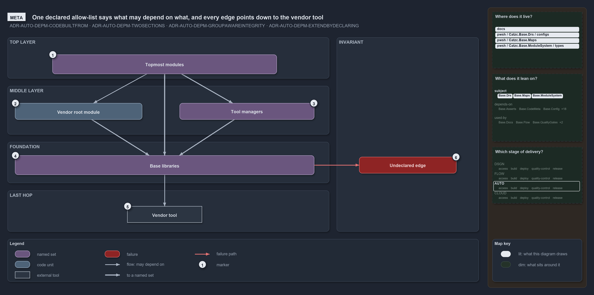

---
catzc:
  warning: "Header is generated by Format-FileMeta via Format-Code; do not change it"
  edges:
    cites:
      - ADR-AUTO-DEPM-CODEBUILTFROM
      - ADR-AUTO-DEPM-TWOSECTIONS
      - ADR-AUTO-DEPM-GROUPAWAREINTEGRITY
      - ADR-AUTO-DEPM-EXTENDBYDECLARING
    drs_total: 4
---

# One declared allow-list says what may depend on what, and every edge points down to the vendor tool

```text
One declared allow-list says what may depend on what, and every allowed edge points down to the vendor tool.

1  Topmost modules     the modules no other layer may depend on, one group
2  Vendor root module  the module of one vendor, in the middle layer
3  Tool managers       the managers of the external tools, one group in the middle layer
4  Base libraries      the foundation: one group that depends on nothing outside itself
5  Vendor tool         the last hop: the call reaches the tool through Base
6  Undeclared edge     any real edge the declaration does not list; it fails the build

Supports ADR-AUTO-DEPM-CODEBUILTFROM, ADR-AUTO-DEPM-TWOSECTIONS, ADR-AUTO-DEPM-GROUPAWAREINTEGRITY and ADR-AUTO-DEPM-EXTENDBYDECLARING (meta lens).
```

The module dependency declaration is one file that says which module may depend on which, and cats checks the code against that file, never
the other way round. The declaration is the allow-list: it lets each layer depend only on the layers below it, and a real edge it does not
list fails the build. Stripped of every module and function name and of any one vendor, the whole idea is three layers, one last hop to the
vendor tool and one failure.



## Walkthrough

1. **Topmost modules.** The top of the graph is a group of modules that no other layer may depend on. Its members may use the vendor root
   module, the tool managers and the Base libraries.
2. **Vendor root module.** The module of one vendor sits in the middle of the graph as a single module. It may use Base.
3. **Tool managers.** The managers of the external tools form a group in the middle of the graph. It may use Base.
4. **Base libraries.** The foundation is a group that depends on nothing outside itself; its members are layered only among themselves.
5. **Vendor tool.** The call into the vendor's own tool is the last hop, and it is made from Base: every layer above reaches the tool only
   through the foundation, never directly.
6. **Undeclared edge.** An edge the declaration does not list, such as a Base library reaching up into the tool managers, fails the build.
   The check is mechanical, not a matter of review vigilance.

## A worked example: Azure

In the Azure case the topmost group is `AzureExt`, the Azure modules below the Azure root. The vendor root module is `Catzc.Azure`, the
Azure root, a single module. The tool managers are the `Tooling` group, the managers of the non-vendored external tools. The foundation is
the `Base` group, and the vendor tool at the last hop is the Az CLI, which the Azure modules reach only through Base.

## Why it holds

- The declaration is the only place a module dependency can exist, and an actual edge with no declaration fails the build
  (ADR-AUTO-DEPM-CODEBUILTFROM).
- A group is a concept, not a module on disk. Allowing a group allows an edge to any of its members, while allowing one module allows
  exactly that edge (ADR-AUTO-DEPM-TWOSECTIONS).
- The declaration is checked when it loads, and the quality gate then checks every real edge in the code against it
  (ADR-AUTO-DEPM-GROUPAWAREINTEGRITY).
- A new dependency is a new declared edge, landed in the same change as the code that introduces it (ADR-AUTO-DEPM-EXTENDBYDECLARING).

The two Tooling modules that belong to no group, Github and KeyHandler, also depend on Base alone; they are left out here for brevity.

## See also

- [Controlling module dependencies](../drs/automation/controlling-module-dependencies.md) — the decision this article explains.
- The other lenses on the same graph: [architecture](three-layers-edges-point-down.md),
  [implementation](two-sections-unioned-into-one-allow-set.md), [operations](undeclared-edge-fails-with-one-line.md) and
  [governance](two-gates-check-the-layer-pins.md).
- [The automation explanations](../explanation/automation/index.md) · [How to read the diagrams](how-cats-works-and-why-in-one-diagram-per-article.md#how-to-read-the-diagrams)
