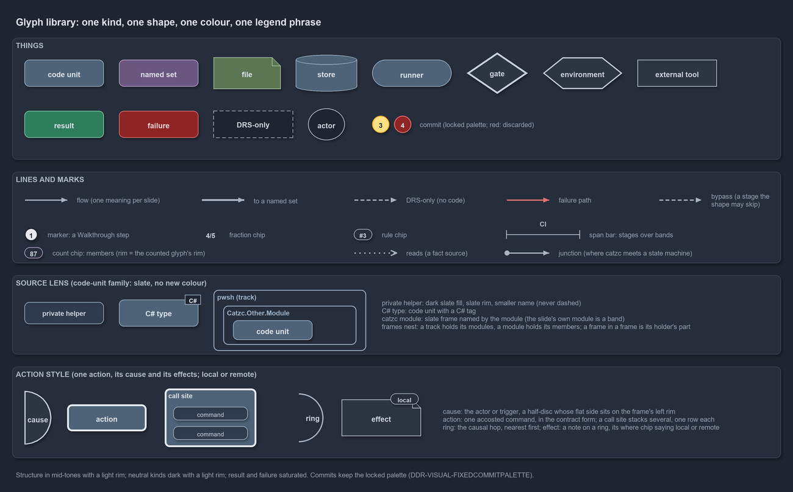

---
catzc:
  warning: "Header is generated by Format-FileMeta via Format-Code; do not change it"
  edges:
    cites:
      - DDR-TRACK-WORLDMAP
      - DDR-TRACK-LITCELL
      - DDR-TRACK-VALUECHAINMAP
    drs_total: 3
---

# Explanation

```text
Explanation articles: how cats works and why, one diagram each.

automation      module dependencies, the importer, the bundle, and what compiled types cost
azure           how Azure resource names are assembled
configuration   how configuration is read, cached and addressed
design          the commit lifecycle, run modes, module aspects, tracks, the thin platform, the server remote
flow            promotion, the pipeline runner, and the globsets that trigger pipelines
pipelines       how Azure DevOps calls prove their credentials
repository      how managed root files and repository variants are kept in shape
```

The documentation has four kinds of article. A [decision record](../drs/index.md) records a decision and the rules it sets. A
[how-to](../how-to/getting-started/automation/index.md) walks through one task. A [reference](../references/pwsh/index.md) describes a
module's responsibilities. An **explanation** article shows how one part of cats works and why it holds: each one narrates a single diagram,
step by step, and points back to the DRS rules the diagram supports.

Each diagram is drawn five times, through five lenses, so the same idea can be read at the depth a reader needs:

| Lens               | Shows                                                                  |
| ------------------ | ---------------------------------------------------------------------- |
| **meta**           | the idea and the one rule that holds, with no function or file names   |
| **architecture**   | the parts, their boundaries, and who depends on whom                   |
| **implementation** | the real functions, files and configs, in the order the code runs them |
| **operations**     | what a person or a pipeline runs, and what they see when it fails      |
| **governance**     | which DRS rule constrains each step, and which gate checks it          |

## How to read the diagrams

Every diagram uses the same glyphs. The shape says what kind of thing an element is, and the colour says whether it is structure (dark, with
white text) or state and outcome (light). Every diagram also carries its own legend panel.



The glyph library is described element by element in the kit's
[style guide](../../python/catzc_diagrams/assets/STYLE.md#glyphs-one-kind-one-shape-one-colour-one-legend-phrase).

The sidebar of every diagram places it on three maps, each drawn small as a minimap:

- The **world map** is the repository drawn as its tracks crossed with its file languages
  ([DDR-TRACK-WORLDMAP](../drs/design/tracks.md#rule-ddr-track-worldmap)). It shows where the files the diagram concerns are.
- The **tree** is the repository's files, grouped by folder. It shows the same files in the folders that hold them.
- The **value-chain map** is the decision records drawn as the value-chain stack crossed with the value-chain concerns
  ([DDR-TRACK-VALUECHAINMAP](../drs/design/tracks.md#rule-ddr-track-valuechainmap)). It shows where the decision sits in delivery.

On each map, a **lit cell** ([DDR-TRACK-LITCELL](../drs/design/tracks.md#rule-ddr-track-litcell)) is one the diagram's decision record
selects; a cell lit only by passing mentions is drawn lighter, and every other cell is idle. The map key below the minimaps names the four
swatches, and each minimap's own description, in the minimap's sub-folder of `docs/explanation/.assets/` (`grid/`, `tree/`, `chain/`), gives
the reason for every lit cell.

## Domains

The articles are grouped by the decision-record domain of the decision they explain:

- [Ado](how-azure-devops-calls-prove-their-credentials.md) — how Azure DevOps calls prove their credentials.
- [Automation](../explanation/automation/index.md) — module dependencies, the importer, and the bundle.
- [Azure](../explanation/azure/index.md) — how Azure resource names are assembled.
- [Configuration](../explanation/configuration/index.md) — how configuration is read, cached and addressed.
- [Design](../explanation/design/index.md) — the commit lifecycle, run modes, module aspects, tracks, the thin platform, and the server remote.
- [Flow](../explanation/flow/index.md) — promotion, the pipeline runner, and the globsets that trigger pipelines.
- [Repository](../explanation/repository/index.md) — how managed root files and repository variants are kept in shape.
- [Thesis](../explanation/thesis/index.md) — the product thesis as a deck of slide files.
