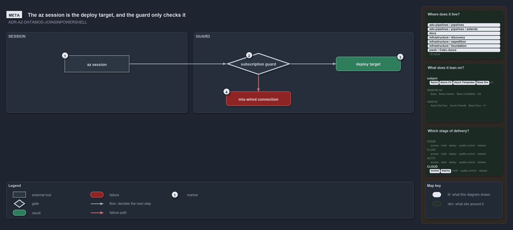

---
catzc:
  warning: "Header is generated by Format-FileMeta via Format-Code; do not change it"
  edges:
    cites:
      - ADR-AZ-DATAMOD-JOINSINPOWERSHELL
    drs_total: 1
---

# The az session is the deploy target, and the guard only checks it

```text
The deploy target is the az session's subscription; the guard checks it and never selects it.

1  az session            the az CLI's active subscription: what the service connection logged into
2  subscription guard    the pin of the expected subscription id; mandatory in a pipeline
3  deploy target         the confirmed subscription, whose customer picks the config and the names
4  mis-wired connection  the throw when the session and the pin disagree

Supports ADR-AZ-DATAMOD-JOINSINPOWERSHELL (meta lens).
```

Cats deploys a Bicep template into whatever subscription the az session is signed in to. No deploy call, pipeline step or config path names
the subscription: in a pipeline it is exactly what the service connection logged into, and on a devbox it is what `az account set` chose. A
guard can state which subscription the session is expected to target, and in a pipeline it must, but the guard only confirms the target. It
never picks one.

```yml drawio
description:
  The deploy target is the subscription the az session is signed in to; the guard states which subscription the session is expected to
  target and only confirms it, stopping a mis-wired connection, and never selects one.
about:
  adrs: [ADR-AZ-DATAMOD-JOINSINPOWERSHELL]
  lens: meta
content:
  title: The az session is the deploy target, and the guard only checks it
  kind: explanation
  flow: left-to-right
  relation: decides the next step
  theme: dark
  bands:
    - { id: band-session, label: SESSION }
    - { id: band-guard, label: GUARD }
  glyphs:
    - { id: x-session, kind: external, label: az session, in: band-session }
    - { id: g-guard, kind: gate, label: subscription guard, in: band-guard }
    - { id: r-target, kind: result, label: deploy target, in: band-guard }
    - { id: f-mis-wired, kind: failure, label: mis-wired connection, in: band-guard }
  edges:
    - { from: x-session, to: g-guard, kind: flow, label: "" }
    - { from: g-guard, to: r-target, kind: flow, label: "" }
    - { from: g-guard, to: f-mis-wired, kind: fail, label: "" }
  markers:
    - { at: x-session, number: 1 }
    - { at: g-guard, number: 2 }
    - { at: r-target, number: 3 }
    - { at: f-mis-wired, number: 4 }
  legend: auto
  minimaps: [code-locations, module-neighbourhood, axis]
layout:
  band-session: { x: 20, y: 84, w: 560, h: 250 }
  band-guard: { x: 600, y: 84, w: 680, h: 250 }
  x-session: { x: 200, y: 156, w: 200, h: 52 }
  g-guard: { x: 700, y: 148, w: 200, h: 68 }
  r-target: { x: 1040, y: 160, w: 200, h: 44 }
  f-mis-wired: { x: 700, y: 268, w: 200, h: 44 }
```



## Walkthrough

1. **Az session.** The az CLI's active subscription. In a pipeline it is the subscription the service connection logged into; on a devbox
   `az login` and `az account set` choose it. Cats reads the session and resolves its subscription id against `azure.yml`. A session that
   targets a subscription the file does not declare is an error, not a fallback.
2. **Subscription guard.** `-SubscriptionIdAssertIs` carries the subscription id the session is expected to target. It is mandatory in a
   pipeline, where `Deploy-Bicep` throws without it, and optional on a devbox. When it is set, the resolved session must carry the same id.
   The guard selects nothing: the session has already decided.
3. **Deploy target.** The session's subscription, confirmed. Its `customer` picks the template's configuration slot, the customer's
   subfolder or the configuration root, and renders into the resource-group name. The subscription itself never appears in a name.
4. **Mis-wired connection.** When the session's id and the guard's id differ, the deploy throws before anything is built or deployed. In a
   pipeline that means the service connection is wired to the wrong subscription, so a re-wired connection can never silently retarget an
   existing pipeline's deploy.

## Why it holds

- The deploy-time subscription is determined by the az session, reverse-resolved against `azure.yml`, and a pipeline deploy must still pin
  its target: `-SubscriptionIdAssertIs` is mandatory in a pipeline and optional on a devbox (ADR-AZ-DATAMOD-JOINSINPOWERSHELL).
- The assert is a guard, never a selector: a mismatch means a mis-wired service connection and fails loudly
  (ADR-AZ-DATAMOD-JOINSINPOWERSHELL).

## See also

- [Templating data model](../drs/azure/azure-data-model.md) — the decision this article explains.
- The other lenses on the same deploy target: [architecture](one-reverse-lookup-feeds-every-module.md),
  [implementation](read-the-session-guard-then-pick-slot.md), [operations](pipeline-pins-devbox-picks-the-target.md) and
  [governance](four-gates-hold-the-session-rule.md).
- [The azure explanations](../explanation/azure/index.md) · [How to read the diagrams](how-cats-works-and-why-in-one-diagram-per-article.md#how-to-read-the-diagrams)
