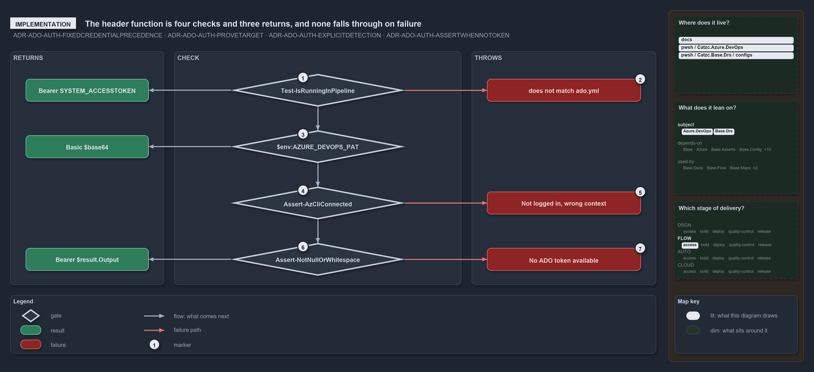

---
catzc:
  warning: "Header is generated by Format-FileMeta via Format-Code; do not change it"
  edges:
    cites:
      - ADR-ADO-AUTH-FIXEDCREDENTIALPRECEDENCE
      - ADR-ADO-AUTH-PROVETARGET
      - ADR-ADO-AUTH-EXPLICITDETECTION
      - ADR-ADO-AUTH-ASSERTWHENNOTOKEN
    drs_total: 4
---

# The header function is four checks and three returns, and none falls through on failure

```text
Four checks in code order, three returns, and no check falls through on failure.

1  Test-IsRunningInPipeline      check 1: the pipeline rung; returns Bearer SYSTEM_ACCESSTOKEN
2  does not match ado.yml        the throw when the collection is not the configured org
3  $env:AZURE_DEVOPS_PAT         check 2: the PAT rung; returns Basic $base64
4  Assert-AzCliConnected         check 3: the az CLI session is in the ado.yml tenant
5  Not logged in, wrong context  the two throws of Assert-AzCliConnected
6  Assert-NotNullOrWhitespace    check 4: the token is not empty; returns Bearer $result.Output
7  No ADO token available        the throw when the az CLI yields no token

Supports ADR-ADO-AUTH-FIXEDCREDENTIALPRECEDENCE, ADR-ADO-AUTH-PROVETARGET, ADR-ADO-AUTH-EXPLICITDETECTION and ADR-ADO-AUTH-ASSERTWHENNOTOKEN (implementation lens).
```

`Get-AdoAuthorizationHeader` in `Catzc.Azure.DevOps` builds the `Authorization` header for every Azure DevOps REST call in cats. In code it
is a short ladder of four checks and three returns: two guarded early returns, then the az CLI path, which asserts twice before its final
return. Every check either returns a header, passes control on, or throws; a check that throws never hands over to the next rung.

```yml drawio
description:
  "The header function's four checks in code order: three return a header, three throw, and no check falls through to the next on failure."
about:
  adrs: [ADR-ADO-AUTH-FIXEDCREDENTIALPRECEDENCE, ADR-ADO-AUTH-PROVETARGET, ADR-ADO-AUTH-EXPLICITDETECTION, ADR-ADO-AUTH-ASSERTWHENNOTOKEN]
  lens: implementation
content:
  title: The header function is four checks and three returns, and none falls through on failure
  kind: explanation
  flow: left-to-right
  relation: what comes next
  theme: dark
  bands:
    - { id: band-returns, label: RETURNS }
    - { id: band-check, label: CHECK }
    - { id: band-throws, label: THROWS }
  glyphs:
    - { id: g-pipeline, kind: gate, label: Test-IsRunningInPipeline, in: band-check }
    - { id: g-pat, kind: gate, label: "$env:AZURE_DEVOPS_PAT", in: band-check }
    - { id: g-azcli, kind: gate, label: Assert-AzCliConnected, in: band-check }
    - { id: g-not-empty, kind: gate, label: Assert-NotNullOrWhitespace, in: band-check }
    - { id: r-bearer, kind: result, label: Bearer SYSTEM_ACCESSTOKEN, in: band-returns }
    - { id: r-basic, kind: result, label: Basic $base64, in: band-returns }
    - { id: r-output, kind: result, label: Bearer $result.Output, in: band-returns }
    - { id: f-mismatch, kind: failure, label: does not match ado.yml, in: band-throws }
    - { id: f-context, kind: failure, label: "Not logged in, wrong context", in: band-throws }
    - { id: f-no-token, kind: failure, label: No ADO token available, in: band-throws }
  edges:
    - { from: g-pipeline, to: g-pat, kind: flow, label: "" }
    - { from: g-pat, to: g-azcli, kind: flow, label: "" }
    - { from: g-azcli, to: g-not-empty, kind: flow, label: "" }
    - { from: g-pipeline, to: r-bearer, kind: flow, label: "" }
    - { from: g-pat, to: r-basic, kind: flow, label: "" }
    - { from: g-not-empty, to: r-output, kind: flow, label: "" }
    - { from: g-pipeline, to: f-mismatch, kind: fail, label: "" }
    - { from: g-azcli, to: f-context, kind: fail, label: "" }
    - { from: g-not-empty, to: f-no-token, kind: fail, label: "" }
  markers:
    - { at: g-pipeline, number: 1 }
    - { at: f-mismatch, number: 2 }
    - { at: g-pat, number: 3 }
    - { at: g-azcli, number: 4 }
    - { at: f-context, number: 5 }
    - { at: g-not-empty, number: 6 }
    - { at: f-no-token, number: 7 }
  legend: auto
  minimaps: [code-locations, module-neighbourhood, axis]
layout:
  band-returns: { x: 20, y: 84, w: 300, h: 456 }
  band-check: { x: 340, y: 84, w: 560, h: 456 }
  band-throws: { x: 920, y: 84, w: 360, h: 456 }
  g-pipeline: { x: 450, y: 128, w: 340, h: 64 }
  g-pat: { x: 450, y: 238, w: 340, h: 64 }
  g-azcli: { x: 450, y: 348, w: 340, h: 64 }
  g-not-empty: { x: 450, y: 458, w: 340, h: 64 }
  r-bearer: { x: 50, y: 138, w: 240, h: 44 }
  r-basic: { x: 50, y: 248, w: 240, h: 44 }
  r-output: { x: 50, y: 468, w: 240, h: 44 }
  f-mismatch: { x: 950, y: 138, w: 300, h: 44 }
  f-context: { x: 950, y: 358, w: 300, h: 44 }
  f-no-token: { x: 950, y: 468, w: 300, h: 44 }
```



## Walkthrough

1. **Test-IsRunningInPipeline.** The first rung runs when `(Test-IsRunningInPipeline) -and $env:SYSTEM_ACCESSTOKEN` holds. The guard is true
   when `TF_BUILD` or `GITHUB_ACTIONS` is set. Inside, the rung compares `$env:SYSTEM_COLLECTIONURI` with
   `(Get-Config -Config ado).organization`, both with the trailing `/` trimmed, and on a match returns `Bearer $env:SYSTEM_ACCESSTOKEN`.
2. **does not match ado.yml.** On a mismatch the rung throws "Pipeline collection '…' does not match ado.yml organization '…' — refusing the
   agent token for a different org." The comparison is skipped when `SYSTEM_COLLECTIONURI` is empty.
3. **$env:AZURE_DEVOPS_PAT.** The second rung runs when the PAT is set, and returns `Basic` with the base64 of `":" + PAT`. It throws
   nothing: a rejected PAT surfaces later as the error of the `Invoke-RestMethod` call in `Invoke-AdoRestMethod`.
4. **Assert-AzCliConnected.** With neither set, the az CLI path runs `Assert-AzCliConnected -TenantId (Get-Config -Config ado).tenant`,
   which proves the session is in the tenant behind the org. It then runs
   `az account get-access-token --resource $ResourceUrl --query accessToken -o tsv` through `Invoke-Executable`; `-ResourceUrl` defaults to
   `499b84ac-1321-427f-aa17-267ca6975798`, the Azure DevOps resource ID.
5. **Not logged in, wrong context.** `Assert-AzCliConnected` throws one of two errors: "Not logged in to az CLI. Run: az login --tenant …"
   when there is no session, or "az CLI is set to the wrong context. Expected tenant=…; got sub=… tenant=…. Run: az login --tenant …" when
   the session is in another tenant.
6. **Assert-NotNullOrWhitespace.** The token output is asserted non-empty, and only then does the function make its third return,
   `Bearer $($result.Output)`.
7. **No ADO token available.** An empty output throws the assert's error text: "No ADO token available. Set $env:AZURE_DEVOPS_PAT, or run
   Connect-AzCli with an Entra ID account."

`organization` and `tenant` are required keys of the typed `AdoConfig` record that `Get-Config -Config ado` returns, so both proofs always
have a value to check against. The only caller of the function is `Invoke-AdoRestMethod`.

## Why it holds

- The rungs run in a fixed order over what is configured, and a rung that fails throws instead of falling through
  (ADR-ADO-AUTH-FIXEDCREDENTIALPRECEDENCE).
- The pipeline rung proves the collection is the configured org, and the az CLI rung proves the session tenant, before a header is returned
  (ADR-ADO-AUTH-PROVETARGET).
- Pipeline detection goes through `Test-IsRunningInPipeline`, never a raw read of the agent variables (ADR-ADO-AUTH-EXPLICITDETECTION).
- When the az CLI yields no token, the assert names the actionable causes (ADR-ADO-AUTH-ASSERTWHENNOTOKEN).

## Where the code and the decision record differ

The rule says the pipeline rung asserts `SYSTEM_COLLECTIONURI`, but the code skips the comparison when that variable is empty; the ADR's own
sample code shows the same skip.

## See also

- [Dual authentication](../drs/ado/dual-authentication.md) — the decision this article explains.
- The other lenses on the same precedence: [meta](configured-credential-proves-its-org.md),
  [architecture](one-header-function-owns-precedence.md), [operations](what-you-set-decides-the-credential.md) and
  [governance](which-auth-rungs-have-a-gate.md).
- [The ado explanations](how-azure-devops-calls-prove-their-credentials.md) · [How to read the diagrams](how-cats-works-and-why-in-one-diagram-per-article.md#how-to-read-the-diagrams)
