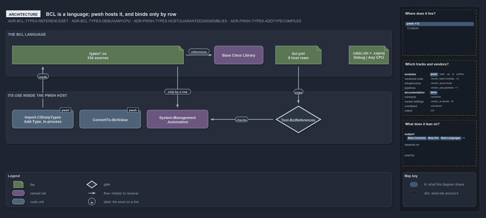

# BCL (C# / .NET types) — automation reference

**BCL** is the .NET **Base Class Library** — the standard set of libraries built into the .NET runtime, spanning the `System.*` (and, to a
limited extent, `Microsoft.*`) namespaces. It is the general-purpose, lower-level framework that every higher-level .NET framework builds
on: the foundational types (`Object`, `String`, `Array`, `Int32`), collections, IO, serialization, and the rest. Microsoft also calls the
same set the runtime libraries, framework libraries, or shared framework. See the [Microsoft references](#microsoft-references) below for
the authoritative definitions.

In catzc, BCL is two things, and this page is the one place that defines both.

## The BCL language

BCL is a .NET language of catzc's own: C# written against the Base Class Library, a subset of .NET. A language here carries more than its
files:

- **Its files** are the `types/*.cs` sources of every module, one type per file, each in the namespace of its module.
- **Its build pair** is one configuration on one platform, Debug on Any CPU, declared once on `BclConfig` and read through
  `pwsh/Base.Languages/configs/bcl.yml`. Every non-vendored solution and project declares only that pair, and every `dotnet` call a catzc
  command makes builds it.
- **Its reference set** is the Base Class Library and nothing else. There is no NuGet in this toolset, so a type that wants a package is
  asking for logic that belongs in a script calling a vendored tool.

The decision behind the language is the [native-csharp-types](../../drs/automation/BCL/native-csharp-types.md) record.

## Its use inside the pwsh host

pwsh is the language's host, not its owner. It compiles the sources into one combined assembly inside the .NET runtime already running the
session, so a type costs no extra process and no build step, and pwsh callers reach each type by its full name or a `Catzc.` accelerator.
That use is intrinsic to pwsh and decided in the pwsh domain, in the
[hosting-csharp-types](../../drs/automation/pwsh/hosting-csharp-types.md) record.

A type that needs the host itself, such as a parser over pwsh's syntax tree or a pipeline of the session, binds to
`System.Management.Automation` on purpose. That host binding is one row in `bcl.yml` with its reason, and `Test-BclReferences` fails a type
that binds without its row. A value that only crosses from pwsh, such as a `PSObject` in an array, is unwrapped by its pwsh caller through
`ConvertTo-BclValue`, so the type stays in the language.

## Reference material

- [The type system](types-system.md) — the combined assembly, the shared `DictionaryRecord` base, and the type-accelerator aliases.

The modules most involved are [`Catzc.Base.Languages`](../pwsh/base-languages/index.md) (`bcl.yml` and `BclConfig`),
[`Catzc.Base.Objects`](../pwsh/base-objects/index.md) (the `DictionaryRecord` base, shared records and `ConvertTo-BclValue`) and
[`Catzc.Base.TypesSystem`](../pwsh/base-types-system/index.md) (the IDE project build).

## Microsoft references

The BCL is Microsoft's, not ours — these are the authoritative public sources for what it is and what it contains.

- [Base Class Library (BCL) — .NET glossary](https://learn.microsoft.com/en-us/dotnet/standard/glossary#bcl) — the one-paragraph definition:
  the `System.*`/`Microsoft.*` namespaces that higher-level frameworks build on.
- [Runtime libraries overview](https://learn.microsoft.com/en-us/dotnet/standard/runtime-libraries-overview) — what the runtime libraries
  provide and how the BCL relates to the shared framework and its NuGet extensions.
- [Overview of core .NET libraries](https://learn.microsoft.com/en-us/dotnet/standard/class-library-overview) — a tour of the core library
  areas: the `System` namespace, data structures, and utility APIs.
- [.NET API browser](https://learn.microsoft.com/en-us/dotnet/api/) — the searchable per-type API reference for everything the BCL ships.
- [Add-Type](https://learn.microsoft.com/en-us/powershell/module/microsoft.powershell.utility/add-type) — the PowerShell cmdlet the importer
  uses to compile the `types/*.cs` sources into the combined assembly.
