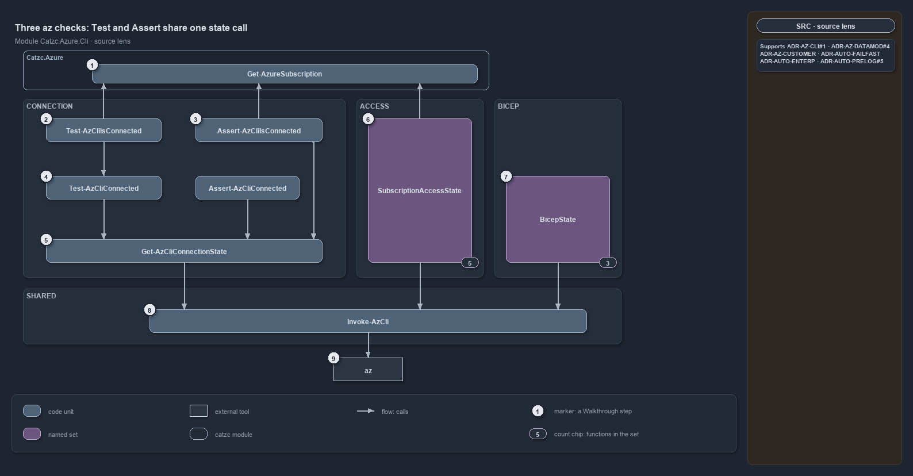

---
catzc:
  immutable:
    with_body_sha: "1a24ce69a808"
    repo_status: clean
    path: docs/references/automation/catzc-azure-cli.md
    folder: docs/references/automation
    name: catzc-azure-cli
    filetype: md
    kind: reference
    language: markdown
    track: docs
    tracktype: documentation
  edges:
    links:
      - docs/adr/azure/az-session-verification.md
      - docs/references/.assets/automation/catzc-azure-cli/az-cli-test-assert-share-one-state.drawio.png
      - docs/references/automation/catzc-azure-cli/az-cli-test-assert-share-one-state.drawio.md
      - docs/references/automation/catzc-azure.md
      - docs/references/automation/catzc-base-execution.md
      - docs/references/automation/catzc-tooling-core.md
      - docs/references/automation/catzc-tooling-toolchain.md
---

# Catzc.Azure.Cli

The Azure CLI module. It **encapsulates every interaction with the `az` CLI** — issuing commands, establishing and selecting the session,
and verifying that the session points where configuration says it should. It is the single boundary the whole platform runs `az` through.
What it deliberately does **not** own is the az _binary_: installing it lives in [Catzc.Tooling.Toolchain](catzc-tooling-toolchain.md)
(`Install-AzCli`) and locking its version in [Catzc.Tooling.Core](catzc-tooling-core.md) (`Assert-Tool`, against the `tools.yml` lock that
[Catzc.Base.Execution](catzc-base-execution.md) owns). This module owns everything you _do_ with `az` once it is installed. The
verify-vs-connect split is the subject of [az-session-verification](../../adr/azure/az-session-verification.md).

## Responsibilities

| Responsibility   | Area          | Name                                                                                       |
| ---------------- | ------------- | ------------------------------------------------------------------------------------------ |
| responsibility:1 | invocation    | [Azure CLI invocation](#responsibility1--azure-cli-invocation)                             |
| responsibility:2 | connect       | [Session connect and disconnect](#responsibility2--session-connect-and-disconnect)         |
| responsibility:3 | context       | [Subscription selection and context](#responsibility3--subscription-selection-and-context) |
| responsibility:4 | inspect       | [Connection-state inspection](#responsibility4--connection-state-inspection)               |
| responsibility:5 | verify-args   | [By-args session verification](#responsibility5--by-args-session-verification)             |
| responsibility:6 | verify-config | [Config-aware session verification](#responsibility6--config-aware-session-verification)   |
| responsibility:7 | access        | [Subscription access checks](#responsibility7--subscription-access-checks)                 |
| responsibility:8 | bicep         | [Bicep CLI readiness](#responsibility8--bicep-cli-readiness)                               |

### responsibility:1 — Azure CLI invocation

The single asserted entry point every `az` command in the platform flows through. It version-checks the CLI against the locked `tools.yml`
version (`Assert-Tool 'az_cli'`), disables dynamic extension install so a missing-extension command fails fast instead of hanging on an
invisible prompt, logs the exact command, and returns either a structured result or — in dry-run — the command string for a test to assert
on. Extension presence checks belong here too: they are how a command that needs an `az` extension fails with a clear remediation instead of
a cryptic argument error. This is the encapsulation the module exists for — no other module issues raw `az`.

### responsibility:2 — Session connect and disconnect

Establishing and tearing down the authenticated `az` session: signing in (interactively, by device code, by service principal, or by managed
identity) and signing out. This is a state-changing action — the _connect_ side of "verify is not connect." It asserts the binary is present
(`Assert-Tool`) but knows nothing about whether the session targets the right place; that judgement is the verification responsibilities
below.

### responsibility:3 — Subscription selection and context

Choosing which subscription the session acts against, and running work pinned to a chosen one. This responsibility reads the active
subscription, switches it, and runs a scriptblock against a selected subscription with the surrounding context restored afterward. It
changes session _selection_ only — never credentials.

### responsibility:4 — Connection-state inspection

The single shared comparison: run the live session's account query once and report whether it is logged in, what subscription and tenant it
is on, and how that compares to what was expected. Every verification in this module reads from this one source, so the throwing and
querying forms can never disagree.

### responsibility:5 — By-args session verification

Confirming the session matches a subscription and/or tenant supplied as raw GUIDs. This layer knows nothing about the identity model in
`azure.yml`, so any module can use it without taking a dependency on the templating configuration.

### responsibility:6 — Config-aware session verification

Confirming the session matches the subscription _named_ in the identity model — it resolves that name to its GUIDs (through
[Catzc.Azure](catzc-azure.md)) and then delegates to the by-args check. This is the verification a deployment uses, because it checks
against what configuration says is correct.

### responsibility:7 — Subscription access checks

Confirming the signed-in identity can actually _reach_ a subscription — that it is listed and accessible — as opposed to merely being the
currently-selected one. This distinguishes "authenticated somewhere" from "able to operate here."

### responsibility:8 — Bicep CLI readiness

Provisioning and confirming the Bicep CLI at or above the minimum version the estate requires — installing or upgrading it, and asserting or
testing its presence — before a build or deploy relies on it.

## What the module does

The module is the platform's `az` boundary, and it is built as a stack with one foundation. Responsibility 1 is that foundation in the
literal sense: `Invoke-AzCli` is the one place a real `az` process is launched, and everything else here — connecting, selecting,
inspecting, verifying — runs through it or through the connection-state primitive it feeds. Pulling the runner into this module (rather than
leaving it among the generic tool wrappers) is what lets "use the az CLI" be one cohesive responsibility: the version lock, the
extension-install guard, and the command log are inherited by every caller for free, and no other module ever issues raw `az`.

Two design rules shape the verification half. First, **verify is not connect**: responsibilities 2 and 3 _act_ (log in, select a
subscription); responsibilities 4–8 only _read_ and, on a mismatch, name the command the operator should run — they never run it themselves,
so a verification is always safe to call anywhere. Second, **configuration defines "correct"**: whether a session is pointed at the right
place is decided by what the identity model says, not by the mere presence of a credential. Responsibilities 5 and 6 are two heights of the
same check — responsibility 5 compares against GUIDs a caller supplies, responsibility 6 against an identity resolved from `azure.yml` by
name — and responsibility 6 is literally responsibility 5 with the names looked up first. Keeping them separate is what lets a module with
no business reading `azure.yml` still verify a session by GUID.

The split with the Tooling group is the deliberate counterpart to all of this: [Catzc.Tooling.Toolchain](catzc-tooling-toolchain.md) owns
the az **binary** (install and uninstall) and [Catzc.Tooling.Core](catzc-tooling-core.md) the version lock asserted by `Assert-Tool` (the
`tools.yml` entry, owned by [Catzc.Base.Execution](catzc-base-execution.md)), while this module owns the az **session**. The one tie back is
that `Invoke-AzCli` and the connect functions call `Assert-Tool 'az_cli'` (from [Catzc.Tooling.Core](catzc-tooling-core.md)) — a single,
version-locking dependency, not a reimplementation of tool management.

The diagram below draws session verification from the source. Each of the three az checks (connection, subscription access and Bicep) has
one state call that its query form and its throwing form share, so the two cannot drift. The config-aware wrappers add only the `azure.yml`
lookup. Its [description](catzc-azure-cli/az-cli-test-assert-share-one-state.drawio.md) walks it step by step.

## Division

The module's public functions, sorted into the responsibilities above.

| Responsibility                                        | Function                             |
| ----------------------------------------------------- | ------------------------------------ |
| responsibility:1 — Azure CLI invocation               | `Invoke-AzCli`                       |
|                                                       | `Assert-AzCliExtension`              |
|                                                       | `Test-AzCliExtension`                |
| responsibility:2 — Session connect and disconnect     | `Connect-AzCli`                      |
|                                                       | `Disconnect-AzCli`                   |
| responsibility:3 — Subscription selection and context | `Set-AzCliSubscription`              |
|                                                       | `Get-CurrentAzSubscription`          |
|                                                       | `Set-CurrentAzSubscription`          |
|                                                       | `Invoke-InSubscription`              |
| responsibility:4 — Connection-state inspection        | `Get-AzCliConnectionState`           |
| responsibility:5 — By-args session verification       | `Assert-AzCliConnected`              |
|                                                       | `Test-AzCliConnected`                |
| responsibility:6 — Config-aware session verification  | `Assert-AzCliIsConnected`            |
|                                                       | `Test-AzCliIsConnected`              |
| responsibility:7 — Subscription access checks         | `Get-AzCliSubscriptionAccessState`   |
|                                                       | `Assert-AzCliCanAccess`              |
|                                                       | `Test-AzCliCanAccess`                |
|                                                       | `Assert-AzCliSubscriptionAccessible` |
|                                                       | `Test-AzCliSubscriptionAccessible`   |
| responsibility:8 — Bicep CLI readiness                | `Install-AzCliBicep`                 |
|                                                       | `Assert-AzCliBicep`                  |
|                                                       | `Test-AzCliBicep`                    |
