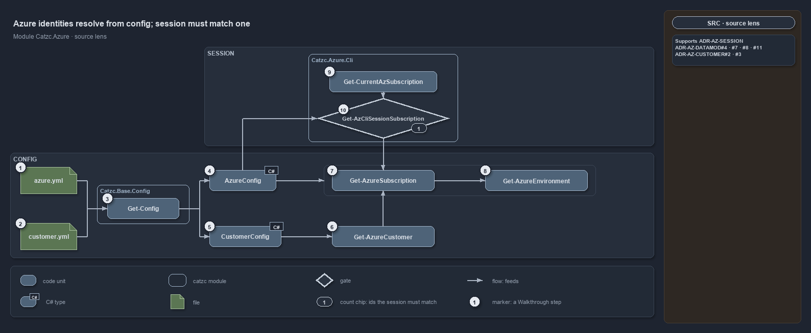

---
catzc:
  derived:
    path: docs/references/automation/catzc-azure.md
    kind: reference
    language: markdown
    track: docs
    body_sha: d8b3dc66ab75
    links:
      - docs/.assets/references/automation/catzc-azure/azure-identity-resolves-from-config.drawio.md
      - docs/.assets/references/automation/catzc-azure/azure-identity-resolves-from-config.drawio.png
      - docs/adr/azure/azure-data-model.md
      - docs/adr/azure/azure-network-model.md
      - docs/references/automation/catzc-azure-templates.md
---

# Catzc.Azure

The Azure identity module. It owns the _model_ behind every Azure deployment — the tenants, customers, environments, and subscriptions the
platform deploys into, and the network plan that overlays them — and the resolution logic that turns a name into the full identity the rest
of the Azure stack needs. It holds the source-of-truth configuration; the templating module
([Catzc.Azure.Templates](catzc-azure-templates.md)) consumes it.

## Responsibilities

| Responsibility   | Area         | Name                                                                         |
| ---------------- | ------------ | ---------------------------------------------------------------------------- |
| responsibility:1 | model        | [Identity and topology model](#responsibility1--identity-and-topology-model) |
| responsibility:2 | subscription | [Subscription resolution](#responsibility2--subscription-resolution)         |
| responsibility:3 | environment  | [Environment resolution](#responsibility3--environment-resolution)           |
| responsibility:4 | catalog      | [Global catalog accessors](#responsibility4--global-catalog-accessors)       |

### responsibility:1 — Identity and topology model

The declared shape of the Azure estate: the tenants, the customers (each with a readable key and a short code), the environments (each with
a region, region code, and short code), and the subscriptions (each bound to a tenant, optionally to a customer, and serving a set of
environments). Overlaid on this is the IP plan: a range per environment, and a hub-and-spoke network per subscription — a hub in each shared
subscription, a spoke in each customer subscription, with no two networks overlapping. This is data, not behaviour — it lives in two
configuration assets, `azure.yml` and `network.yml`, and is the single source of truth the whole Azure stack resolves against; a quality
gate keeps the IP plan in step with the environments and subscriptions. See [data-model](../../adr/azure/azure-data-model.md) and
[network-model](../../adr/azure/azure-network-model.md).

### responsibility:2 — Subscription resolution

Turning a subscription name into its full identity: its id and tenant, the customer it belongs to (if any), and its per-subscription
identity environment. A subscription is the deployment target, and this responsibility is where "which subscription, and what does that
imply" is answered.

### responsibility:3 — Environment resolution

Turning an environment name into its full identity in the context of a serving subscription: its region and region code, its short code, and
the resolved subscription that serves it. This is the join between the environment dimension and the subscription dimension.

### responsibility:4 — Global catalog accessors

Whole-estate lookups that aren't tied to one subscription or environment: the list of customers, and the minimum Bicep CLI version the
estate requires. These are thin readers over the identity model for callers that need a catalog rather than a single resolved identity.

## What the module does

This module is pure resolution over a declared model. It performs no Azure API calls and changes no state — it reads `azure.yml` and
`network.yml`, validates each through its config type on load, checks with a quality gate that the network plan stays in sync with the
environments and subscriptions, and answers questions about identity. The governing principle is "optimise for ease of configuration and
codebase-as-source-of-truth": the configuration is shaped for a human to read and edit, and the non-trivial joins between its dimensions
live here, in code, rather than being denormalised into the config.

The model has two independent dimensions — subscriptions and environments — that meet at deployment time. Responsibility 2 resolves the
subscription dimension, responsibility 3 resolves the environment dimension _in the context of_ a subscription, and the catalog accessors in
responsibility 4 expose the whole sets when a caller needs to enumerate rather than resolve. The customer is never a dimension a caller
selects directly; it is derived from the resolved subscription, which is why "which customer" is answered through subscription resolution
rather than as its own input.

Everything downstream — resource naming, build, deploy — phrases its questions in terms this module answers, so the identity model has
exactly one home. Adding a tenant, customer, environment, or subscription is an edit to `azure.yml` (and a matching `network.yml` entry for
a standard environment or a subscription: a hub for a shared one, a spoke for a customer's); the validation on load and the quality gate are
what stop the two assets from drifting apart.

The diagram below draws identity resolution from the source. Every Azure identity resolves from `azure.yml` and `customer.yml` through the
configuration loader, each into its own registered type. The live az session is matched back to the declared subscriptions and must match
exactly one. Its [description](../../.assets/references/automation/catzc-azure/azure-identity-resolves-from-config.drawio.md) walks it step
by step.

## Division

The module's public functions and configuration, sorted into the responsibilities above.

| Responsibility                                 | Function                           |
| ---------------------------------------------- | ---------------------------------- |
| responsibility:1 — Identity and topology model | `Test-AzureNetworkPlan`            |
| config                                         | `azure.yml`                        |
|                                                | `network.yml`                      |
| responsibility:2 — Subscription resolution     | `Get-AzureSubscription`            |
|                                                | `Get-AzureSubscriptionCustomer`    |
|                                                | `Get-AzureSubscriptionEnvironment` |
| responsibility:3 — Environment resolution      | `Get-AzureEnvironment`             |
| responsibility:4 — Global catalog accessors    | `Get-AzureCustomers`               |
|                                                | `Get-AzureBicepMinVersion`         |
