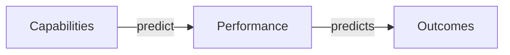

---
catzc:
  derived:
    path: docs/references/dora/core-model.md
    kind: reference
    language: markdown
    filetype: md
    track: docs
    body_sha: "523a0e9c4ca7"
    links:
      - docs/references/dora/capabilities.md
      - docs/references/dora/capabilities.md#code-maintainability
      - docs/references/dora/capabilities.md#continuous-delivery
      - docs/references/dora/capabilities.md#continuous-integration
      - docs/references/dora/capabilities.md#database-change-management
      - docs/references/dora/capabilities.md#deployment-automation
      - docs/references/dora/capabilities.md#documentation-quality
      - docs/references/dora/capabilities.md#flexible-infrastructure
      - docs/references/dora/capabilities.md#generative-organizational-culture
      - docs/references/dora/capabilities.md#job-satisfaction
      - docs/references/dora/capabilities.md#loosely-coupled-teams
      - docs/references/dora/capabilities.md#monitoring-and-observability
      - docs/references/dora/capabilities.md#pervasive-security
      - docs/references/dora/capabilities.md#reliability-engineering
      - docs/references/dora/capabilities.md#streamlining-change-approval
      - docs/references/dora/capabilities.md#teams-empowered-to-choose-tools
      - docs/references/dora/capabilities.md#test-automation
      - docs/references/dora/capabilities.md#test-data-management
      - docs/references/dora/capabilities.md#trunk-based-development
      - docs/references/dora/capabilities.md#version-control
      - docs/references/dora/capabilities.md#well-being
      - docs/references/dora/capabilities.md#working-in-small-batches
      - docs/references/dora/metrics.md
      - docs/references/dora/metrics.md#reliability
      - "https://dora.dev/capabilities/"
      - "https://dora.dev/capabilities/well-being/"
      - "https://dora.dev/capabilities/well-being/#burnout"
      - "https://dora.dev/capabilities/well-being/#rework"
      - "https://dora.dev/faq/"
      - "https://dora.dev/guides/dora-metrics/"
      - "https://dora.dev/research/"
      - "https://dora.dev/research/core/assets/index.js"
      - "https://github.com/dora-team/dora.dev/blob/main/svelte/core-v2/src/lib/Footer.svelte"
      - "https://github.com/dora-team/dora.dev/blob/main/svelte/core-v2/src/lib/core_data.json"
      - "https://github.com/dora-team/dora.dev/discussions/582"
---

# DORA Core Model

The DORA Core Model is DORA's distillation of the capabilities, metrics, and outcomes its research has demonstrated repeatedly. It is shown
as an interactive diagram on the [research page](https://dora.dev/research/). The current version is **v2.1.0**: the diagram's footer
carries that label, and the summary and detail PNG/PDF downloads are named for it.

Core is meant for practitioners. It deliberately trails the research and changes more slowly, so that teams can use it to set multi-year
improvement priorities without chasing each year's new findings ([research](https://dora.dev/research/), [FAQ](https://dora.dev/faq/)).

## Structure

The model has three columns joined by two arrows. The diagram labels the first arrow "predict" and the second "predicts":

- **Capabilities** fall into three groups, named for the benefit they give a team: climate for learning, fast flow, and fast feedback.
- **Performance** has two parts: software delivery, measured by the delivery metrics, and reliability, measured by service level objectives.
- **Outcomes** has two parts: organizational performance and well-being.

The diagram has a summary view, which shows only the top-level groups and their relationships, and a detail view, which expands each group
into its member entities. The arrows link whole columns, not individual capabilities to individual outcomes. A maintainer explains in the v2
design discussion that individual pathways vary from year to year, so the model does not fix them
([Core V2 discussion](https://github.com/dora-team/dora.dev/discussions/582)).

## Capability groups

Group membership below is taken from the v2.1.0 diagram data. Each name links to its entry in [capabilities.md](capabilities.md).

### Climate for learning

An organizational climate that treats learning as a strategic investment and supports continuous improvement and knowledge sharing. The
diagram links it to better software delivery performance and to organizational performance.

- [Code maintainability](capabilities.md#code-maintainability)
- [Documentation quality](capabilities.md#documentation-quality)
- [Empowering teams to choose tools](capabilities.md#teams-empowered-to-choose-tools)
- [Generative organizational culture](capabilities.md#generative-organizational-culture) (labelled "Generative culture" in the diagram)

### Fast flow

A delivery approach that lets a team keep shipping high-quality software at speed. The diagram ties it to improved software delivery
performance.

- [Continuous delivery](capabilities.md#continuous-delivery)
- [Database change management](capabilities.md#database-change-management)
- [Deployment automation](capabilities.md#deployment-automation)
- [Flexible infrastructure](capabilities.md#flexible-infrastructure)
- [Loosely coupled teams](capabilities.md#loosely-coupled-teams)
- [Streamlining change approval](capabilities.md#streamlining-change-approval)
- [Version control](capabilities.md#version-control)
- [Working in small batches](capabilities.md#working-in-small-batches)

### Fast feedback

Rapid, actionable signal throughout the delivery lifecycle, which builds confidence in each change and speeds up iteration.

- [Continuous integration](capabilities.md#continuous-integration)
- [Monitoring and observability](capabilities.md#monitoring-and-observability)
- [Reliability engineering](capabilities.md#reliability-engineering) (in the diagram only; no capability page on dora.dev)
- [Pervasive security](capabilities.md#pervasive-security)
- [Test automation](capabilities.md#test-automation)
- [Test data management](capabilities.md#test-data-management)

## Performance

### Software delivery performance

The diagram says DORA's research consistently finds that a team's software delivery capability predicts the value it provides to its
organization. It says software delivery performance is "measured by" four key metrics: change lead time, deployment frequency, change fail
percentage, and failed deployment recovery time. The [metrics guide](https://dora.dev/guides/dora-metrics/) now defines five metrics. The
fifth, deployment rework rate, was added in 2024 and does not appear in the v2.1.0 diagram. See [metrics.md](metrics.md) for definitions.

### Reliability

Reliability is a system's ability to keep performing its intended function without interruption or failure: available, performant, correct,
and predictable. It is measured by service level objectives (SLOs). The diagram breaks it into four assessment questions:

- **Measurement coverage**: whether every critical service has service level indicators (SLIs) that represent customer happiness.
- **Measurement focus**: whether those indicators reflect system behaviour as users experience it, not internal or infrastructure measures.
- **Target optimization**: whether the SLO targets reflect user sentiment and organizational capability, and are understood well enough to
  change deliberately.
- **Target compliance**: whether the targets are met consistently and the results are visible to others in the organization.

Reliability was added to the performance column in Core V2 ([FAQ](https://dora.dev/faq/)). See also [reliability](metrics.md#reliability).

## Outcomes

### Organizational performance

An organization's ability to meet its commercial and non-commercial goals. The diagram notes that this measure is academically validated,
correlates highly with return on investment, and holds up across economic cycles. It also says that, over several years of analysis,
organizations with the highest software delivery performance are twice as likely as low performers to exceed their goals, and that employee
well-being contributes to organizational performance.

- **Commercial performance**: for example profitability, productivity, market share, number of customers, and quantity of products or
  services.
- **Non-commercial performance**: for example operating efficiency, customer satisfaction, quality of products or services, and achieving
  organizational or mission goals.

### Well-being

A reflection of individuals' happiness and job satisfaction. The diagram says increased well-being predicts organizational performance and
how long employees stay in their jobs. It shows four sub-entities:

- [Job satisfaction](capabilities.md#job-satisfaction): fulfilment from challenging, meaningful work that uses a person's skills.
- **Productivity**: the ability to work effectively, experiment, iterate, and learn in order to keep improving the user experience.
- **Reduced burnout**: less physical, mental, or emotional exhaustion caused by overwork or stress
  ([well-being: burnout](https://dora.dev/capabilities/well-being/#burnout)).
- **Reduced rework**: less reactive, unplanned work such as break/fix work, emergency deployments and patches, and urgent audit requests
  ([well-being: rework](https://dora.dev/capabilities/well-being/#rework)).

In the model, [well-being](capabilities.md#well-being) and job satisfaction are outcomes. The capability catalogue nevertheless lists both
as capability pages tagged `core`.

## What qualifies for Core

The [FAQ](https://dora.dev/faq/) gives the inclusion rubric. A concept may be considered for Core if:

1. it has been researched at least twice;
2. practitioners have found it valuable; and
3. further exploration is warranted.

The FAQ calls this rubric deliberately subjective: it rests on the data but is finally guided by judgement. Concepts DORA has studied
promisingly but not yet replicated stay outside Core as "areas of inquiry". Over time, well-supported concepts graduate into Core, and
concepts the evidence stops supporting are deprecated. Core evolves with the research, but more slowly. Research years are not treated
equally: some findings replicate year after year, and others change.

## Version history

- **Core V2** was published in July 2024 ([FAQ](https://dora.dev/faq/)). It simplified the structure to emphasize capabilities → performance
  → outcomes, added the summary/detail views, introduced capability groups based on the benefit to teams, added, modified, or removed
  several capabilities, and added reliability to performance.
- The [Core V2 discussion](https://github.com/dora-team/dora.dev/discussions/582) records specific changes, as described by maintainers in
  the thread:
  - trunk-based development left Core, with working in small batches taking its place;
  - "shift left on security" became pervasive security;
  - loosely coupled architecture was reframed as loosely coupled teams;
  - failed deployment recovery time replaced mean time to recover;
  - deployment pain stopped being a named well-being item;
  - AI practices were left out of Core for lack of sufficient research at the time.
- **v2.1.0** is the version the live diagram shows as of 2026-10-13. The site gives no changelog for the step from v2.0 to v2.1.

## Core tag in the capability catalogue

The [capability catalogue](https://dora.dev/capabilities/) marks some capabilities with a `core` tag. The tag does not match the diagram
exactly:

- Tagged `core` and in the diagram's capability column: the 17 capabilities listed under the three groups above, excluding reliability
  engineering, which has no page.
- Tagged `core` but shown as outcomes in the diagram: [job satisfaction](capabilities.md#job-satisfaction) and
  [well-being](capabilities.md#well-being).
- In the diagram but with no catalogue page: [reliability engineering](capabilities.md#reliability-engineering).
- Not tagged `core`: [trunk-based development](capabilities.md#trunk-based-development) (removed in V2), the lean product, process, and some
  culture capabilities, and the AI capabilities.

## Sources

Retrieved 2026-10-13.

- <https://dora.dev/research/> (Core Model diagram and "About the DORA Core Model")
- <https://dora.dev/faq/> (DORA Core section)
- <https://dora.dev/capabilities/>
- <https://dora.dev/capabilities/well-being/>
- <https://dora.dev/guides/dora-metrics/>
- <https://github.com/dora-team/dora.dev/discussions/582> (DORA Core V2 discussion)
- <https://github.com/dora-team/dora.dev/blob/main/svelte/core-v2/src/lib/core_data.json> (diagram data, commit `b14ae08`)
- <https://github.com/dora-team/dora.dev/blob/main/svelte/core-v2/src/lib/Footer.svelte> (version label v2.1.0)
- <https://dora.dev/research/core/assets/index.js> (live diagram bundle, checked for the v2.1.0 label)
