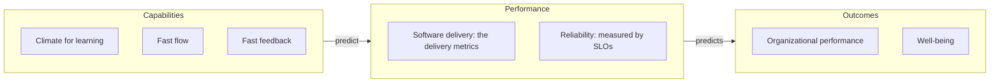

---
catzc:
  derived:
    path: docs/references/dora/index.md
    kind: reference
    language: markdown
    filetype: md
    track: docs
    body_sha: "3cfd89b51712"
    links:
      - docs/adr/research/index.md
      - docs/references/dora/ai.md
      - docs/references/dora/ai.md#ai-capabilities-model
      - docs/references/dora/capabilities.md
      - docs/references/dora/core-model.md
      - docs/references/dora/core-model.md#climate-for-learning
      - docs/references/dora/core-model.md#fast-feedback
      - docs/references/dora/core-model.md#fast-flow
      - docs/references/dora/core-model.md#organizational-performance
      - docs/references/dora/core-model.md#well-being
      - docs/references/dora/metrics.md
      - docs/references/dora/metrics.md#performance-clusters
      - docs/references/dora/metrics.md#reliability
      - docs/references/dora/publications.md
      - "https://creativecommons.org/licenses/by/4.0/"
      - "https://dora.dev/brand-guidelines/"
      - "https://dora.dev/faq/"
      - "https://dora.dev/insights/dora-2025-year-in-review/"
      - "https://dora.dev/news/dora-joins-google-cloud/"
      - "https://dora.dev/research/"
      - "https://dora.dev/research/2018/"
      - "https://dora.dev/research/2022/structural-equation-model/"
      - "https://dora.dev/research/2023/structural-equation-models/"
      - "https://dora.dev/research/2024/ai-preview/"
      - "https://dora.dev/research/2025/questions/"
      - "https://dora.dev/research/core/questions/"
      - "https://dora.dev/research/team/"
      - "https://github.com/dora-team/dora.dev"
---

# DORA research reference

This folder is the repository's local, citable copy of the structure of the [DORA research program](https://dora.dev/research/): its model,
its metrics, its capability catalogue, and its publications. DORA is the theory every ADR domain in this repository depends on (see the
`research` domain in the ADR registry), so markdown anywhere in the repository cites DORA through the stable anchors defined here instead of
linking deep into an external site that changes shape over time.

The per-capability ADR summaries live in [docs/adr/research/](../../adr/research/index.md). This reference does not repeat their content. It
is the corpus around them: what the site says, where it says it, and which report a finding comes from.

All content here is paraphrased from dora.dev and retrieved on **2026-10-13**. dora.dev content is published by Google LLC under
[CC BY 4.0](https://creativecommons.org/licenses/by/4.0/).

## What DORA is

DORA is a long-running research program, run by a team of researchers at Google Cloud, that studies how teams build and run software and
what that does for their organizations. The site describes it as "the longest running academically rigorous research investigation of its
kind" ([research](https://dora.dev/research/)).

- **Name.** Since the October 2024 rebrand, "DORA" is a brand name, not an acronym, and is always written in capitals
  ([brand guidelines](https://dora.dev/brand-guidelines/)). It began as DevOps Research and Assessment, the company Google acquired in
  December 2018 ([DORA joins Google Cloud](https://dora.dev/news/dora-joins-google-cloud/)).
- **History.** The 2014–2017 State of DevOps Reports were produced in partnership with Puppet. The 2018 report was the first that DORA
  published on its own ([2018 archive](https://dora.dev/research/2018/)). In 2025 the annual report was renamed from "Accelerate State of
  DevOps" to "State of AI-assisted Software Development" ([2025 year in review](https://dora.dev/insights/dora-2025-year-in-review/)).
- **Aim.** The research traces predictive pathways from ways of working, through software delivery performance, to organizational goals and
  individual well-being ([research](https://dora.dev/research/)).

## Research program and methodology

What the site states about how the research is done:

- **Behavioural-science method on survey data.** Each year's findings come from an annual survey of practitioners. DORA publishes the survey
  questions for each year, for example the [2025 questions](https://dora.dev/research/2025/questions/) and the
  [Core Model questions](https://dora.dev/research/core/questions/). It does not publish raw data, to protect respondents' privacy
  ([FAQ](https://dora.dev/faq/)).
- **Structural equation modelling.** The models are fitted with PLS-PM (partial least squares path modelling), chosen because it does not
  assume normally distributed data, suits exploratory and incremental research, and optimizes for predicting the dependent variable. Only
  paths significant at p < .05 are shown ([2022 SEM](https://dora.dev/research/2022/structural-equation-model/)).
- **Per-topic models from 2023.** The 2023 analysis replaced one large model with a model per report section, using directed acyclic graphs
  to decide which covariates to include ([2023 SEMs](https://dora.dev/research/2023/structural-equation-models/)). The 2024 preview says the
  2024 analysis adds causal-inference methods ([2024 AI preview](https://dora.dev/research/2024/ai-preview/)).
- **Emergent performance clusters.** Cluster analysis groups respondents by their delivery metrics. DORA does not fix the number of clusters
  in advance; the data decides it ([FAQ](https://dora.dev/faq/)). See [performance clusters](metrics.md#performance-clusters).
- **Qualitative work.** The research team includes qualitative and ethnographic researchers alongside the quantitative leads
  ([research team](https://dora.dev/research/team/)).
- **Replication over novelty.** The FAQ treats a new finding as suspect until it is replicated and applied. That is why the Core Model
  trails the annual reports ([FAQ](https://dora.dev/faq/)).

## The DORA Core Model in brief

The [DORA Core Model](core-model.md) (version **2.1.0**) is DORA's conservative, practitioner-facing distillation of its most replicated
findings. It has three columns joined by two predictive arrows:



- **Capabilities** are grouped by the benefit they give a team: [climate for learning](core-model.md#climate-for-learning),
  [fast flow](core-model.md#fast-flow), and [fast feedback](core-model.md#fast-feedback).
- **Performance** is [software delivery performance](metrics.md) plus [reliability](metrics.md#reliability).
- **Outcomes** are [organizational performance](core-model.md#organizational-performance) and [well-being](core-model.md#well-being).

For AI-assisted development, DORA also publishes a separate [AI Capabilities Model](ai.md#ai-capabilities-model). In that model, seven
capabilities amplify the effect of AI adoption on a set of outcomes.

## Files in this reference

| File                               | Contents                                                                                                         |
| ---------------------------------- | ---------------------------------------------------------------------------------------------------------------- |
| [index.md](index.md)               | This overview: what DORA is, its method, the Core Model in brief, and the anchor scheme.                         |
| [core-model.md](core-model.md)     | The DORA Core Model v2.1.0: capability groups, performance, outcomes, inclusion rules, and how it changes.       |
| [metrics.md](metrics.md)           | The five software delivery performance metrics, their two families, reliability, clusters, and metric history.   |
| [capabilities.md](capabilities.md) | The full 34-entry capability catalogue, grouped by the site's own categories, cross-linked to the research ADRs. |
| [ai.md](ai.md)                     | The DORA AI Capabilities Model (capabilities, outcomes, connections) and the AI-era research line.               |
| [publications.md](publications.md) | Every publication the site lists, newest first, with URL and paraphrased headline findings.                      |

The split follows the site's own first-class concepts. The Core Model, the metrics guide, the capability catalogue, the AI model, and the
publications list are each a distinct section of dora.dev. The site has no glossary or outcomes catalogue, so outcomes are covered inside
[core-model.md](core-model.md) and [ai.md](ai.md) rather than in a file of their own.

## How to cross-reference

Every heading in this folder is written so that its GitHub-generated anchor is stable and predictable. Cite DORA through these anchors, not
through deep links into dora.dev. Each entry here carries its dora.dev source URL, so a reader is always one click from the original.

### Anchor scheme

| Target                | File              | Anchor rule                                      | Example anchor                                  |
| --------------------- | ----------------- | ------------------------------------------------ | ----------------------------------------------- |
| A capability          | `capabilities.md` | the dora.dev capability slug, exactly            | `#continuous-integration`, `#wip-limits`        |
| A capability category | `capabilities.md` | the kebab-case category name                     | `#fast-flow`, `#climate-for-learning`, `#ai`    |
| A delivery metric     | `metrics.md`      | the kebab-case current metric name               | `#change-lead-time`, `#deployment-rework-rate`  |
| A metric family       | `metrics.md`      | the family name                                  | `#throughput`, `#instability`                   |
| A Core Model element  | `core-model.md`   | the kebab-case element name                      | `#fast-feedback`, `#organizational-performance` |
| An AI model element   | `ai.md`           | the kebab-case name of the capability or outcome | `#ai-capabilities-model`, `#reduced-friction`   |
| A publication         | `publications.md` | `<year>-<kebab-case title>`                      | `#2024-accelerate-state-of-devops-report`       |

Capability anchors are guaranteed to equal the dora.dev slug. Where the site's display name would not produce that slug (for example, "Work
in process limits" lives at `/capabilities/wip-limits/`), the heading uses a slug-shaped name and the entry gives the site's full title.

### Example links

From the repository root (for example a `README.md`):

```markdown
[continuous integration](docs/references/dora/capabilities.md#continuous-integration)
[deployment frequency](docs/references/dora/metrics.md#deployment-frequency)
```

From a research ADR, `docs/adr/research/<slug>.md`, or any other first-level ADR folder such as `docs/adr/design/`:

```markdown
[change lead time](../../references/dora/metrics.md#change-lead-time)
[the 2023 report](../../references/dora/publications.md#2023-accelerate-state-of-devops-report)
```

From a nested ADR folder, `docs/adr/automation/BCL/<name>.md`:

```markdown
[fast feedback](../../../references/dora/core-model.md#fast-feedback)
```

From a sibling reference, `docs/references/automation/<module>.md`:

```markdown
[working in small batches](../dora/capabilities.md#working-in-small-batches)
```

Inside this folder:

```markdown
[instability](metrics.md#instability)
```

### Stability rules

- Headings that carry anchors are not renamed. If dora.dev renames a concept, the entry keeps its heading and records the new name in its
  body, so existing links keep working.
- A capability heading changes only if dora.dev changes the capability's slug. That counts as a new capability in this reference.
- Report headings carry the publication year and title as published, so they never collide across years.

## Provenance

The prose pages were read on dora.dev on 2026-10-13. The site is built from a public repository, and two interactive diagrams (the Core
Model and the AI Capabilities Model) are rendered by JavaScript from data files in it. Their content was read from that repository
(`dora-team/dora.dev`, `main` at commit `b14ae08`, last changed 2026-07-29). On 2026-10-13 it was checked against the bundles the live site
serves: the Core Model bundle reports v2.1.0 and the AI model bundle carries the same 17 connections. Spot checks of live pages (metrics
guide, 2025 report page, a capability page, the AI page) matched the repository content.

## Sources

Retrieved 2026-10-13.

- <https://dora.dev/research/>
- <https://dora.dev/faq/>
- <https://dora.dev/brand-guidelines/>
- <https://dora.dev/news/dora-joins-google-cloud/>
- <https://dora.dev/research/2018/>
- <https://dora.dev/research/2022/structural-equation-model/>
- <https://dora.dev/research/2023/structural-equation-models/>
- <https://dora.dev/research/2024/ai-preview/>
- <https://dora.dev/research/2025/questions/>
- <https://dora.dev/research/core/questions/>
- <https://dora.dev/research/team/>
- <https://dora.dev/insights/dora-2025-year-in-review/>
- <https://github.com/dora-team/dora.dev> (site source, commit `b14ae08`)
