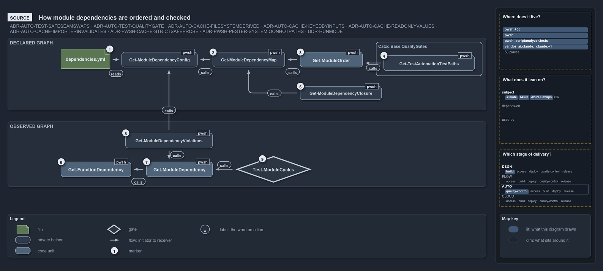

# Catzc.Base.ModuleSystem

The module-system introspection module: the one place the platform turns to reason about its own shape — which modules and functions exist
on disk, what the module-to-module and function-to-function dependency edges actually are, and whether those edges — together with the
cross-module C# type edges computed by [Catzc.Base.TypesSystem](../base-types-system/index.md) — conform to the group-aware declared graph
in `dependencies.yml`. Its quality gates are the mechanical guard that keeps the layering and the module conventions honest (see
[controlling-module-dependencies](../../../drs/automation/controlling-module-dependencies.md),
[open-closed-architecture](../../../drs/automation/open-closed-architecture.md), and
[native-csharp-types](../../../drs/automation/BCL/native-csharp-types.md)); copying the toolset and generating the repository's
`importer.ps1` entry point complete the module's concern. The native C# type system itself — the compiled-assembly cache and the
cross-module type-reference scanner — lives in [Catzc.Base.TypesSystem](../base-types-system/index.md).

## Responsibilities

| Responsibility   | Area        | Name                                                                               |
| ---------------- | ----------- | ---------------------------------------------------------------------------------- |
| responsibility:1 | introspect  | [Function enumeration](#responsibility1--function-enumeration)                     |
| responsibility:2 | graph       | [Dependency graph and integrity](#responsibility2--dependency-graph-and-integrity) |
| responsibility:3 | conventions | [Module conventions](#responsibility3--module-conventions)                         |
| responsibility:4 | copy        | [Toolset model and copy](#responsibility4--toolset-model-and-copy)                 |
| responsibility:5 | importer    | [Importer and generated files](#responsibility5--importer-and-generated-files)     |

### responsibility:1 — Function enumeration

The primitive that answers "what functions exist": the full set of PowerShell functions the catzc modules define, and — with
`-NotUsedInternally` — which of them are never called by another. It builds on the module list that `Get-CatzcModule` provides (the modules
of the code track, `Catzc.Base.Modules`), and the dependency-edge computation in responsibility 2 traverses this function set to find call
sites.

### responsibility:2 — Dependency graph and integrity

Computing the actual dependency edges — module-to-module through PowerShell call-site analysis and function-to-function through call-graph
traversal from a named root — rendering them, ordering the modules foundation-first, and checking them with quality gates
([ADR-AUTO-TEST-QUALITYGATE](../../../drs/automation/test-automation.md#rule-adr-auto-test-qualitygate)). The actual edges, together with
the cross-module C# type edges that [Catzc.Base.TypesSystem](../base-types-system/index.md) computes, are checked against the declared graph
in `dependencies.yml`; the whole call graph is checked for cycles; and every function call is checked to resolve to a defined command. The
declared graph is group-aware: its `groups:` section names sets of on-disk modules each with an internal member-to-member DAG; its
`modules:` section lists, per consumer, the allowed targets as group names (loose: any member) or specific module names (tight). The config
this responsibility owns — `dependencies.yml` — is the platform's single declared layering contract.

### responsibility:3 — Module conventions

The quality gates over the shape of the module tree itself: every module folder follows the folder and file conventions, every checked-in
binary under `pwsh/.vendor` and `pwsh/.compiled` is stored byte-exact, and every internal asset dependency — a module reading a file from
its own folder — is inventoried from the code and covered by a test that runs in both run modes (see
[conventional-folders](../../../drs/repository/conventional-folders.md) and
[internal-asset-dependencies](../../../drs/automation/internal-asset-dependencies.md)).

### responsibility:4 — Toolset model and copy

The module profiles and the copy built on them: named module profiles resolved to their dependency closure over the modules the
`Catzc.Base.Modules` resolver (`Get-CatzcModule`) returns, and a deterministic copy of a selected subset of the toolset into a destination
rooted like the repository — for testing in a temporary folder or vendoring the toolset as a package. Its configs name the extra file
packages each module owns (`files.yml`), the module profiles (`profiles.yml`), and the publish targets for module-manifest artifacts
(`artifacts.yml`).

### responsibility:5 — Importer and generated files

Generating a repository's `importer.ps1` — the dot-sourced entry point that loads the toolset — and committing the files the importer
maintains. `New-Importer` reads the parameter block of the `Invoke-Importer` overlay and renders `importer.ps1` around a fixed template, so
the committed entry point can never drift from the load sequence it delegates to (a drift test regenerates and compares). It scaffolds into
any repository root that already carries the toolset, so the same generator serves this repository and a vendored copy of it. On a devbox
the importer's janitor commits the generated files that differ from `HEAD` — the compiled type assembly — and skips in CI and in build mode.
The vendored modules themselves are managed by [Catzc.Base.Vendor](../base-vendor/index.md).

## What the module does

The module holds the platform's knowledge of itself. Responsibility 1 enumerates the functions the modules define, responsibility 2 computes
and checks what the code actually depends on, responsibility 3 checks the shape of the module tree, responsibility 4 resolves the module
profiles and copies the modules, and responsibility 5 generates and commits the files that load them.

The dependency graph half of responsibility 2 deserves explicit explanation because `dependencies.yml` carries a `groups` schema. The file
has two top-level sections. `groups:` is a map where each key is a group name and each value is a map of on-disk module names to the list of
other members they are allowed to depend on — the group's internal member-to-member DAG. A group is a concept, not a disk module: it names a
set of real modules and declares the layering among them. `modules:` lists, per consumer module, the targets it may depend on; each target
is either a group name — loose, meaning any member of that group — or a specific module name — tight, meaning only that exact module. The
file's config type checks the declaration when it loads: every target is declared, and the module graph and each group's internal DAG are
acyclic. `Test-ModuleDependency` then resolves each declared target to a member set, unions the sets for a given consumer, and verifies that
every actual edge from that consumer falls within the resolved allow-set and that every declared module exists on disk.

The `Base` group is the primary instance of this schema: it holds the cluster of small, focused `Catzc.Base.*` libraries, and
`Catzc.Base.ModuleSystem` is itself a member, with its own declared intra-group dependencies. A feature module such as `Catzc.Azure` or
`Catzc.Tooling.Core` declares `[Base]` in its `modules:` entry, which permits an edge to any member without naming each individually.

The gates are the mechanical evidence that the [open-closed-architecture](../../../drs/automation/open-closed-architecture.md) rules hold:
extending the platform means adding new files, and the gates are what prove no addition created a layering violation or broke a module
convention. The cross-module C# type edges that PowerShell call-site analysis cannot see are computed by
[Catzc.Base.TypesSystem](../base-types-system/index.md)'s `Get-CSharpTypeDependency` (see
[native-csharp-types](../../../drs/automation/BCL/native-csharp-types.md)) and folded into `Test-ModuleDependency`, completing the edge set
it runs against.

The diagram below draws the two dependency graphs from the source. The declared graph in `dependencies.yml` orders the test run and closes
each profile. The graph observed from the parsed code is checked against it for cycles and for undeclared edges.

## Division

The module's public functions and configuration files, sorted into the responsibilities above.

| Responsibility                                    | Function                            |
| ------------------------------------------------- | ----------------------------------- |
| responsibility:1 — Function enumeration           | `Get-ModuleFunction`                |
| responsibility:2 — Dependency graph and integrity | `Get-ModuleDependency`              |
|                                                   | `Get-ModuleDependencyEdges`         |
|                                                   | `ConvertTo-ModuleDependencyDiagram` |
|                                                   | `Get-FunctionDependency`            |
|                                                   | `Get-FunctionDependencyTree`        |
|                                                   | `Get-ModuleOrder`                   |
|                                                   | `Test-ModuleDependency`             |
|                                                   | `Test-ModuleCycles`                 |
|                                                   | `Test-FunctionDependency`           |
| config                                            | `dependencies.yml`                  |
| responsibility:3 — Module conventions             | `Test-FolderConventions`            |
|                                                   | `Test-CheckedInBinaries`            |
|                                                   | `Get-InternalAssetDependency`       |
|                                                   | `Test-InternalAssetDependency`      |
| responsibility:4 — Toolset model and copy         | `Get-ModuleProfile`                 |
|                                                   | `Copy-CatzcModule`                  |
| config                                            | `files.yml`                         |
|                                                   | `profiles.yml`                      |
|                                                   | `artifacts.yml`                     |
| responsibility:5 — Importer and generated files   | `New-Importer`                      |
|                                                   | `Get-ImportMix`                     |
|                                                   | `Set-ImportMix`                     |
|                                                   | `Sync-GeneratedFile`                |
| config                                            | `importer.yml`                      |
