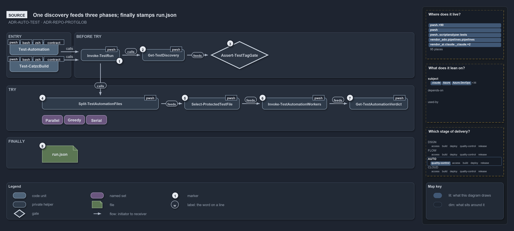

# Catzc.Base.QualityGates

The quality-gate module. It **runs every check the repository applies to itself** — all tests (with tag-enforcement and timestamped
reporting), the repository-wide quality gates, the spell-checker, the Markdown linter, the formatters, the terminology registry, and the
managed-GUID registry. What it deliberately does **not** own is the tests themselves (each module keeps its own `tests/` folder), the
quality gates whose property belongs to another module (the module-graph quality gates live in
[Catzc.Base.ModuleSystem](../base-module-system/index.md)), or the per-tool configuration (cSpell, markdownlint, and Prettier each carry
their own config at the repository root). A quality gate collects every issue, writes its report through
[Catzc.Base.Reports](../base-reports/index.md), and throws once listing them all
([test-automation](../../../drs/automation/test-automation.md#rule-adr-auto-test-qualitygate)); the tier and category tag rules the Pester
runner enforces are the subject of the same ADR.

## Responsibilities

| Responsibility   | Area        | Name                                                                           |
| ---------------- | ----------- | ------------------------------------------------------------------------------ |
| responsibility:1 | runner      | [Test runner](#responsibility1--test-runner)                                   |
| responsibility:2 | gates       | [Repository quality gates](#responsibility2--repository-quality-gates)         |
| responsibility:3 | formatting  | [Document and code formatting](#responsibility3--document-and-code-formatting) |
| responsibility:4 | terminology | [Terminology and dictionaries](#responsibility4--terminology-and-dictionaries) |
| responsibility:5 | guids       | [Managed GUIDs](#responsibility5--managed-guids)                               |

### responsibility:1 — Test runner

How the repository runs and validates all its tests. This responsibility discovers tests across every module, runs them at the requested
tier level (L0–L2 by default, the opt-in L3 and L4 when asked) and optional category filter (`logic`/`integrity`), and writes a timestamped
report — as a source run, as a build run against a fresh build of the selected modules, one test file at a time, or for a module profile
copied into an isolated sandbox. Before any test executes, a discovery-only pass inspects the full test tree and throws if any test is
missing or ambiguous on either of the two mandatory tag axes — exactly one tier (`L0|L1|L2|L3|L4`) and exactly one category
(`logic|integrity`). An L4 test, which tests the released system after final approval, asks `Get-TestTargetSkipReason` first and self-skips
when the console cannot reach its target or the target's `test-policy.yml` mode does not allow what it does. A module's Go, Python and Bash
tests, in the Go test module and the Python and Bash test folders named for it, count as that module's tests: one shared Pester bridge, the
language bridge, runs them and turns every test into one Pester test. The tag model, the two-axis tagging contract, the two run modes, and
the tier definitions are the subject of [test-automation](../../../drs/automation/test-automation.md); the Go, Python and Bash tests are the
subject of [go-test-artifacts](../../../drs/automation/go/go-test-artifacts.md),
[python-test-artifacts](../../../drs/automation/python/python-test-artifacts.md) and
[bash-test-artifacts](../../../drs/automation/bash/bash-test-artifacts.md).

### responsibility:2 — Repository quality gates

The gates that each check one property of the whole repository: every generated file equals what its generator would write now; every
formatter would leave the repository unchanged; the built artifact builds, loads, and matches its source; every shipped config has a
registered C# config type and loads through it
([module-config-loading](../../../drs/configuration/module-config-loading.md#rule-adr-conf-loading-csharpconfigtype)); the source and test
files follow the naming and one-function conventions; test titles carry no unfilled template token; the manual test plan lists every
integrity check once; the analyzer-to-ADR map cites only real rules and maps every custom analyzer rule; the PowerShell passes
PSScriptAnalyzer; and test and production identities never cross — no logic test names a live identity, no shipped config carries a
test-fixture one, and no fixture identity is also a live one. An integrity test runs each gate at its tier, so every default test run and
every CI run includes it.

### responsibility:3 — Document and code formatting

How the repository checks and enforces the style of its written and source content. This responsibility runs the spell-checker (and collects
its flagged tokens into a triage queue), the Markdown linter, the Markdown formatter (which aligns tables and wraps prose in place), the
Markdown title and heading formatter and quality gate, the Markdown meta formatter and its two gates (the block itself and the registry's
processors), the one formatting command (`Format-Code`, which runs the formatter engine `languages.yml` names for each file language —
Prettier, the managed toolchain's `gofmt`, the pinned `ruff`, PSScriptAnalyzer, `dotnet format`, the pinned Bicep CLI — with one private
adapter per engine; [configure-not-program](../../../drs/principles/configure-not-program.md)), the C# type-namespace formatter, the Python
lint and type quality gates (`Test-PythonLint`, `ruff check`; `Test-PythonTypes`, `pyright`, the engine Pylance runs in the editor) over
every `.py` file the repository holds, the shell-script quality gate (`Test-ShellScripts`: LF, the executable bit, and ShellCheck) over
every shell script it tracks ([bash-test-artifacts](../../../drs/automation/bash/bash-test-artifacts.md)), the idiomatic-names quality gate
and its assertion (`Test-IdiomaticNames`, `Assert-IdiomaticNames`: every tracked file and its folders named in its language's idiom;
[idiomatic-names](../../../drs/automation/idiomatic-names.md)), and the link aligner and quality gate, which keep code links
repository-rooted and markdown links relative and resolving ([markdown-links](../../../drs/repository/markdown-links.md)), and the comment
converters and their quality gate, which move every long comment into its file's comment page, leaving nothing behind in the file, and write
the annotated view ([comments-in-docs](../../../drs/repository/comments-in-docs.md)). The responsibility owns the invocation of each tool,
not the tool itself or its per-tool configuration.

### responsibility:4 — Terminology and dictionaries

The terminology registry (`terminology.yml`) is the single authored source of the repository's approved vocabulary, grouped by category.
This responsibility generates the per-category spell-checker dictionaries from it and the committed English word list the spell-out-names
analyzer rule checks identifiers against, and checks the registry: no drift between it and the generated dictionaries, no orphan entries, no
unjustified ones.

### responsibility:5 — Managed GUIDs

The managed-GUID registry (`guids.yml`) names every GUID the repository is allowed to carry
([managed-guids](../../../drs/automation/managed-guids.md)). This responsibility reads the registry, answers or asserts whether one GUID is
registered, scans tracked text for GUID literals, mints a readable GUID from a sentence, and checks the repository: every GUID in tracked
text is registered, none is denied, and every entry is live.

## What the module does

The module is the repository's self-check harness. The test runner (responsibility 1) checks behaviour — does every function do what it
claims? — and runs every gate through the integrity tests that call it. The repository quality gates (responsibility 2) check the properties
no single function owns: generated files, formatting, the built artifact, the shipped configs, and the conventions. The formatting quality
gates (responsibility 3) check form — are the prose, markup, and source consistently shaped? The terminology (responsibility 4) and
managed-GUID (responsibility 5) registries turn two open-ended vocabularies — accepted words and allowed GUIDs — into reviewed, checked
lists. All answer to the same contract: these are the gates a change is measured against before it merges.

Responsibility 1 carries the most machinery. The test runner does not simply invoke Pester; it enforces the two-tag contract on every run. A
discovery-only pass — driven by private helpers that perform nearest-contributing-block tag resolution across the `Describe`/`Context` chain
— inspects every test before a single one executes, so a missing or ambiguous tag fails the run immediately rather than silently skipping a
tier. The L0–L3 tier filter and the `logic`/`integrity` category filter are orthogonal run parameters, and the enforcement pass always
covers the full tree regardless of which subset is requested.

The runner reaches past PowerShell for the Go and Python tests, through one language bridge. Discovery maps each Go test module and Python
test folder to the catzc module it is named for (in kebab case), so module selection, test suites, ordering, and protection treat it like
that module's `tests/` folder, and a test folder that names no catzc module stops the run. The bridge reads the tests from their source, so
discovery needs no tool, and runs them once per module through [Catzc.Base.Languages](../base-languages/index.md): every test becomes one
`L2` Pester test with the category its name gives, and passes, fails with the tool output, or skips as the test did. The run's source
session locates the tools once — the managed `go`, `uv` with the pinned interpreter, and the bash engine — and hands them to the bridge;
without one, that language's tests skip with `tool_go_missing`, `tool_uv_missing` or `tool_bash_missing`. The Go and Python tests run once
under each of the three execution engines, pwsh, bash and zsh; the Bash tests run under bash only. In a build run the bridge hands the
build's entry script on, so the tests start the built engine.

Responsibility 3 is a set of thin wrappers, one per external tool, deliberately kept separate so each can be run in isolation;
`Test-Formatting` (responsibility 2) runs every formatter in its report-only mode as one gate. A `Format-*` function is both a check and a
mutation — it rewrites files in place, so it belongs to the authoring workflow as well as CI.

The module's neighbours are the rest of the `Base` group, which supply the primitives (file location, process invocation, console output,
reports, and assertions) this module composes. It does not depend on any feature module.

The diagram below draws one test run of responsibility 1 from the source. Both kinds of run share one harness. It discovers the tests once
and checks their tags before any run directory exists, then splits the files into the parallel, greedy and serial phases, drops the modules
that are already protected, and derives one verdict. A `finally` stamps the run's `run.json` record on every exit from the run.

```yml drawio
description:
  "Both kinds of test run share one harness: it discovers the tests once, checks their tags before any run directory exists, splits the
  files into three phases, drops protected modules, runs the workers and derives one verdict; a finally stamps run.json."
about:
  adrs: [ADR-AUTO-TEST, ADR-REPO-PROTGLOB]
  lens: source
content:
  title: One discovery feeds three phases; finally stamps run.json
  kind: reference
  flow: top-to-bottom
  theme: dark
  bands:
    - { id: band-entry, label: ENTRY }
    - { id: band-before, label: BEFORE TRY }
    - { id: band-try, label: TRY }
    - { id: band-finally, label: FINALLY }
  glyphs:
    - { id: g-automation, kind: code, label: Test-Automation, in: band-entry }
    - { id: g-build, kind: code, label: Test-CatzcBuild, in: band-entry }
    - { id: g-run, kind: private, label: Invoke-TestRun, in: band-before }
    - { id: g-discovery, kind: private, label: Get-TestDiscovery, in: band-before }
    - { id: g-tag-gate, kind: gate, label: Assert-TestTagGate, in: band-before }
    - { id: g-split, kind: private, label: Split-TestAutomationFiles, in: band-try }
    - { id: s-parallel, kind: set, label: Parallel, in: band-try }
    - { id: s-greedy, kind: set, label: Greedy, in: band-try }
    - { id: s-serial, kind: set, label: Serial, in: band-try }
    - { id: g-select, kind: private, label: Select-ProtectedTestFile, in: band-try }
    - { id: g-workers, kind: private, label: Invoke-TestAutomationWorkers, in: band-try }
    - { id: g-verdict, kind: private, label: Get-TestAutomationVerdict, in: band-try }
    - { id: f-run-json, kind: file, label: run.json, in: band-finally }
  edges:
    - { from: g-automation, to: g-run, kind: flow, label: calls }
    - { from: g-build, to: g-run, kind: flow, label: calls }
    - { from: g-run, to: g-discovery, kind: flow, label: calls }
    - { from: g-discovery, to: g-tag-gate, kind: flow, label: feeds }
    - { from: g-run, to: g-split, kind: flow, label: calls }
    - { from: g-split, to: g-select, kind: flow, label: feeds }
    - { from: g-select, to: g-workers, kind: flow, label: feeds }
    - { from: g-workers, to: g-verdict, kind: flow, label: feeds }
  markers:
    - { at: g-run, number: 1 }
    - { at: g-discovery, number: 2 }
    - { at: g-tag-gate, number: 3 }
    - { at: g-split, number: 4 }
    - { at: g-select, number: 5 }
    - { at: g-workers, number: 6 }
    - { at: g-verdict, number: 7 }
    - { at: f-run-json, number: 8 }
  legend: auto
  minimaps: [code-locations, module-neighbourhood, axis]
layout:
  band-entry: { x: 20, y: 84, w: 200, h: 140 }
  band-before: { x: 230, y: 84, w: 1050, h: 140 }
  band-try: { x: 20, y: 248, w: 1260, h: 140 }
  band-finally: { x: 20, y: 408, w: 1260, h: 96 }
  g-automation: { x: 30, y: 114, w: 150, h: 40 }
  g-build: { x: 30, y: 166, w: 150, h: 40 }
  g-run: { x: 250, y: 136, w: 120, h: 36 }
  g-discovery: { x: 440, y: 136, w: 130, h: 36 }
  g-tag-gate: { x: 650, y: 111, w: 180, h: 86 }
  g-split: { x: 130, y: 286, w: 360, h: 36 }
  s-parallel: { x: 130, y: 340, w: 64, h: 28 }
  s-greedy: { x: 198, y: 340, w: 64, h: 28 }
  s-serial: { x: 266, y: 340, w: 64, h: 28 }
  g-select: { x: 570, y: 286, w: 170, h: 36 }
  g-workers: { x: 810, y: 286, w: 200, h: 36 }
  g-verdict: { x: 1080, y: 286, w: 180, h: 36 }
  f-run-json: { x: 130, y: 434, w: 110, h: 52 }
```



## Division

The module's public functions and configuration files, sorted into the responsibilities above.

| Responsibility                                  | Function                      |
| ----------------------------------------------- | ----------------------------- |
| responsibility:1 — Test runner                  | `Test-Automation`             |
|                                                 | `Invoke-TestFile`             |
|                                                 | `Test-CatzcBuild`             |
|                                                 | `Test-InIsolation`            |
|                                                 | `Get-TestTargetSkipReason`    |
|                                                 | `Test-Change`                 |
| config                                          | `test-policy.yml`             |
| responsibility:2 — Repository quality gates     | `Test-GeneratedFiles`         |
|                                                 | `Test-TrackMemberCommitted`   |
|                                                 | `Get-GeneratedWriterDue`      |
|                                                 | `Test-Formatting`             |
|                                                 | `Test-BclReferences`          |
|                                                 | `Test-BuildArtifact`          |
|                                                 | `Test-ShippedConfigs`         |
|                                                 | `Test-SourceConventions`      |
|                                                 | `Test-TestTitles`             |
|                                                 | `Test-ManualTestPlan`         |
|                                                 | `Test-AnalyzerDrsMap`         |
|                                                 | `Test-ScriptAnalyzer`         |
|                                                 | `Test-Parsing`                |
|                                                 | `Test-LogicTestIdentity`      |
|                                                 | `Test-ConfigIdentityHygiene`  |
|                                                 | `Test-ParameterConsistency`   |
|                                                 | `Test-Plans`                  |
|                                                 | `Test-ReferencePages`         |
|                                                 | `Test-BicepLint`              |
|                                                 | `Test-SecretScan`             |
|                                                 | `New-Plan`                    |
|                                                 | `Get-DrsUsage`                |
|                                                 | `Measure-QualityGates`        |
| config                                          | `analyzer-drs-map.yml`        |
|                                                 | `generated-files.yml`         |
|                                                 | `source-conventions.yml`      |
|                                                 | `parameter-consistency.yml`   |
|                                                 | `plans.yml`                   |
|                                                 | `edit-reminders.yml`          |
| responsibility:3 — Document and code formatting | `Test-Spelling`               |
|                                                 | `Export-SpellingTriage`       |
|                                                 | `Test-Markdownlint`           |
|                                                 | `Format-Code`                 |
|                                                 | `Format-MarkdownTitle`        |
|                                                 | `Test-MarkdownTitle`          |
|                                                 | `Format-FileMeta`             |
|                                                 | `Get-FileMetaFact`            |
|                                                 | `Sync-FileMeta`               |
|                                                 | `Test-FileMeta`               |
|                                                 | `Test-FileMetaProcessors`     |
|                                                 | `Format-Types`                |
|                                                 | `Test-PythonLint`             |
|                                                 | `Test-PythonTypes`            |
|                                                 | `Test-ShellScripts`           |
|                                                 | `Test-IdiomaticNames`         |
|                                                 | `Assert-IdiomaticNames`       |
|                                                 | `Repair-IdiomaticNames`       |
|                                                 | `Format-Links`                |
|                                                 | `Test-Links`                  |
|                                                 | `Export-Comments`             |
|                                                 | `Build-CommentView`           |
|                                                 | `Test-Comments`               |
| config                                          | `links.yml`                   |
|                                                 | `comments.yml`                |
|                                                 | `file-meta.yml`               |
| responsibility:4 — Terminology and dictionaries | `Build-TerminologyDictionary` |
|                                                 | `Build-EnglishDictionary`     |
|                                                 | `Test-Terminology`            |
| config                                          | `terminology.yml`             |
| responsibility:5 — Managed GUIDs                | `Test-ManagedGuid`            |
|                                                 | `Assert-ManagedGuid`          |
|                                                 | `Get-RepositoryGuids`         |
|                                                 | `ConvertTo-Guid`              |
|                                                 | `Test-ManagedGuids`           |
| config                                          | `guids.yml`                   |
