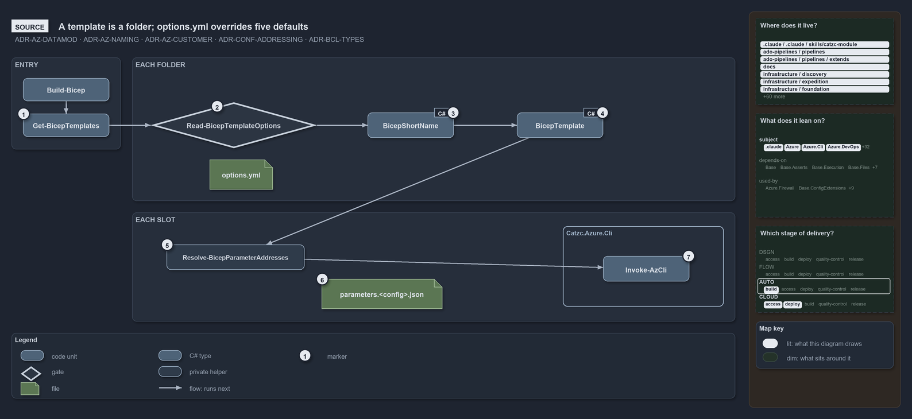
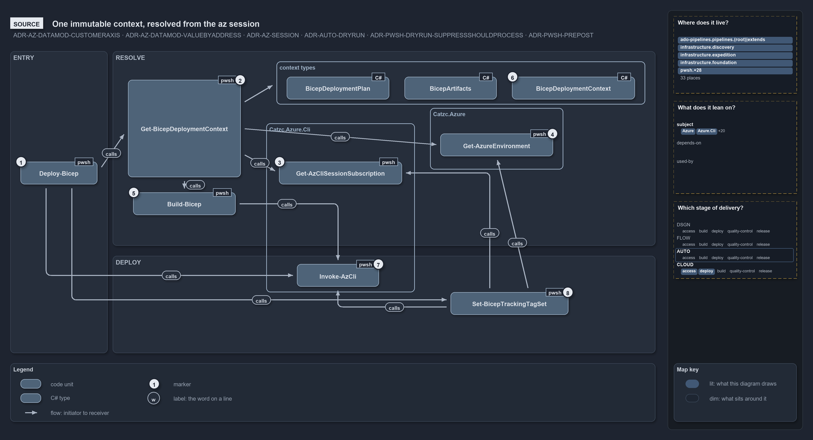

# Catzc.Azure.Templates

The Bicep templating module. It is the top of the Azure stack: it discovers the deployable templates in the repository, derives the names
their resources must carry, builds them into deployable artifacts, and deploys them. It consumes the identity model from
[Catzc.Azure](catzc-azure.md) and the session checks from [Catzc.Azure.Cli](catzc-azure-cli.md), and is the implementation of the
[data-model](../../drs/azure/azure-data-model.md) and [naming-standard](../../drs/azure/azure-naming-standard.md) decisions.

## Responsibilities

| Responsibility   | Area           | Name                                                                                                               |
| ---------------- | -------------- | ------------------------------------------------------------------------------------------------------------------ |
| responsibility:1 | discovery      | [Template discovery and the configuration model](#responsibility1--template-discovery-and-the-configuration-model) |
| responsibility:2 | naming         | [Deterministic resource naming](#responsibility2--deterministic-resource-naming)                                   |
| responsibility:3 | classification | [Deployment classification](#responsibility3--deployment-classification)                                           |
| responsibility:4 | build          | [Build](#responsibility4--build)                                                                                   |
| responsibility:5 | deploy         | [Deploy and resource-group provisioning](#responsibility5--deploy-and-resource-group-provisioning)                 |
| responsibility:6 | integrity      | [Template integrity validation](#responsibility6--template-integrity-validation)                                   |

### responsibility:1 — Template discovery and the configuration model

Finding the deployable templates on disk and reading their structure: the per-template options, and the per-resource-group configuration
files that map a subscription, environment, and slot to one set of parameters. This responsibility also exposes the distinct customers,
subscriptions, and slots a template targets, and writing a configuration back. One configuration file corresponds to exactly one Azure
resource group, so this responsibility _is_ the resource-group inventory. See [data-model](../../drs/azure/azure-data-model.md).

### responsibility:2 — Deterministic resource naming

Assembling an Azure resource name from its canonical components — environment, slot, region, organization, template short name, optional
customer and role, and resource type — in the active component order, rendered to each resource type's length and character budget. Names
are deterministic, with no random suffixes, and an over-budget name fails rather than being silently truncated. This responsibility owns the
name builder and the registries of orders, render patterns, and resource types. See
[naming-standard](../../drs/azure/azure-naming-standard.md).

### responsibility:3 — Deployment classification

The small, closed vocabularies a template and a deployment are classified by: the environment kinds a template can declare, and the
deployment modes and targets a deploy can use. These are the allowed-value sets the options and the deploy validate against.

### responsibility:4 — Build

Turning a template plus a chosen environment and slot into a deployable artifact: resolving the build context, resolving every
config-addressed parameter into the value its config address names, running the template's build-time preparation hook, rendering the
per-slot parameter file, and compiling the Bicep into the output directory, which sits under the one output root every template's build
output resolves to. Build is mode-agnostic — it produces artifacts, it does not touch Azure. The deployment's identifying name is derived
here too.

### responsibility:5 — Deploy and resource-group provisioning

Taking a built template to Azure: ensuring the target resource group exists, running the pre-deploy hook, executing the deployment
(honouring a dry-run preview), applying the tracking tags that scope the deployment, and running the post-deploy hook. This is the only
state-changing responsibility, and it verifies the session targets the configured subscription before it acts.

### responsibility:6 — Template integrity validation

Checking that a template is internally consistent and conforms to the model — that its configuration sits under defined subscriptions
serving the right environments, that its class and slots are valid, that its name renders within budget, and that every parameters file it
renders satisfies the parameter model of its compiled `main.json` (see
[data-model](../../drs/azure/azure-data-model.md#rule-adr-az-datamod-parametercontract)). This is the guard the integrity tests run across
every shipped template.

## What the module does

The module is a pipeline of concerns that takes a template from "a folder in the repository" to "resources in Azure". Discovery
(responsibility 1) reads the filesystem into a model: which templates exist, what each declares, and the one-to-one map between a
configuration file and a resource group. Naming (responsibility 2) is the deterministic function that turns the identity components into the
exact strings Azure will see — it is pure derivation, so the same inputs always produce the same names, and a name that cannot fit its
resource type's budget is an error to fix, not a string to trim.

Build (responsibility 4) and deploy (responsibility 5) are the two execution phases, and the split is deliberate: build produces an
immutable artifact and never touches the cloud, while deploy is the only place state changes. Both phases call the template's optional
extension hooks at the right moments — preparation merges global configuration into the parameter set at build time, and the pre/post-deploy
hooks bracket the deployment — which is how a template injects a secret reference or provisions a queue without that logic leaking into the
engine (see [prepost-extension-modules](../../drs/automation/pwsh/prepost-extension-modules.md)). A value that belongs to the repository
rather than to one template, such as the policy enforcement mode, needs no hook: a template's configuration names it by its config address,
and build renders the addressed value into the parameter file (see
[data-model](../../drs/azure/azure-data-model.md#rule-adr-az-datamod-valuebyaddress) and
[config-value-addressing](../../drs/configuration/config-value-addressing.md)). Deploy leans on the session-verification checks before it
acts, so a deployment can never run against the wrong subscription.

The classification vocabularies (responsibility 3) are the small enumerations that keep options and deploys honest, and integrity validation
(responsibility 6) is the safety net: it binds to the _set_ of shipped templates and asserts the invariants that must hold for every one of
them, so a misnamed config folder or an undefined environment fails the tests rather than a deployment. Throughout, identity comes from the
[Catzc.Azure](catzc-azure.md) model — this module owns no configuration of its own; it reads `azure.yml` and `network.yml` through that
module.

The first diagram below draws template discovery and the build from the source. A template is a folder, and its `options.yml` may override
only five derived defaults, under a strict schema. The build writes one parameters file per slot and then compiles the template once. The
second diagram draws a deployment. It works on one immutable context (the plan, the artifacts and the environment), resolved from the live
az session against `azure.yml`. A dry run stops at the what-if; otherwise the deployment is created.

```yml drawio
description:
  Template discovery walks the template folders, lets an optional options.yml override five derived defaults, and resolves each template's
  short name and type; the build then resolves the parameter addresses per slot and compiles through the az runner.
about:
  adrs: [ADR-AZ-DATAMOD, ADR-AZ-NAMING, ADR-AZ-CUSTOMER, ADR-CONF-ADDRESSING, ADR-BCL-TYPES]
  lens: source
content:
  title: A template is a folder; options.yml overrides five defaults
  kind: reference
  flow: left-to-right
  relation: runs next (code order)
  theme: dark
  bands:
    - { id: band-entry, label: ENTRY }
    - { id: band-folder, label: EACH FOLDER }
    - { id: band-slot, label: EACH SLOT }
  groups:
    - { id: grp-cli, label: Catzc.Azure.Cli, in: band-slot }
  glyphs:
    - { id: g-build, kind: code, label: Build-Bicep, in: band-entry }
    - { id: g-templates, kind: code, label: Get-BicepTemplates, in: band-entry }
    - { id: g-options, kind: gate, label: Read-BicepTemplateOptions, in: band-folder }
    - { id: f-options-yml, kind: file, label: options.yml, in: band-folder }
    - { id: t-short-name, kind: type, label: BicepShortName, in: band-folder }
    - { id: t-template, kind: type, label: BicepTemplate, in: band-folder }
    - { id: g-addresses, kind: private, label: Resolve-BicepParameterAddresses, in: band-slot }
    - { id: f-parameters, kind: file, label: parameters.<config>.json, in: band-slot }
    - { id: g-invoke, kind: code, label: Invoke-AzCli, in: grp-cli }
  edges:
    - { from: g-build, to: g-templates, kind: flow, label: "" }
    - { from: g-templates, to: g-options, kind: flow, label: "" }
    - { from: g-options, to: t-short-name, kind: flow, label: "" }
    - { from: t-short-name, to: t-template, kind: flow, label: "" }
    - { from: t-template, to: g-addresses, kind: flow, label: "" }
    - { from: g-addresses, to: g-invoke, kind: flow, label: "" }
  markers:
    - { at: g-templates, number: 1 }
    - { at: g-options, number: 2 }
    - { at: t-short-name, number: 3 }
    - { at: t-template, number: 4 }
    - { at: g-addresses, number: 5 }
    - { at: f-parameters, number: 6 }
    - { at: g-invoke, number: 7 }
  legend: auto
  minimaps: [code-locations, module-neighbourhood, axis]
layout:
  band-entry: { x: 20, y: 84, w: 190, h: 160 }
  band-folder: { x: 230, y: 84, w: 1050, h: 250 }
  band-slot: { x: 230, y: 354, w: 1050, h: 190 }
  g-build: { x: 40, y: 120, w: 150, h: 40 }
  g-templates: { x: 40, y: 182, w: 150, h: 40 }
  g-options: { x: 262, y: 162, w: 290, h: 80 }
  f-options-yml: { x: 365, y: 262, w: 110, h: 52 }
  t-short-name: { x: 640, y: 180, w: 150, h: 44 }
  t-template: { x: 900, y: 180, w: 150, h: 44 }
  g-addresses: { x: 290, y: 410, w: 240, h: 44 }
  f-parameters: { x: 560, y: 470, w: 210, h: 52 }
  grp-cli: { x: 980, y: 378, w: 280, h: 140 }
  g-invoke: { x: 1050, y: 430, w: 150, h: 44 }
```



```yml drawio
description:
  Deploy-Bicep resolves one immutable deployment context from the az session and the Azure config, then builds, deploys through the az
  runner and sets the tracking tags, all from that one context.
about:
  adrs:
    - ADR-AZ-DATAMOD-CUSTOMERAXIS
    - ADR-AZ-DATAMOD-VALUEBYADDRESS
    - ADR-AZ-SESSION
    - ADR-AUTO-DRYRUN
    - ADR-PWSH-DRYRUN-SUPPRESSSHOULDPROCESS
    - ADR-PWSH-PREPOST
  lens: source
content:
  title: One immutable context, resolved from the az session
  kind: reference
  flow: left-to-right
  theme: dark
  bands:
    - { id: band-entry, label: ENTRY }
    - { id: band-resolve, label: RESOLVE }
    - { id: band-deploy, label: DEPLOY }
  groups:
    - { id: grp-types, label: context types, in: band-resolve }
    - { id: grp-cli, label: Catzc.Azure.Cli, in: band-resolve }
    - { id: grp-azure, label: Catzc.Azure, in: band-resolve }
  glyphs:
    - { id: g-deploy, kind: code, label: Deploy-Bicep, in: band-entry }
    - { id: g-context, kind: code, label: Get-BicepDeploymentContext, in: band-resolve }
    - { id: t-plan, kind: type, label: BicepDeploymentPlan, in: grp-types }
    - { id: t-artifacts, kind: type, label: BicepArtifacts, in: grp-types }
    - { id: t-context, kind: type, label: BicepDeploymentContext, in: grp-types }
    - { id: g-build, kind: code, label: Build-Bicep, in: band-resolve }
    - { id: g-session-sub, kind: code, label: Get-AzCliSessionSubscription, in: grp-cli }
    - { id: g-invoke, kind: code, label: Invoke-AzCli, in: grp-cli }
    - { id: g-environment, kind: code, label: Get-AzureEnvironment, in: grp-azure }
    - { id: g-tracking, kind: code, label: Set-BicepTrackingTagSet, in: band-deploy }
  edges:
    - { from: g-deploy, to: g-context, kind: flow, label: calls }
    - { from: g-context, to: grp-types, kind: flow, label: "" }
    - { from: g-context, to: g-build, kind: flow, label: calls }
    - { from: g-context, to: g-session-sub, kind: flow, label: calls }
    - { from: g-context, to: g-environment, kind: flow, label: calls }
    - { from: g-build, to: g-invoke, kind: flow, label: calls }
    - { from: g-deploy, to: g-invoke, kind: flow, label: calls }
    - { from: g-deploy, to: g-tracking, kind: flow, label: calls }
    - { from: g-tracking, to: g-invoke, kind: flow, label: calls }
    - { from: g-tracking, to: g-session-sub, kind: flow, label: calls }
    - { from: g-tracking, to: g-environment, kind: flow, label: calls }
  markers:
    - { at: g-deploy, number: 1 }
    - { at: g-context, number: 2 }
    - { at: g-session-sub, number: 3 }
    - { at: g-environment, number: 4 }
    - { at: g-build, number: 5 }
    - { at: t-context, number: 6 }
    - { at: g-invoke, number: 7 }
    - { at: g-tracking, number: 8 }
  legend: auto
  minimaps: [code-locations, module-neighbourhood, axis]
layout:
  band-entry: { x: 20, y: 84, w: 190, h: 590 }
  band-resolve: { x: 220, y: 84, w: 1060, h: 380 }
  band-deploy: { x: 220, y: 484, w: 1060, h: 190 }
  g-deploy: { x: 40, y: 300, w: 150, h: 44 }
  g-context: { x: 250, y: 140, w: 220, h: 190 }
  grp-types: { x: 540, y: 104, w: 720, h: 84 }
  t-plan: { x: 560, y: 134, w: 200, h: 44 }
  t-artifacts: { x: 790, y: 134, w: 180, h: 44 }
  t-context: { x: 1000, y: 134, w: 240, h: 44 }
  g-build: { x: 260, y: 360, w: 200, h: 44 }
  grp-cli: { x: 520, y: 225, w: 290, h: 330 }
  g-session-sub: { x: 545, y: 300, w: 240, h: 44 }
  g-invoke: { x: 580, y: 500, w: 160, h: 44 }
  grp-azure: { x: 840, y: 195, w: 260, h: 120 }
  g-environment: { x: 860, y: 245, w: 220, h: 44 }
  g-tracking: { x: 880, y: 555, w: 230, h: 44 }
```



## Division

The module's public functions, sorted into the responsibilities above. This module owns no config files of its own; it consumes `azure.yml`
and `network.yml` (owned by [Catzc.Azure](catzc-azure.md)).

| Responsibility                                                    | Function                          |
| ----------------------------------------------------------------- | --------------------------------- |
| responsibility:1 — Template discovery and the configuration model | `Get-BicepTemplates`              |
|                                                                   | `Get-BicepTemplate`               |
|                                                                   | `Get-BicepTemplateNames`          |
|                                                                   | `Get-BicepTemplateConfiguration`  |
|                                                                   | `Set-BicepTemplateConfiguration`  |
|                                                                   | `Get-BicepTemplateCustomers`      |
|                                                                   | `Get-BicepTemplateSlots`          |
| responsibility:2 — Deterministic resource naming                  | `Get-AzureResourceName`           |
|                                                                   | `Get-BicepResourceName`           |
|                                                                   | `Get-AzureNameOrderSet`           |
|                                                                   | `Get-AzureNamePatternSet`         |
|                                                                   | `Get-AzureResourceTypeSet`        |
| responsibility:3 — Deployment classification                      | `Get-AzureBicepEnvironmentKinds`  |
|                                                                   | `Get-AzureBicepDeploymentModes`   |
|                                                                   | `Get-AzureBicepDeploymentTargets` |
|                                                                   | `Get-BicepDeploymentName`         |
| responsibility:4 — Build                                          | `Build-Bicep`                     |
|                                                                   | `ConvertTo-BicepParam`            |
|                                                                   | `Get-BicepTemplatesOutputRoot`    |
| responsibility:5 — Deploy and resource-group provisioning         | `Deploy-Bicep`                    |
|                                                                   | `Get-BicepDeploymentContext`      |
|                                                                   | `Deploy-AzureResourceGroup`       |
|                                                                   | `Set-BicepTrackingTagSet`         |
|                                                                   | `Get-BicepTrackTagNameSet`        |
| responsibility:6 — Template integrity validation                  | `Assert-BicepTemplate`            |
|                                                                   | `Get-BicepParameterModel`         |
