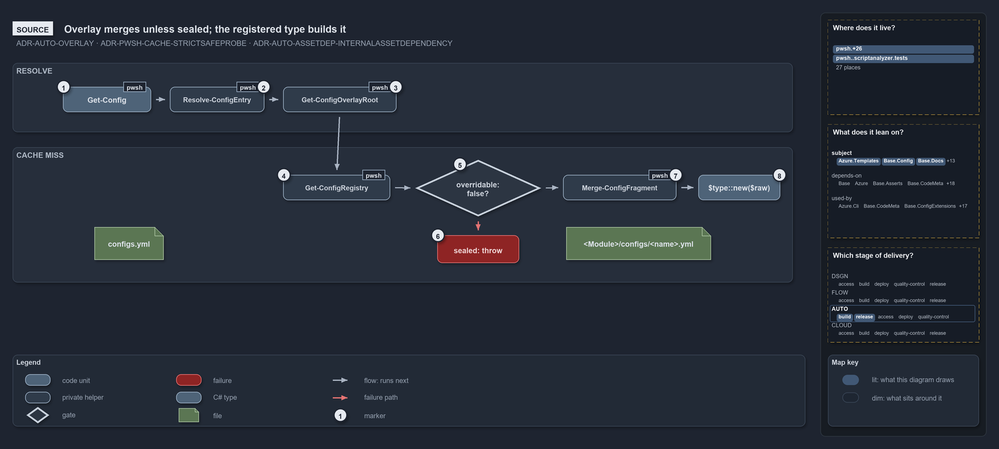

---
catzc:
  warning: "Header is generated by Format-FileMeta via Format-Code; do not change it"
  edges:
    drs_total: 2
---

# Catzc.Base.Config

The single config reader for the platform. It owns `Get-Config` — the one public function every module calls to find, parse, validate, and
cache a named config file — `Get-ConfigValue`, the by-reference addressing that resolves a `global.<config>.<key.path>` address to a value
on top of that reader, and the `configs.yml` registry that binds every shipped config to its C# config type. It does **not** own the config
types themselves (each lives in its owning module's `types/`), the config files they guard, the PowerShell validator extension point (that
is [Catzc.Base.ConfigExtensions](catzc-base-config-extensions.md)), or the object-shaping helpers that manipulate already-loaded config
objects (those live in [Catzc.Base.Objects](catzc-base-objects.md)). The design is governed by
[module-config-loading](../../drs/configuration/module-config-loading.md).

## Responsibilities

| Responsibility   | Area       | Name                                                                       |
| ---------------- | ---------- | -------------------------------------------------------------------------- |
| responsibility:1 | loading    | [Config loading and caching](#responsibility1--config-loading-and-caching) |
| responsibility:2 | registry   | [Config type registry](#responsibility2--config-type-registry)             |
| responsibility:3 | addressing | [Config value addressing](#responsibility3--config-value-addressing)       |

### responsibility:1 — Config loading and caching

The unified path from a config name to a validated, cached object. `Get-Config` discovers the file by scanning `pwsh/*/configs/<name>.yml`
(via the private `Resolve-ConfigEntry` seam), parses it as an ordered dictionary, constructs its registered C# config type — which maps and
validates it — and stores the result keyed by resolved file path; a config with no registered type comes back raw. Every subsequent call for
the same name returns the cached reference; the file is read once per session. Unknown and ambiguous names throw immediately; there is no
silent fall-through. The full design — discovery, typed configs, poka-yoke table — is in
[module-config-loading](../../drs/configuration/module-config-loading.md).

### responsibility:2 — Config type registry

A `configs.yml` file that binds each shipped config name to its C# config type (`<name>: { type: <C# FQN> }`). `Get-Config` constructs
`[type]::new($dict)`, so the type both maps and validates the ordered dict into a typed object and reports every violation at once.
`ConfigsConfig` (`Catzc.Base.Config.ConfigsConfig`) is the C# type that validates this registry file itself and exposes its entries. The
quality gate `Test-ShippedConfigs` keeps the registry and the shipped configs in step. See
[native-csharp-types](../../drs/automation/BCL/native-csharp-types.md) for the type mechanism.

### responsibility:3 — Config value addressing

A global config address `global.<config>.<key.path>` names one node — a leaf value or a subtree — inside a named config, resolved by
`Get-ConfigValue` on top of `Get-Config`, so there is still one reader and one cache. The first segment after `global.` is the global config
name (the owning module is discovered, not part of the address); each following segment is a key walked into the parsed config, over a raw
ordered dictionary or a typed object alike. The key path is optional — `global.<config>` addresses the whole config as a subtree. An address
is the by-reference form of a config value: committable as data, dereferenced wherever a value is wanted without re-reading a file, and
always read-only. Because an address only ever reaches version-controlled config, nothing addressable is a secret. The design is in
[config-value-addressing](../../drs/configuration/config-value-addressing.md).

## What the module does

This module is a single-function reader with a typed back-end. Responsibility 1 is the invariant: `Get-Config` is the one place in the
platform where a config file is opened, parsed, and cached. No other module keeps its own cache, re-reads a file, or re-implements
parse-and-validate. Because validation is the config type's constructor, it is caller-independent — the same validated object comes back no
matter who asked.

Responsibility 2 is the binding between a config file and its shape. Adding a config is a file, a C# type in the owning module, and one
registry line — no change to the reader. The registry file is validated by `ConfigsConfig`, which is itself loaded through `Get-Config` —
the mechanism eats its own cooking.

Responsibility 3 is a thin read on top of responsibility 1. `Get-ConfigValue` adds a grammar and a key-path walk over the object
`Get-Config` already loaded and cached — it opens no file and keeps no cache of its own, so the one-reader invariant holds. An address is
how a config value earns a written-down name: a `global.<config>.<key.path>` string is data a caller can commit and dereference at the point
of use, and its hard line at secrets (everything reachable is in git, so nothing addressable is secret) is what lets a consumer treat an
address-sourced value as non-secret.

The module is a member of the `Base` group and depends on [Catzc.Base.Repository](catzc-base-repository.md) for file-path resolution and on
[Catzc.Base.Asserts](catzc-base-asserts.md) for fail-fast assertions.

The diagram below draws one configuration read from the source. The name resolves to its config file, an overlay fragment is merged unless
the configuration is sealed, and the registered type is built from the result. The cache key carries the fragment's timestamp, so an edited
fragment is read again.

```yml drawio
description:
  A config read resolves the name to one entry and the overlay root; on a cache miss the registry is read, a fragment of a sealed config
  throws, any other fragment is merged onto the shipped config, and the registered type builds the result.
about:
  adrs: [ADR-AUTO-OVERLAY, ADR-PWSH-CACHE-STRICTSAFEPROBE, ADR-AUTO-ASSETDEP-INTERNALASSETDEPENDENCY]
  lens: source
content:
  title: Overlay merges unless sealed; the registered type builds it
  kind: reference
  flow: top-to-bottom
  relation: runs next (code order)
  theme: dark
  bands:
    - { id: band-resolve, label: RESOLVE }
    - { id: band-miss, label: CACHE MISS }
  glyphs:
    - { id: g-get-config, kind: code, label: Get-Config, in: band-resolve }
    - { id: g-resolve-entry, kind: private, label: Resolve-ConfigEntry, in: band-resolve }
    - { id: g-overlay-root, kind: private, label: Get-ConfigOverlayRoot, in: band-resolve }
    - { id: g-registry, kind: private, label: Get-ConfigRegistry, in: band-miss }
    - { id: g-sealed, kind: gate, label: "overridable: false?", in: band-miss }
    - { id: f-sealed, kind: failure, label: "sealed: throw", in: band-miss }
    - { id: g-merge, kind: private, label: Merge-ConfigFragment, in: band-miss }
    - { id: t-new, kind: type, label: "$type::new($raw)", in: band-miss }
    - { id: f-configs-yml, kind: file, label: configs.yml, in: band-miss }
    - { id: f-fragment, kind: file, label: <Module>/configs/<name>.yml, in: band-miss }
  edges:
    - { from: g-get-config, to: g-resolve-entry, kind: flow, label: "" }
    - { from: g-resolve-entry, to: g-overlay-root, kind: flow, label: "" }
    - { from: g-overlay-root, to: g-registry, kind: flow, label: "" }
    - { from: g-registry, to: g-sealed, kind: flow, label: "" }
    - { from: g-sealed, to: f-sealed, kind: fail, label: "" }
    - { from: g-sealed, to: g-merge, kind: flow, label: "" }
    - { from: g-merge, to: t-new, kind: flow, label: "" }
  markers:
    - { at: g-get-config, number: 1 }
    - { at: g-resolve-entry, number: 2 }
    - { at: g-overlay-root, number: 3 }
    - { at: g-registry, number: 4 }
    - { at: g-sealed, number: 5 }
    - { at: f-sealed, number: 6 }
    - { at: g-merge, number: 7 }
    - { at: t-new, number: 8 }
  legend: auto
  minimaps:
    code-locations:
      - cell: docs/-/.
        by:
          - docs/drs/automation/consumer-overlay.md
          - docs/drs/automation/dora-explains.md
          - docs/drs/automation/internal-asset-dependencies.md
          - docs/drs/automation/pwsh/dora-explains.md
          - docs/drs/automation/pwsh/script-scope-caching.md
          - docs/drs/glossary.md
          - docs/drs/index.md
          - docs/references/pwsh/catzc-azure-templates/Get-BicepTemplates.ps1.md
          - docs/references/pwsh/catzc-base-config/Get-Config.ps1.md
          - docs/references/pwsh/catzc-base-config/configs/configs.yml.md
          - docs/references/pwsh/catzc-base-config/private/Get-ConfigOverlayRoot.ps1.md
          - docs/references/pwsh/catzc-base-config/private/Get-ConfigRegistry.ps1.md
          - docs/references/pwsh/catzc-base-config/private/Merge-ConfigFragment.ps1.md
          - docs/references/pwsh/catzc-base-config/private/Resolve-ConfigEntry.ps1.md
          - docs/references/pwsh/catzc-base-config/tests/Get-Config.Tests.ps1.md
          - docs/references/pwsh/catzc-base-config/types/ConfigsConfig.cs.md
          - docs/references/pwsh/catzc-base-docs/Get-Glossary.ps1.md
          - docs/references/pwsh/catzc-base-docs/private/Get-CatsRuleEnforcers.ps1.md
          - docs/references/pwsh/catzc-base-drs/Get-CatsDrsIndex.ps1.md
          - docs/references/pwsh/catzc-base-drs/Get-CatsDrsRuleIds.ps1.md
          - docs/references/pwsh/catzc-base-drs/Get-DrsCitationMap.ps1.md
          - docs/references/pwsh/catzc-base-execution/Find-Executable.ps1.md
          - docs/references/pwsh/catzc-base-files/Get-GitTrackedPath.ps1.md
          - docs/references/pwsh/catzc-base-globs/Protect-GlobSet.ps1.md
          - docs/references/pwsh/catzc-base-globs/Test-GlobSetProtection.ps1.md
          - docs/references/pwsh/catzc-base-maps/Get-WorldMap.ps1.md
          - docs/references/pwsh/catzc-base-module-system/Get-FunctionDependency.ps1.md
          - docs/references/pwsh/catzc-base-overlay/Assert-CatzcOverlay.ps1.md
          - docs/references/pwsh/catzc-base-overlay/Get-CatzcOverlay.ps1.md
          - docs/references/pwsh/catzc-base-overlay/Get-FunctionFileViolation.ps1.md
          - docs/references/pwsh/catzc-base-overlay/Import-CatzcOverlay.ps1.md
          - docs/references/pwsh/catzc-base-overlay/private/Get-LocalModuleViolation.ps1.md
          - docs/references/pwsh/catzc-base-overlay/private/Get-OverlayContractViolation.ps1.md
          - docs/references/pwsh/catzc-base-quality-gates/Test-ScriptAnalyzer.ps1.md
          - docs/references/pwsh/catzc-base-quality-gates/private/Import-VendoredPester.ps1.md
          - docs/references/pwsh/catzc-base-quality-gates/private/Invoke-PsScriptAnalyzerFormat.ps1.md
          - docs/references/pwsh/catzc-base-quality-gates/private/Invoke-ScriptAnalyzerShards.ps1.md
          - docs/references/pwsh/catzc-base-quality-gates/private/New-TestAutomationShardScript.ps1.md
          - docs/references/pwsh/catzc-base-repository/Get-CatzcModuleRoot.ps1.md
          - docs/references/pwsh/catzc-base-repository/Get-CatzcOverlayRoot.ps1.md
          - docs/references/pwsh/catzc-base-vs-code/private/New-VsCodeExtensionFolder.ps1.md
          - docs/references/pwsh/catzc-tooling-core/private/Assert-ToolVersion.ps1.md
          - docs/references/pwsh/catzc-tooling-toolchain/Install-Dotnet.ps1.md
          - ADR-AUTO-ASSETDEP-INTERNALASSETDEPENDENCY
          - ADR-AUTO-OVERLAY
          - ADR-PWSH-CACHE-STRICTSAFEPROBE
      - cell: pwsh/-/.
        by:
          - pwsh/.scriptanalyzer/tests/NoBareCacheEntryRead.Tests.ps1
          - pwsh/.scriptanalyzer/tests/NoScriptRootAnchor.Tests.ps1
          - ADR-AUTO-ASSETDEP-INTERNALASSETDEPENDENCY
          - ADR-PWSH-CACHE-STRICTSAFEPROBE
      - cell: pwsh/Catzc.Azure.Templates/.
        by: [pwsh/Catzc.Azure.Templates/Get-BicepTemplates.ps1, ADR-PWSH-CACHE-STRICTSAFEPROBE]
      - cell: pwsh/Catzc.Base.Config/.
        by: [pwsh/Catzc.Base.Config/Get-Config.ps1, ADR-AUTO-OVERLAY, ADR-PWSH-CACHE-STRICTSAFEPROBE]
      - cell: pwsh/Catzc.Base.Config/configs
        by: [pwsh/Catzc.Base.Config/configs/configs.yml, pwsh/Catzc.Base.Config/configs/glossary.yml, ADR-AUTO-OVERLAY]
      - cell: pwsh/Catzc.Base.Config/private
        by:
          - pwsh/Catzc.Base.Config/private/Get-ConfigOverlayRoot.ps1
          - pwsh/Catzc.Base.Config/private/Get-ConfigRegistry.ps1
          - pwsh/Catzc.Base.Config/private/Merge-ConfigFragment.ps1
          - pwsh/Catzc.Base.Config/private/Resolve-ConfigEntry.ps1
          - ADR-AUTO-ASSETDEP-INTERNALASSETDEPENDENCY
          - ADR-AUTO-OVERLAY
          - ADR-PWSH-CACHE-STRICTSAFEPROBE
      - cell: pwsh/Catzc.Base.Config/tests
        by: [pwsh/Catzc.Base.Config/tests/Get-Config.Tests.ps1, ADR-AUTO-OVERLAY]
      - cell: pwsh/Catzc.Base.Config/types
        by: [pwsh/Catzc.Base.Config/types/ConfigsConfig.cs, ADR-AUTO-OVERLAY]
      - cell: pwsh/Catzc.Base.Docs/.
        by: [pwsh/Catzc.Base.Docs/Get-Glossary.ps1, ADR-PWSH-CACHE-STRICTSAFEPROBE]
      - cell: pwsh/Catzc.Base.Docs/private
        by: [pwsh/Catzc.Base.Docs/private/Get-CatsRuleEnforcers.ps1, ADR-PWSH-CACHE-STRICTSAFEPROBE]
      - cell: pwsh/Catzc.Base.Drs/.
        by:
          - pwsh/Catzc.Base.Drs/Get-CatsDrsIndex.ps1
          - pwsh/Catzc.Base.Drs/Get-CatsDrsRuleIds.ps1
          - pwsh/Catzc.Base.Drs/Get-DrsCitationMap.ps1
          - ADR-PWSH-CACHE-STRICTSAFEPROBE
      - cell: pwsh/Catzc.Base.Drs/configs
        by:
          - pwsh/Catzc.Base.Drs/configs/drs.yml
          - ADR-AUTO-ASSETDEP-INTERNALASSETDEPENDENCY
          - ADR-AUTO-OVERLAY
          - ADR-PWSH-CACHE-STRICTSAFEPROBE
      - cell: pwsh/Catzc.Base.Execution/.
        by: [pwsh/Catzc.Base.Execution/Find-Executable.ps1, ADR-PWSH-CACHE-STRICTSAFEPROBE]
      - cell: pwsh/Catzc.Base.Files/.
        by: [pwsh/Catzc.Base.Files/Get-GitTrackedPath.ps1, ADR-PWSH-CACHE-STRICTSAFEPROBE]
      - cell: pwsh/Catzc.Base.Globs/.
        by: [pwsh/Catzc.Base.Globs/Protect-GlobSet.ps1, pwsh/Catzc.Base.Globs/Test-GlobSetProtection.ps1, ADR-PWSH-CACHE-STRICTSAFEPROBE]
      - cell: pwsh/Catzc.Base.Maps/.
        by: [pwsh/Catzc.Base.Maps/Get-WorldMap.ps1, ADR-PWSH-CACHE-STRICTSAFEPROBE]
      - cell: pwsh/Catzc.Base.ModuleSystem/.
        by: [pwsh/Catzc.Base.ModuleSystem/Get-FunctionDependency.ps1, ADR-PWSH-CACHE-STRICTSAFEPROBE]
      - cell: pwsh/Catzc.Base.Overlay/.
        by:
          - pwsh/Catzc.Base.Overlay/Assert-CatzcOverlay.ps1
          - pwsh/Catzc.Base.Overlay/Get-CatzcOverlay.ps1
          - pwsh/Catzc.Base.Overlay/Get-FunctionFileViolation.ps1
          - pwsh/Catzc.Base.Overlay/Import-CatzcOverlay.ps1
          - ADR-AUTO-ASSETDEP-INTERNALASSETDEPENDENCY
          - ADR-AUTO-OVERLAY
      - cell: pwsh/Catzc.Base.Overlay/private
        by:
          - pwsh/Catzc.Base.Overlay/private/Get-LocalModuleViolation.ps1
          - pwsh/Catzc.Base.Overlay/private/Get-OverlayContractViolation.ps1
          - ADR-AUTO-OVERLAY
      - cell: pwsh/Catzc.Base.Overlay/tests
        by: [pwsh/Catzc.Base.Overlay/tests/Assert-CatzcOverlay.Tests.ps1, ADR-AUTO-OVERLAY]
      - cell: pwsh/Catzc.Base.QualityGates/.
        by: [pwsh/Catzc.Base.QualityGates/Test-ScriptAnalyzer.ps1, ADR-AUTO-ASSETDEP-INTERNALASSETDEPENDENCY]
      - cell: pwsh/Catzc.Base.QualityGates/configs
        by:
          - pwsh/Catzc.Base.QualityGates/configs/analyzer-drs-map.yml
          - ADR-AUTO-ASSETDEP-INTERNALASSETDEPENDENCY
          - ADR-PWSH-CACHE-STRICTSAFEPROBE
      - cell: pwsh/Catzc.Base.QualityGates/private
        by:
          - pwsh/Catzc.Base.QualityGates/private/Import-VendoredPester.ps1
          - pwsh/Catzc.Base.QualityGates/private/Invoke-PSScriptAnalyzerFormat.ps1
          - pwsh/Catzc.Base.QualityGates/private/Invoke-ScriptAnalyzerShards.ps1
          - pwsh/Catzc.Base.QualityGates/private/New-TestAutomationShardScript.ps1
          - ADR-AUTO-ASSETDEP-INTERNALASSETDEPENDENCY
      - cell: pwsh/Catzc.Base.Repository/.
        by:
          - pwsh/Catzc.Base.Repository/Get-CatzcModuleRoot.ps1
          - pwsh/Catzc.Base.Repository/Get-CatzcOverlayRoot.ps1
          - ADR-AUTO-ASSETDEP-INTERNALASSETDEPENDENCY
          - ADR-AUTO-OVERLAY
      - cell: pwsh/Catzc.Base.VSCode/private
        by: [pwsh/Catzc.Base.VSCode/private/New-VSCodeExtensionFolder.ps1, ADR-AUTO-ASSETDEP-INTERNALASSETDEPENDENCY]
      - cell: pwsh/Catzc.Internal.Tests/.
        by: [pwsh/.internal/tests/Write-LoadTime.Tests.ps1, ADR-PWSH-CACHE-STRICTSAFEPROBE]
      - cell: pwsh/Catzc.Tooling.Core/private
        by: [pwsh/Catzc.Tooling.Core/private/Assert-ToolVersion.ps1, ADR-PWSH-CACHE-STRICTSAFEPROBE]
      - cell: pwsh/Catzc.Tooling.Toolchain/.
        by: [pwsh/Catzc.Tooling.Toolchain/Install-Dotnet.ps1, ADR-AUTO-ASSETDEP-INTERNALASSETDEPENDENCY]
    module-neighbourhood:
      - cell: subject/Catzc.Azure.Templates
        by: [pwsh/Catzc.Azure.Templates/Get-BicepTemplates.ps1, ADR-PWSH-CACHE-STRICTSAFEPROBE]
      - cell: subject/Catzc.Base.Config
        by:
          - pwsh/Catzc.Base.Config/Get-Config.ps1
          - pwsh/Catzc.Base.Config/configs/configs.yml
          - pwsh/Catzc.Base.Config/configs/glossary.yml
          - pwsh/Catzc.Base.Config/private/Get-ConfigOverlayRoot.ps1
          - pwsh/Catzc.Base.Config/private/Get-ConfigRegistry.ps1
          - pwsh/Catzc.Base.Config/private/Merge-ConfigFragment.ps1
          - pwsh/Catzc.Base.Config/private/Resolve-ConfigEntry.ps1
          - pwsh/Catzc.Base.Config/tests/Get-Config.Tests.ps1
          - pwsh/Catzc.Base.Config/types/ConfigsConfig.cs
          - ADR-AUTO-ASSETDEP-INTERNALASSETDEPENDENCY
          - ADR-AUTO-OVERLAY
          - ADR-PWSH-CACHE-STRICTSAFEPROBE
      - cell: subject/Catzc.Base.Docs
        by: [pwsh/Catzc.Base.Docs/Get-Glossary.ps1, pwsh/Catzc.Base.Docs/private/Get-CatsRuleEnforcers.ps1, ADR-PWSH-CACHE-STRICTSAFEPROBE]
      - cell: subject/Catzc.Base.Drs
        by:
          - pwsh/Catzc.Base.Drs/Get-CatsDrsIndex.ps1
          - pwsh/Catzc.Base.Drs/Get-CatsDrsRuleIds.ps1
          - pwsh/Catzc.Base.Drs/Get-DrsCitationMap.ps1
          - pwsh/Catzc.Base.Drs/configs/drs.yml
          - ADR-AUTO-ASSETDEP-INTERNALASSETDEPENDENCY
          - ADR-AUTO-OVERLAY
          - ADR-PWSH-CACHE-STRICTSAFEPROBE
      - cell: subject/Catzc.Base.Execution
        by: [pwsh/Catzc.Base.Execution/Find-Executable.ps1, ADR-PWSH-CACHE-STRICTSAFEPROBE]
      - cell: subject/Catzc.Base.Files
        by: [pwsh/Catzc.Base.Files/Get-GitTrackedPath.ps1, ADR-PWSH-CACHE-STRICTSAFEPROBE]
      - cell: subject/Catzc.Base.Globs
        by: [pwsh/Catzc.Base.Globs/Protect-GlobSet.ps1, pwsh/Catzc.Base.Globs/Test-GlobSetProtection.ps1, ADR-PWSH-CACHE-STRICTSAFEPROBE]
      - cell: subject/Catzc.Base.Maps
        by: [pwsh/Catzc.Base.Maps/Get-WorldMap.ps1, ADR-PWSH-CACHE-STRICTSAFEPROBE]
      - cell: subject/Catzc.Base.ModuleSystem
        by: [pwsh/Catzc.Base.ModuleSystem/Get-FunctionDependency.ps1, ADR-PWSH-CACHE-STRICTSAFEPROBE]
      - cell: subject/Catzc.Base.Overlay
        by:
          - pwsh/Catzc.Base.Overlay/Assert-CatzcOverlay.ps1
          - pwsh/Catzc.Base.Overlay/Get-CatzcOverlay.ps1
          - pwsh/Catzc.Base.Overlay/Get-FunctionFileViolation.ps1
          - pwsh/Catzc.Base.Overlay/Import-CatzcOverlay.ps1
          - pwsh/Catzc.Base.Overlay/private/Get-LocalModuleViolation.ps1
          - pwsh/Catzc.Base.Overlay/private/Get-OverlayContractViolation.ps1
          - pwsh/Catzc.Base.Overlay/tests/Assert-CatzcOverlay.Tests.ps1
          - ADR-AUTO-ASSETDEP-INTERNALASSETDEPENDENCY
          - ADR-AUTO-OVERLAY
      - cell: subject/Catzc.Base.QualityGates
        by:
          - pwsh/Catzc.Base.QualityGates/Test-ScriptAnalyzer.ps1
          - pwsh/Catzc.Base.QualityGates/configs/analyzer-drs-map.yml
          - pwsh/Catzc.Base.QualityGates/private/Import-VendoredPester.ps1
          - pwsh/Catzc.Base.QualityGates/private/Invoke-PSScriptAnalyzerFormat.ps1
          - pwsh/Catzc.Base.QualityGates/private/Invoke-ScriptAnalyzerShards.ps1
          - pwsh/Catzc.Base.QualityGates/private/New-TestAutomationShardScript.ps1
          - ADR-AUTO-ASSETDEP-INTERNALASSETDEPENDENCY
          - ADR-PWSH-CACHE-STRICTSAFEPROBE
      - cell: subject/Catzc.Base.Repository
        by:
          - pwsh/Catzc.Base.Repository/Get-CatzcModuleRoot.ps1
          - pwsh/Catzc.Base.Repository/Get-CatzcOverlayRoot.ps1
          - ADR-AUTO-ASSETDEP-INTERNALASSETDEPENDENCY
          - ADR-AUTO-OVERLAY
      - cell: subject/Catzc.Base.VSCode
        by: [pwsh/Catzc.Base.VSCode/private/New-VSCodeExtensionFolder.ps1, ADR-AUTO-ASSETDEP-INTERNALASSETDEPENDENCY]
      - cell: subject/Catzc.Internal.Tests
        by: [pwsh/.internal/tests/Write-LoadTime.Tests.ps1, ADR-PWSH-CACHE-STRICTSAFEPROBE]
      - cell: subject/Catzc.Tooling.Core
        by: [pwsh/Catzc.Tooling.Core/private/Assert-ToolVersion.ps1, ADR-PWSH-CACHE-STRICTSAFEPROBE]
      - cell: subject/Catzc.Tooling.Toolchain
        by: [pwsh/Catzc.Tooling.Toolchain/Install-Dotnet.ps1, ADR-AUTO-ASSETDEP-INTERNALASSETDEPENDENCY]
    axis:
      - cell: AUTO/build
        by: [ADR-AUTO-ASSETDEP-INTERNALASSETDEPENDENCY, ADR-AUTO-OVERLAY]
      - cell: AUTO/release
        by: [ADR-AUTO-OVERLAY]
      - cell: AUTO/*
        by: [ADR-PWSH-CACHE-STRICTSAFEPROBE]
layout:
  band-resolve: { x: 20, y: 84, w: 1240, h: 110 }
  band-miss: { x: 20, y: 218, w: 1240, h: 215 }
  g-get-config: { x: 120, y: 122, w: 150, h: 40 }
  g-resolve-entry: { x: 340, y: 122, w: 170, h: 40 }
  g-overlay-root: { x: 580, y: 122, w: 190, h: 40 }
  g-registry: { x: 120, y: 262, w: 170, h: 40 }
  g-sealed: { x: 360, y: 238, w: 200, h: 90 }
  g-merge: { x: 640, y: 262, w: 190, h: 40 }
  t-new: { x: 920, y: 262, w: 170, h: 40 }
  f-sealed: { x: 395, y: 358, w: 130, h: 44 }
  f-configs-yml: { x: 150, y: 345, w: 110, h: 52 }
  f-fragment: { x: 620, y: 345, w: 230, h: 52 }
```



## Division

The module's public function and configuration file, sorted into the responsibilities above.

| Responsibility                                | Function          |
| --------------------------------------------- | ----------------- |
| responsibility:1 — Config loading and caching | `Get-Config`      |
| responsibility:2 — Config type registry       | `configs.yml`     |
| responsibility:3 — Config value addressing    | `Get-ConfigValue` |
